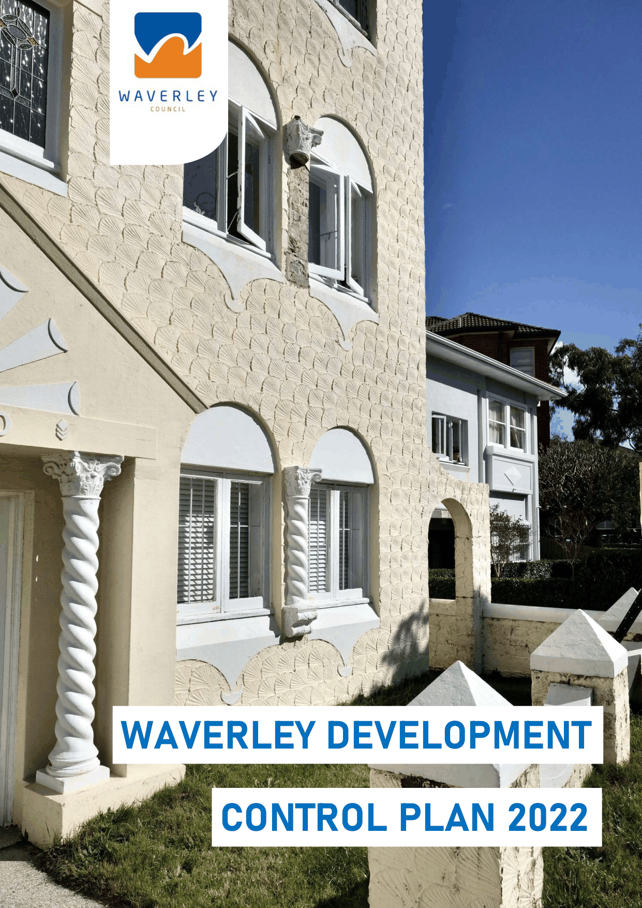

# Waverley Development Control Plan 2022 - Document Information and Table of Contents

> This chapter is split into 2 section file(s), one per main heading, in the order they appear in the PDF.

Source PDF: [Document_Information_and_Table_of_Contents.pdf](https://planfortomorrow.sharepoint.com/sites/Planfortomorrow/Shared%20Documents/00%20NSW-Planning-Resources/dcp/waverley-development-control-plan-2022/document-information-and-table-of-contents/Document_Information_and_Table_of_Contents.pdf)

> [Picture on page 1: a picture, saved as a picture (images/document-information-and-table-of-contents-page-1-1.gif, 150 dpi).]

### WAVERLEY DEVELOPMENT BENEFIT REGISTER

### CONTROL PLAN 2022

<!-- sections -->
## Sections

1. [Waverley Council](01-waverley-council.md)
2. [AMENDMENT HISTORY](02-amendment-history.md)
