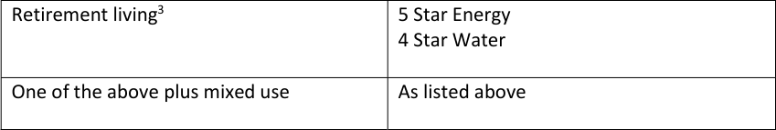

### 2.6 NABERS COMMITTMENT AGREEMENT

#### Background

NABERS (the National Australian Built Environment Rating System) is a national rating tool which measures the environmental performance of a building, in particular energy and water consumption and waste impact.

A Commitment Agreement is a contract signed by a developer or owner to commit to design, build and commission a building to achieve a specific NABERS energy rating.

#### Objectives

To ensure all development will reduce water consumption and can reduce greenhouse gas emissions to net zero To encourage the use of rating tools to ensure that the environmental performance of the building is verified at occupancy stage and ensure ongoing improvement over time.

#### Affects:

i. office buildings > 1000m2 net lettable area

ii. retail premises > 5000m2 gross lettable area

iii. hotels > 100 rooms

iv. residential aged care

v. retirement living

vi. one of the above plus mixed use

#### Control

a) Affected buildings are to sign NABERS Commitment Energy and Water Agreements according to the schedule outlined in Table 1.

#### Table 1: Minimum NABERS Commitment Agreement requirements

| Building type | Required Commitment Agreement |
|---|---|
| Office buildings > 1000 m2 net lettable area | 5.5 Star Energy 4 Star Water |
| Retail premises > 5000m2 gross lettable area | 5.5 Star Energy 4 Star Water |
| Hotels > 100 rooms | 5.5 Star Energy 4 Star Water |
| Residential Aged Care2 | 5 Star Energy 4 Star Water |

2 Residential Aged Care is a form of seniors housing that falls under the Housing SEPP 2021. It includes residential care facilities in which residents receive full time care, otherwise known as nursing homes or aged care homes.

> [Picture on page 26: a picture, saved as a picture (images/part-b-general-provisions-page-26-1.gif, 150 dpi).]

| Retirement living3 | 5 Star Energy 4 Star Water |
|---|---|
| One of the above plus mixed use | As listed above |

3 Retirement living is a form of seniors housing that falls under the Housing SEPP 2021. It is independent living and consists of apartments or villas for seniors and people living with a disability.

### Landscaping, Biodiversity and Vegetation Preservation      B3
