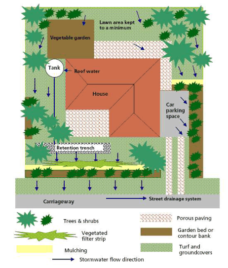

### 5.1 STORMWATER MANAGEMENT AND WSUD

#### Objectives

(a) To promote the implementation of Water Sensitive Urban Design (WSUD).

(b) To minimise the impacts of development upon the water cycle.

(c) To encourage sustainable development through the integration of stormwater management systems into the landscape.

(d) To ensure that development considers flooding, coastal water and groundwater protection, habitat creation and improves visual amenity.

(e) To integrate water sensitive urban design with landscape and building design.

(f) To reduce the volume of stormwater run-off.

(g) To promote increased on-site stormwater retention, detention, and recycling.

(h) To improve catchment water quality.

(i) To minimise the impacts of urban development upon water balance and surface and groundwater flow regimes.

(j) To promote infiltration within the “Infiltration zone” and reduce stormwater run-off (refer to Annexure B in the Water Management Technical Manual ).

(k) To encourage the use of soft landscaping and permeable paving as an alternative to impervious surfaces.

(l) To prevent stormwater from overflowing into basement garages of residences.

(m) To protect existing natural groundwater flows and downstream properties from seepage.

#### Controls

(a) A stormwater management plan is required to be submitted with all development applications (except minor alterations, retrofits and the like).

(b) WSUD principles are to be integrated into the development through the design of stormwater drainage, on-site detention and landscaping and in the orientation of the development rather than relying on ‘end of pipe’ treatment devices prior to discharge (refer to Figure 1).

(c) WSUD measures are to be employed to prevent contamination of stormwater.

(d) Development is to be sited and built to minimise disturbance of the natural drainage system.

(e) WSUD elements should be located and configured to maximise the impervious area that is treated.

(f) On site detention is to be designed, installed and maintained in accordance with the Water Management Technical Manual.

(g) Council consent is required for temporary/permanent dewatering and groundwater extraction and use prepared in accordance with the Water Management Technical Manual. The proposal is assessed on merits and where appropriate, referred by Council to the relevant Government department for an access licence.

(h) Applications for roof water and stormwater harvesting and reuse and grey water or black water treatment systems will be assessed on merit in accordance with the WM Technical Manual.

(i) Methods of disposal of stormwater from the site must be provided using one or a combination of the following:

(i) Infiltration;

(ii) Gravity connection to Council’s stormwater system;

(iii) Charged system; and / or

(iv) Pump system. Note: A stormwater system must be constructed in accordance with AS/NZS 3500.3:2021 Plumbing and drainage

(j) Depending on the extent of disturbed area, the following plans to manage erosion and sedimentation must be submitted with the development application:

(i) For areas of disturbance less than 250m2, a marked up plan of proposed works and control measures is required;

(ii) For disturbed areas between 250m2 and 2,500m2, an erosion and sediment control plan is required; and

(iii) For disturbed areas greater than 2,500m2 soil and water management plan is required.

> [Picture on page 42: a picture, saved as a picture (images/part-b-general-provisions-page-42-24.gif, 150 dpi).]

Figure 1 Example of an integrated stormwater strategy for a dwelling
