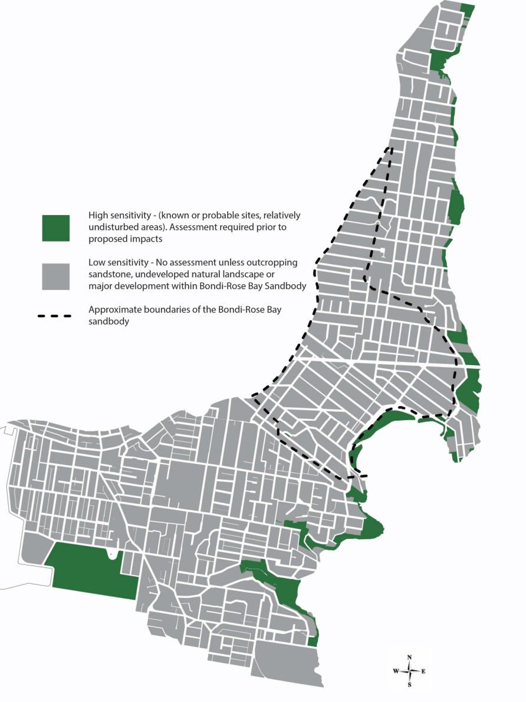

### 8.3 ABORIGINAL SITES

The National Parks and Wildlife Act 1974 (NPW Act) is the primary legislation for the protection of some aspects of Aboriginal cultural heritage in New South Wales. Under the NPW Act, anyone carrying out an activity must exercise due diligence to determine whether they should apply for consent in the form of an Aboriginal Heritage Impact Permit (AHIP).

The Due Diligence Code of Practice for the Protection of Aboriginal Objects in New South Wales sets out the steps to be taken in order to: Identify whether or not Aboriginal objects are, or are likely to be, present in an area Determine whether or not activities are likely to harm Aboriginal objects (if present) Determine whether an application for an AHIP is required.

A number of Aboriginal cultural heritage sites occur within Waverley and have been included within the WLEP. Further information on Waverley’s Aboriginal Cultural Heritage can be found in the Waverley Aboriginal Cultural Heritage Study on the Council website.

As per WLEP clause 5.10, development consent is required to disturb or excavate an Aboriginal place of heritage significance, land known to contain Aboriginal objects, or land which is suspected to contain Aboriginal objects. This Part provides controls to ensure the ongoing management of these sites (refer to Figure 20).

#### Objectives

(a) To effectively manage and protect currently identified Aboriginal heritage sites.

(b) To protect any undetected aboriginal heritage sites.

#### Controls

(a) Development on land where there is an identified Aboriginal object as identified in WLEP; is likely to be an Aboriginal object; or is an Aboriginal place of heritage significance; must be supported by an Aboriginal cultural heritage assessment prepared in accordance with the requirements of the NPW Act and include appropriate recommendations to inform the long term management of the item of significance.

(b) Development must be in accordance with Table 8.

(c) An applicant must refer to the NPW Act should an Aboriginal object(s) be discovered when undertaking development.

| Site category | Action required |
|---|---|
| High sensitivity: Sites identified in the LEP as containing an Aboriginal object or Aboriginal Place of heritage significance, or relatively undisturbed areas where artefacts are most likely located. | (a) Due diligence must be exercised to determine whether an AHIP is required. (b) Development consent required. |
| Low sensitivity: Any area with outcropping sandstone, undeveloped natural landscape or the Bondi Rose-Bay Sand body. | (c) Due diligence must be exercised to determine whether an AHIP is required. |
| Little likelihood: All areas not included in one of the categories above. | (d) No pre-emptive action required. |

Table 8: Guideline for Aboriginal Cultural Heritage and Development

> [Picture on page 89: a picture, saved as a picture (images/part-b-general-provisions-page-89-1.gif, 150 dpi).]
