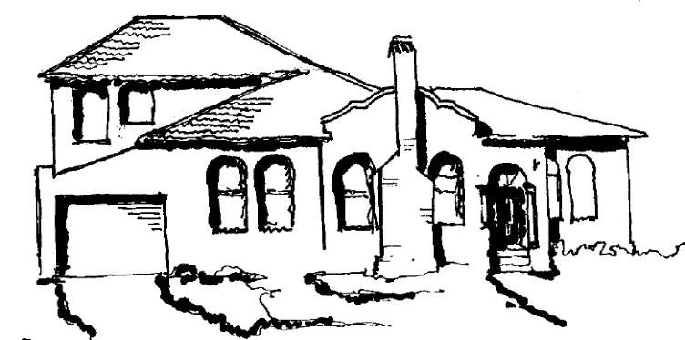
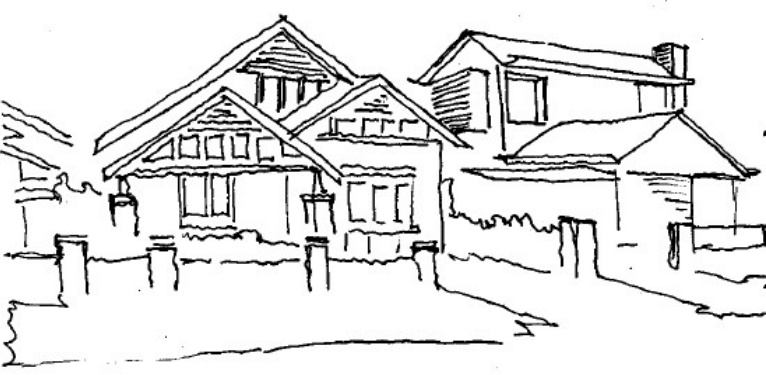

### 8.6 CHARACTER AND STREETSCAPE

#### Objectives

(a) To reinforce the existing street character, through appropriate dwelling facades, building setbacks, fence and landscaping.

(b) To ensure that alterations and additions to the external appearance of heritage items and contributory buildings respect the contributory features and characteristics of the existing building and streetscape.

(c) To allow infill development that respects and complements the existing character of the area.

(d) To reinforce existing views along streets and from the public domain.

#### Controls

#### 8.6.1  All Development

(a) A Context and Streetscape Analysis is to be provided that identifies common elements and features of the area including:

i. Topography and landscape;

ii. Views to and from the site;

iii. Significant subdivision patterns, layout, front and side setbacks;

iv. The type, siting, form, height, bulk, roofscape, scale, materials and details of adjoining or nearby contributory buildings;

v. The interface between the public domain and building alignments and property boundaries; and

vi. Colour schemes that have a hue and tonal relationship with traditional colour schemes.

(b) Development should identify and respect the contributory features and characteristics of the item or the conservation area and incorporate these features into the design.

(c) The established landscape character of the locality including the height of canopy and density of landscaping should be retained.

(d) Development near a heritage item should respect the visual curtilage of the item.

#### 8.6.2  Heritage Items and Contributory Buildings

(a) Additions should be located to the rear to minimise the impact from the street (refer to Figure 7).

(b) Where the building form, detailing or use of individual buildings of historic character have been inappropriately altered and changed, any application to up-grade or re-use the buildings must clearly demonstrate that the architectural and streetscape value of the building will be enhanced by the proposal.

> [Picture on page 93: a picture, saved as a picture (images/part-b-general-provisions-page-93-1.gif, 150 dpi).]

Figure 7 Sympathetic additions located to the rear

#### 8.6.3 Infill Development

(a) New development and alterations and additions to existing dwellings should be compatible and consistent with development both in the immediate vicinity and in the overall context of the street.

(b) Contemporary design is acceptable in a conservation area where it is sympathetic to, and respects the context of the conservation area and any heritage item in the vicinity (refer to Figure 8).

(c) New buildings adjacent to buildings of historic character or heritage items should be secondary in prominence to the existing streetscape fabric and draw on the predominant pattern of the existing streetscape.

(d) Where properties have side street or rear lane frontages, alterations and additions reinforce the desirable side or rear streetscape.

(e) Appropriate landscape species and plantings are used to reinforce and frame existing vistas, particularly in the typical north-south street corridors.

> [Picture on page 93: a picture, saved as a picture (images/part-b-general-provisions-page-93-17.gif, 150 dpi).]

Figure 8 Sympathetic infill development
