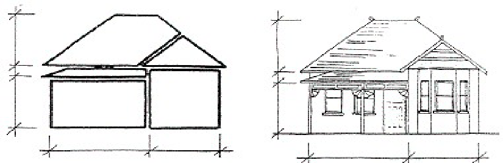
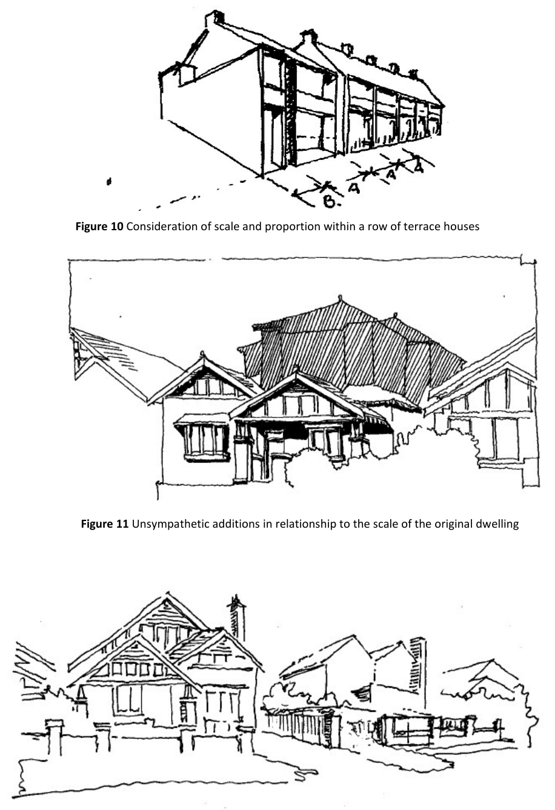

### 8.8 SCALE AND PROPORTION

#### Objectives

(a) To ensure that alterations and additions to heritage item and contributory building are consistent with the scale and proportion of the item and/or streetscape.

(b) To encourage infill development that recognises the predominant scale and proportion of the setting and responds sympathetically.

(c) To promote development that is respectful of the scale of the surrounding buildings and area.

#### Controls

#### 8.8.1 Heritage Items and Contributory Buildings

(a) Alterations and additions should not visually dominate, compete with or conceal the original scale and proportion of the heritage item, contributory building or conservation area.

(b) Alterations and additions should respect the proportions of major elements including doors, windows, roof forms and verandahs (refer to Figures 9-11).

#### 8.8.2 Infill Development

(a) Infill development should be cohesive in scale, proportion and finish to the surrounding streetscape and buildings (refer to Figure 12).

(b) Infill development should maintain and enhance the skyline profiles of established settings.

(c) Where the scale of the roof is much larger than that of adjacent buildings, the roof should be broken up into smaller elements to reduce bulk.

(d) Setbacks should be provided to upper levels.

> [Picture on page 95: a picture, saved as a picture (images/part-b-general-provisions-page-95-24.gif, 150 dpi).]

Figure 9 Consideration of scale and proportion

> [Picture on page 96: a picture, saved as a picture (images/part-b-general-provisions-page-96-1.gif, 150 dpi).]

Figure 10 Consideration of scale and proportion within a row of terrace houses

Figure 11 Unsympathetic additions in relationship to the scale of the original dwelling

Figure 12 Sympathetic infill development
