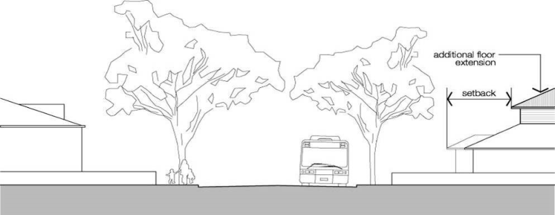

### 8.9 ARCHITECTURAL STYLE

#### Objectives

(a) To reinforce the various established architectural styles of dwellings through sensitive alterations and additions and appropriate new developments.

(b) To emphasise balance and symmetry in alterations and additions to detached, semi-detached and attached dwellings.

(c) To reinforce the existing pitched roofscape as the desired character of conservation areas and promote consistency in roofing materials.

#### Controls

(a) New development is to be sympathetic to the established architectural style in the vicinity and preserve the area’s character.

(b) Where the existing building or structure contributes to a historical or coherent theme of the street, re-use or refurbishment of the existing building is encouraged.

(c) Alterations and additions to existing dwellings must incorporate appropriate or compatible architectural vocabulary, consistent with the period of the building’s original development.

(d) Where a building sits in a row with similar architectural style and details (such as gable, roofscape, entrance, terrace roof, chimney, windows, door, fences), the bulk and rhythm of these details are to be maintained.

(e) Where terrace (attached) and semi-detached dwellings have a small front setback, their façade detail and building elements, such as doors, windows, balustrades, mouldings or tiles are to be sensitively integrated with the streetscape character.

(f) Flat roofs are to be avoided where they detract from the established roof character of the locality. Where they are visible from the street, roofing materials and details shall be compatible with the established streetscape character.

> [Picture on page 97: a picture, saved as a picture (images/part-b-general-provisions-page-97-26.gif, 150 dpi).]

Figure 13 An example of alterations and additions which are sensitively undertaken. First floor additions are set back in order to minimise the impact upon the street character.
