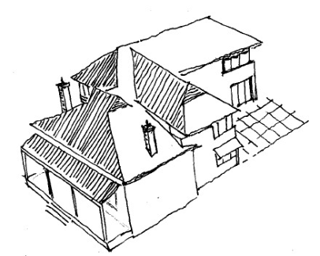

### 8.11 ROOFS AND CHIMNEYS

#### Objective

(a) To retain and maintain the characteristic roof forms, finishes and chimneys of heritage items and conservation areas.

(b) To ensure new roof profiles are consistent with the established skyline profiles of the conservation area.

#### Controls

#### 8.11.1 Heritage Items and Contributory Items

(a) Skyline profiles of original roofs and chimneys should be retained where possible.

(b) Original chimneys are to be retained.

(c) Where chimneys are paired across party walls, treatment of finishes and detailing is to be consistent between properties.

(d) Substitution of finishes and removal of details including chimneys is only permitted where Council approves a cohesive replacement finish or detail.

(e) Attic rooms are to be wholly within existing roof forms which retain the streetscape appearance of the existing building.

(f) Roof extensions are to match the existing roof in form, pitch and eaves and be in proportion with the existing building.

(g) The use of modern roofing materials is discouraged as they can significantly alter the character of the building.

(h) New tiles or slates should match the existing tiles/slates as closely as possible and concrete tiles are not considered a suitable replacement material.

#### 8.11.2 Infill Development

(a) New roof profiles are to be secondary to the established skyline profiles in the Heritage Conservation Area and are to enhance the established character of the existing skyline (refer to Figure 13).

> [Picture on page 99: a picture, saved as a picture (images/part-b-general-provisions-page-99-27.gif, 150 dpi).]

Figure 14 New roof forms are to be secondary to the established skyline profile
