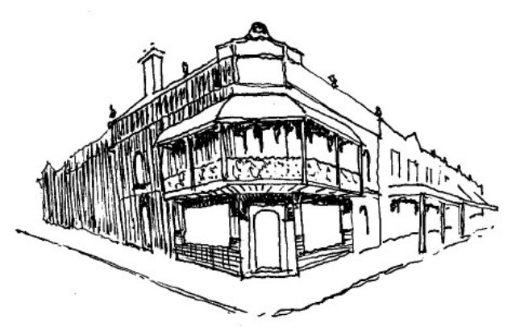

### 8.12 VERANDAHS AND BALCONIES

#### Objectives

(a) To ensure the retention and reinstatement of early verandahs and balcony forms.

(b) To ensure that alterations and additions do not detract from original balconies and verandahs.

#### Controls

#### 8.12.1 Heritage Items and Contributory Buildings

(a) All original verandahs and balconies should be retained and restored (refer to Figure 15).

(b) Infilling or enclosure of verandahs and balconies is not supported.

(c) Additional verandahs should not compete with an original verandah or balcony.

> [Picture on page 100: a picture, saved as a picture (images/part-b-general-provisions-page-100-12.gif, 150 dpi).]

Figure 15 Original verandahs should be retained
