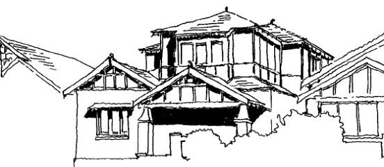

### 8.16 DETAILING

#### Objectives

(a) To encourage the retention and maintenance of original detailing to preserve the character and significance of the area or item.

(b) To ensure alterations and additions have a level of detail that is appropriate to the architectural character and style of the heritage item or conservation area.

(c) To ensure infill development has regard to the architectural character and style of the conservation area.

(d) To promote the retention of historic detailing styles and practices.

#### Controls

#### 8.16.1 All Development

(a) Landscape details such as fences, garden walls and planting treatment which contribute to the area should be retained where possible.

(b) New windows should match the existing in size and detail, including the existing sill details, window heads, and stained or patterned glass type. Window should not be enlarged or altered.

#### 8.16.2 Heritage Items and Contributory Buildings

(a) Development should be designed to enhance original detailing of buildings.

(b) Original details should be retained and repaired where possible.

(c) Where original details have been removed or replaced with modern materials, consideration should be given to reinstating original features.

(d) Decorative elements should not be introduced on heritage items and contributory buildings unless documentation or physical evidence indicates the elements previously existed.

(e) Alterations and additions should adopt a similar character, which uses external finishes, colours, and textures that complement the heritage fabric, rather than mimic inappropriate decoration or detailing (refer to Figure 16).

#### 8.16.3 Infill Development

(a) Modern details should defer to, and be cohesive with, traditional details that contribute to the character of the area.

> [Picture on page 104: a picture, saved as a picture (images/part-b-general-provisions-page-104-31.gif, 150 dpi).]

Figure 16 Sympathetic detailing of additions.
