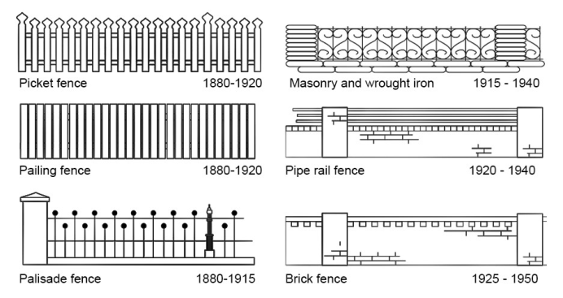
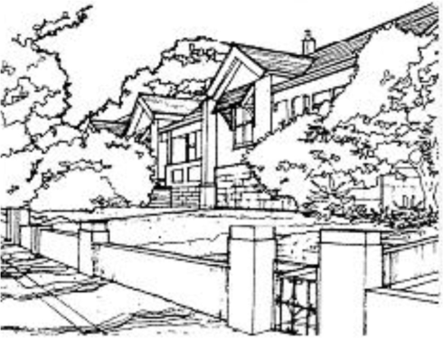

### 8.17 FENCING AND GATES

#### Objectives

(a) To ensure new fencing is consistent with, and does not detract from, the heritage item or streetscape.

(b) To retain, repair and reconstruct original fencing.

(c) To ensure fencing makes a positive contribution to the character and quality of the street.

#### Controls

#### 8.17.1 Heritage Items and Contributory Buildings

(a) Where original fences remain on listed items or within Conservation Areas these are to be retained and enhanced by appropriate maintenance and sympathetic landscaping.

(b) Planting and maintenance of existing planting is to avoid tree or plant growth that damages existing fences or gates.

(c) Fences and boundary walls employing masonry (principally stone or face brick) construction are not to be rendered, painted or coated with other materials unless the finish is known to be a detail of the original construction.

(d) Front fences should not obscure building facades.

(e) New fence heights and form should be appropriate to the character of the heritage item or to the conservation area.

(f) Where an original fence has been lost, new fencing should match the original style.

(g) Sandstone fencing and foundations should be retained and sympathetically incorporated into any new additions or alterations. Restoration/repair of slate/stone must be carried out by specialists.

(h) Low and transparent front fences in front yards are desirable, especially where setbacks are minimal.

(i) Front fences should be of a low or transparent style and where masonry is used it should be no higher than 600mm, while transparent fences may not exceed 1200mm in height.

(j) Rear fences should be between 1.8m and 2m in height.

> [Picture on page 105: a picture, saved as a picture (images/part-b-general-provisions-page-105-32.gif, 150 dpi).]

Figure 17 Examples of period fences

> [Picture on page 106: a picture, saved as a picture (images/part-b-general-provisions-page-106-1.gif, 150 dpi).]

Figure 18 Low fences are desirable, especially where setbacks are minimal.
