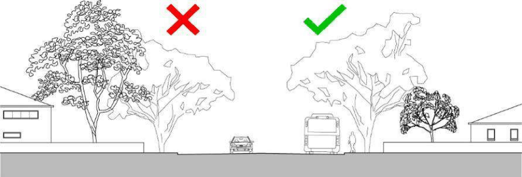
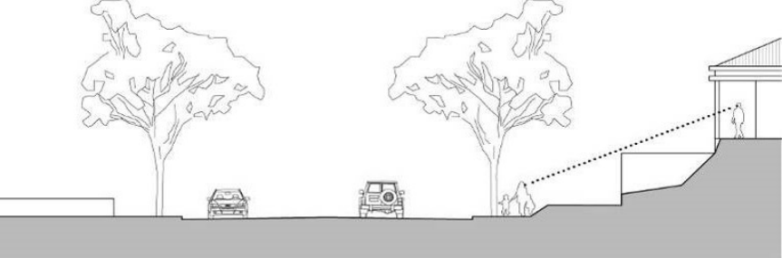

### 8.18 LANDSCAPING

#### Objectives

(a) To conserve the existing inner residential street landscape character and view corridors which have been established by the colonnades and canopy of existing street tree planting.

(b) To establish soft landscaping at the front setback compatible with the style and character of the area.

#### Controls

(a) Unless it is the predominant character, overly dense landscaping or large trees are not desirable in the front setback as they darken the street corridor and undermine the character of the existing street tree plantings (refer to Figure 19).

(b) On steeply sloping or split level sites landscaping is to be planted so as to allow for a visual connection between the building facades and the street (refer to Figure 20).

(c) Soft landscaping is used to reinforce important character elements in the front of dwellings, especially detached dwellings and larger sites.

> [Picture on page 107: a picture, saved as a picture (images/part-b-general-provisions-page-107-17.gif, 150 dpi).]

Figure 19 Where mature street trees exist, avoid high and over dense landscaping in the front of dwellings.

> [Picture on page 107: a picture, saved as a picture (images/part-b-general-provisions-page-107-20.gif, 150 dpi).]

Figure 20 A visual connection to the street is important to cultivate surveillance and is in keeping with the established character.
