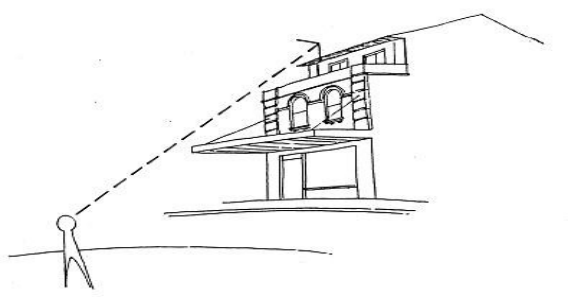
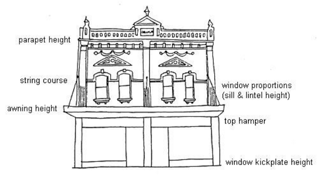
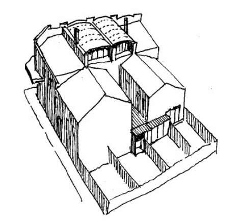

### 8.20 COMMERCIAL PROPERTIES

#### Objective

(a) To ensure that the original characteristics of traditional neighbourhood retail buildings are retained and enhanced.

(b) To encourage the retention of distinctive settings of grouped building frontages aligned to the street.

(c) To promote the retention of distinctive detailing on commercial properties.

(d) To retain original parapet continuity and detailing.

(e) To retain architectural features and detailing that characterise the period of development.

#### Controls

#### 8.19.1 All Development

(a) Generally, the facade at street alignment shall comprise a canopied shop front at ground level, and first floor facade above the awning.

(b) The height of the building at the facade shall take into consideration existing parapets and other facade details of established surrounding development.

(c) Additional floors should be setback from the street alignment to ensure a two storey elevation to the facade is maintained where appropriate (refer to Figure 21).

(d) Consideration will be given to a variation of the established alignment in the case of a comprehensive development incorporating a pedestrian open space function.

(e) Developments on corner sites should be designed to accentuate the corner, and provide the transition between one streetscape and the next. Existing corner splays shall be retained.

(f) Signage shall be restricted to under awning shop fronts, awning fascias and as suspended under awning signs.

(g) Signage above the awnings shall be limited to appropriate areas allocated for such a purpose in the original facade design (parapets for example).

(h) Flush mounted, or projecting wall signs shall not be permitted above the awning. Council will give consideration to the architectural qualities of the building when addressing the suitability of the proposed sign.

(i) Pitched or domed awnings of glass or canvas construction shall not be permitted where they interrupt a run of traditional awnings.

> [Picture on page 109: a picture, saved as a picture (images/part-b-general-provisions-page-109-1.gif, 150 dpi).]

Figure 21 Additional floors should be setback from the street alignment

#### 8.19.2 Heritage Items and Contributory Buildings

(a) Details of earlier shop front features should be retained.

(b) The maintenance and restoration of detailing to commercial/retail groups is encouraged (refer to Figure 22).

(c) Horizontal proportions should be considered both in new development, and in the redevelopment of old facades. Consistency should be achieved through:

(i) Parapet height;

(ii) String course both at parapet level, and to the remainder of the facade;

(iii) Window proportions (sill and lintel height);

(iv) Awning height and continuity; and

(v) Top hamper proportions and window kick plate height.

> [Picture on page 109: a picture, saved as a picture (images/part-b-general-provisions-page-109-14.gif, 150 dpi).]

Figure 22 Overall consistent design of elements

(d) Where shopfront groups are listed as heritage items the following issues are to be considered:

(i) The extent and quality of conservation and restoration of street frontages;

(ii) The interface of new and existing works; and

(iii) The impact of new works on the existing fabric, streetscape and overall setting.

(e) Where it is proposed to retain the street facade and construct new works to the remainder of the site, assessment will be based upon the above the impact of skyline profiles on the retained façade the setting and the cohesion of the works (refer to Figure 23).

(f) Existing shop fronts should not be bricked up or replaced by roller shutters.

(g) Existing box section awnings, either cantilevered, or suspended by tie rods, should be retained.

(h) New awnings should match the form of adjacent awnings and maintain the same alignment, to ensure unity in streetscape details.

(i) Reinstatement of balconies and verandahs to street frontages is supported.

(j) Alterations to individual shop facades above awning level will not be permitted where that facade is part of a homogeneous or symmetrical group of facades.

(k) A row of shops which are homogeneous or symmetrical in style should adopt a uniform tonal distribution over the facade, without limiting the individual expression of colour on each shop.

> [Picture on page 110: a picture, saved as a picture (images/part-b-general-provisions-page-110-12.gif, 150 dpi).]

Figure 23 Rear extensions to commercial properties

#### 8.19.3 Infill Development

(a) New development should conform to the established street front building alignment for the extent of its height.

(b) New under awning shop fronts should be simply detailed with large areas of glazing and narrow mullions/framing.

(c) The height of new development at the street alignment should not exceed the height of existing buildings.

### Safety     B9
