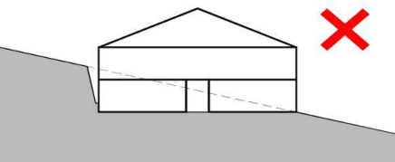
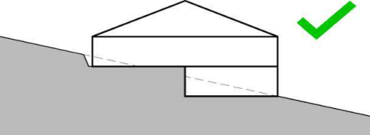
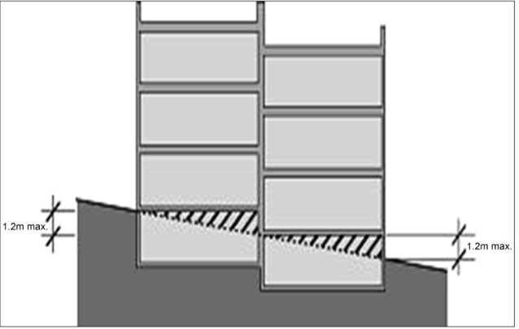

#### B13 EXCAVATION

#### Objectives

(a) To set maximum acceptable extents of excavation which achieve the following objectives.

(b) To minimise the impact of excavation on the natural environment, neighbouring properties, and streetscape.

(c) To ensure the physical environment is preserved and enhanced through minimal site disturbance and the geotechnical stability of landfill and excavations.

(d) To minimise cut and fill on sloping sites.

(e) To encourage good quality internal environments including natural light and ventilation.

(f) To prevent use of subterranean spaces as habitable rooms.

(g) To prevent development exceeding the maximum car parking controls.

(h) To ensure excavation does not adversely impact land stabilisation, ground water flows and vegetation.

(i) To minimise structural risks to adjoining structures.

#### Controls

(a) Excavation for basements will not be supported for dwelling house, attached dwelling, dual occupancy or semi-detached dwelling development, unless Council is satisfied that there is no alternative location on the site to accommodate parking and storage, the development satisfies the objectives of Part B13, and the basement:

(i) Has a maximum floor to ceiling height of 2.1m, except where the entry requires higher to meet Australian Standards,

(ii) Does not exceed one floor,

(iii) Will not contain any habitable rooms unless the room is at grade with external natural ground level along at least one side (refer to Figure 24), and

(iv) Has an area no greater than the area required to accommodate: A maximum of 1 car parking space for dwellings with 1-2 bedrooms, or a maximum of 2 car parking spaces for dwellings with 3 or more bedrooms; Waste storage for 3 x 140L bins per dwelling; A plant room complying with control (b) of this part; A maximum of 8 cubic metres of storage per dwelling; and Minimum access requirements to the car parking and storage areas.

(b) The maximum area permitted for a plant room in any development is the minimum required to meet Australian Standards, accommodate typical dimensions of equipment required and the associated circulation space to access the equipment for maintenance. DA plans should show the approximate location and size of equipment within the plant room.

(c) Excavation should not add to the visual bulk and scale of the building.

(d) Excavation should not result in the loss of naturally occurring sandstone. Where sandstone or natural rock are to be removed, opportunities for reuse on site should be considered (such as for front fencing or landscaping).

(e) Avoid cutting into the natural stone wall of a street.

(f) Avoid and minimise excavation where possible.

(g) Minimise the inclination of any resulting sloping landscaping.

(h) Existing natural features including trees and sandstone walls should be retained and incorporated as landscape features on the site in order to maintain the natural character of the landscape.

(i) Step retaining walls in response to the natural landform to avoid creating monolithic structures, particularly where visible from the neighbouring dwellings and the public domain.

(j) For sites with significant slopes a split-level building design is to be used to minimise excavation and backfilling.

(k) Fill is not to be used to raise the ground level.

(l) Excavation for garaging within sandstone walls facing the street must be minimised to preserve as much of the original wall as possible.

(m) Development should accommodate stormwater detention tanks and storage systems within the excavated area.

(n) Excavation is not permitted within 900mm of side boundaries and shall only occur within the building footprint, except where access to a basement car park is required.

(o) Basement car parking is to be located fully below natural ground level. Where this cannot be achieved due to topographic constraints, a maximum protrusion above ground of 1.2m is permissible (refer to Figure 25).

(p) Where excavation is proposed for development which is subject to Part C2 of this DCP, it is not to occur within a 1.5m setback from side boundaries and shall only occur within the building footprint except where access to a basement car park is required. Excavation will need to be setback greater where required to comply with Part C2, 2.3.2 Side and Rear Setbacks control (d).

(q) All below-ground structures that are located below the groundwater table are to be fully tanked. These types of structures must not collect and dispose of

> [Picture on page 119: a picture, saved as a picture (images/part-b-general-provisions-page-119-30.gif, 150 dpi).]

subsoil/seepage to kerb and gutter.

> [Picture on page 119: a picture, saved as a picture (images/part-b-general-provisions-page-119-32.gif, 150 dpi).]

Figure 24 Habitable rooms are to have ample openings to an external wall for air and light.

> [Picture on page 120: a picture, saved as a picture (images/part-b-general-provisions-page-120-1.gif, 150 dpi).]

Figure 25 Basement parking level on sloping sites

### Advertising and Signage      B14
