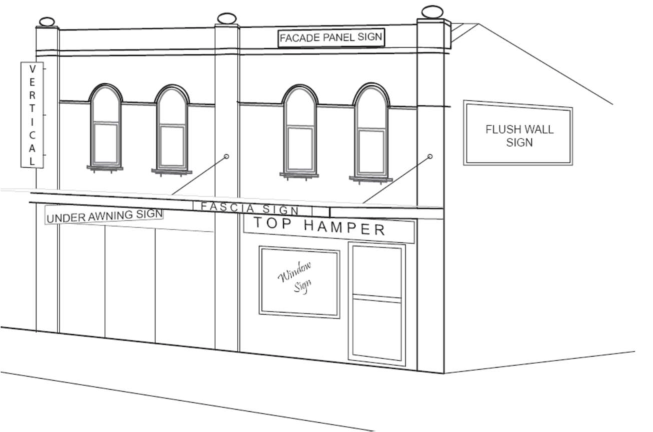

### 14.1 DESIGN AND LOCATION

#### Objectives

(a) To promote innovative, unique and creative signs that support retailers or businesses.

(b) To deliver and maintain a high quality and cohesive public domain.

(c) To maintain the architectural integrity of the subject building and adjacent buildings.

(d) To ensure signage respects the architectural style of the building, contributes to the character of streetscape and is consistent with land uses.

(e) To reduce energy consumption and minimise the negative amenity impacts of illuminated signs and advertisements.

(f) To ensure the amenity of any adjacent non-commercial or residential uses.

(g) To ensure the safety of pedestrians and traffic.

(h) To ensure the harmony of signage with other features, having particular regard to the size and juxtaposition of other signs in the immediate vicinity.

#### Controls

#### 14.1.1 General Controls

(a) Signage is to relate to the use of the building on which it appears and be designed to complement the established streetscape character, and not detract from significant views or vistas.

(b) Signage is to be integrated into the architectural design of the building, awning or shop front (refer to Figure 28).

(c) Where original sign panels have been incorporated into the parapet of the building facade, these should be used to identify the name or nature of the business only and not be used for advertising.

(d) Signs should not obscure decorative forms or moulding and should observe a reasonable separation distance from the line of windows, doors, parapets, piers and the like.

(e) The colour used in the design of a sign or structure should reflect the colour scheme of the building to which it will be attached.

(f) Corporate colours should be limited to the advertising sign or structure.

(g) Careful consideration should be given to the use of illuminated red, green and amber colours in proximity to signalised intersections.

(h) Council may give consideration to temporary advertising in the form of bunting, banners, inflatable or canvas signs for special events provided that the temporary display period does not exceed four weeks.

(i) Illuminated signage is to have no direct adverse impact on the amenity of residential properties.

(j) Illumination of signs by floodlighting is preferable over the use of boxed fluorescent or neon lighting on buildings and places of architectural significance.

(k) The use of neon tubing to highlight the features of a building is not permitted.

(l) Flashing, moving or 3-D signs are not encouraged and will only be considered where permitted in this Part and after practical demonstration and a detailed assessment of any adverse impact on the amenity and character of the neighbouring area.

(m) Signs are to be of a size and proportion that complement the scale of the existing façade, as well as surrounding buildings and signs.

(n) Signage must not have a combined area in excess of 20m2.

(o) Shopping arcades are encouraged to erect a business directory at each entrance.

(p) The following will not be permitted:

(i) Wall signs projecting more than 300mm from the wall.

(ii) Flashing or moving signs.

(iii) Advertising on display window piers or below the display window sill/kick plate.

(iv) Sky, roof, or fin signs.

(v) The display of bunting, banners, canvas, or fabric signs.

(vi) Inflatable signs and the like.

(vii) Advertising on garbage bins, telegraph posts, telephone booths, or other surfaces of a public nature.

(viii) Any sign which in Council’s opinion, would adversely affect the operation of traffic lights, motorists or obstruct their vision.

(ix) Third party advertising.

(x) A-Board (sandwich boards).

(xi) Advertising on canvas shade blinds.

(xii) Signs that extend over street frontage boundaries, unless approved in conjunction with a shop which is built to the street alignment.

> [Picture on page 122: a picture, saved as a picture (images/part-b-general-provisions-page-122-27.gif, 150 dpi).]

Figure 28 Types of signage

#### 14.1.1 Third Party Advertising

(a) Advertising on garbage bins, telegraph posts and other surfaces of a public nature is not permitted, except by prior contractual arrangement with Council.

(b) Advertising signage on buildings and shop fronts must only relate to businesses operating within the same building or shop. Third party advertising is not permitted.

(c) Where multiple occupancies exist within a single building or shop front, a coordinated scheme for all advertising and signage is required.

(d) Council will not approve third party advertising. Signage must relate to the use of the building or land it is on.

#### 14.1.2 Number of signs

(a) Signage should not dominate the façade of buildings.

(b) The number of signs per building or site will be assessed on the following:

(i) Number of existing signs;

(ii) Proportion of solid (wall surface area) to void (window and door openings) available for signage;

(iii) Length of frontage of the premises; and

(iv) Extent of facade detail and dimensional relief on the building which should not be obscured by signage.
