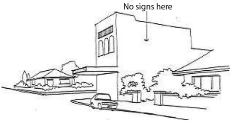
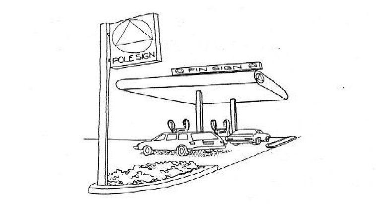

### 14.2 SITE SPECIFIC CONTROLS

#### Objectives

(a) To ensure signage is compatible with the intensity of use in each land use zone and does not detrimentally affect the appearance of the site or adjoining land.

(b) To ensure that signage complements the existing character of the area.

#### Controls

#### 14.2.1 Residential Zones

(a) Any signage within a residential zone shall relate only to premises situated on the subject land and may specify any of the following:

(i) The purpose for which the land is used;

(ii) Identification and description of a person carrying on an occupation or business on the premises; and

(iii) Particulars of the goods or services dealt with on the premises.

(b) Signs should be carefully designed to blend in with the established residential character.

(c) Illuminated and electronic signs are not permitted.

(d) A sign must not exceed 1m x 0.7m in size. The sign shall be affixed to the front façade of the dwelling or to the front boundary wall or fence.

(e) In circumstances where there is no front fence, or where an existing fence does not have sufficient height to display a sign, and where the dwelling has a significant setback from the street front, Council will give consideration to the erection of a pole sign, having a height not greater than 2.8m.

#### 14.2.2 Bondi Junction

(a) Illuminated signage on buildings exceeding eight storeys is visible from the Harbour. Notwithstanding its regional significance, it is not intended that Bondi Junction compete with the established illuminated skylines of the City of Sydney or North Sydney. Any corporate advertising on the Bondi Junction skyline should only be for the purpose of serving the immediate region.

#### 14.2.3Campbell Parade

(a) Projecting wall signs or flush wall signs above the awning of shops fronting Campbell Parade are not permitted with the exception of building identification signs.

(b) Building identification signs shall be painted, identifying only the name of the building, and be traditionally located within the building parapet as a feature of the building.

(c) Generally, neon signage is encouraged on window shop fronts and for under awning signs as an alternative to fluorescent illumination.

#### 14.2.4  Wairoa Avenue in the vicinity of Wallis Parade

(a) Neon signage may be permitted inside the window display area, provided it is not animated or flashing, due to the proximity of these shops to adjacent residential development.

(b) No illumination or electronic signs above the awning will be permitted.

#### 14.2.5 Neighbourhood shops

(a) In areas located within Part E3 Local Village Centres or where shops or commercial premises exist in residential zones, such premises shall be restricted to the display of the following signs:

(i) One under awning sign;

(ii) An awning fascia sign;

(iii) Projecting wall sign;

(iv) Window signage; and

(v) One flush wall sign to each frontage or one top hamper sign having maximum dimensions 3m(W) x 1.5m(H).

(b) Flush wall signs shall not be permitted on side walls facing adjoining residences (refer to Figure 29).

(c) Animated, flashing signs and lights are not permissible.

(d) Electrical conduits to illuminated signs are to be concealed or integrated into the relevant sign.

(e) Shops shall consider the use of branded canvas shade blinds under the awning, in place of above awning advertising signs, as a means of retaining an appropriate neighbourhood scale. Such signage shall relate to the display of product logos and not involve the promotion of sales or specials. Signage shall occupy a maximum of 60% of the surface area of the blind and not involve fluorescent or iridescent paints.

> [Picture on page 125: a picture, saved as a picture (images/part-b-general-provisions-page-125-25.gif, 150 dpi).]

Figure 29 Inappropriate location for flush wall signs

#### 14.2.6 Mixed development buildings

(a) Advertising signs and structures shall not be permitted above the awning on mixed development buildings unless they relate to activities conducted above ground floor level.

#### 14.2.7 Development in excess of 15 metres in height

(a) Naming rights to the building, often in favour of the principal tenant, shall be limited to the form of one advertising sign above the awning. The sign shall be designed and positioned in a manner sympathetic to the design criteria of the building. Where no principal tenant exists, a coordinated approach shall be used in meeting the signage needs of the tenants of a building. This should generally be limited to a directory panel in the common area of the building.

(b) Roof signs shall not be permitted where they exceed the height of the building, or where they are flashing or moving. The assessment of any proposed roof sign shall include an evaluation of its impact on adjacent residential development, in terms of intensity and duration of illumination.

#### 14.2.8 Automotive related activities

(a) Freestanding pole signs shall have a maximum height of 6 metres above ground level, and the sign itself shall not exceed 3.4m2 in area.

(b) Pole signs shall not project more than 750mm beyond street alignment (refer to Figure 30).

(c) A fin sign positioned as such shall have a maximum height of 1.5m above the roof structure (refer to Figure 30). No portion of the sign shall project over Council’s footpath. Fin signs shall have a maximum area of 9m2 referring only to the name of the establishment. Only one fin sign shall be permitted on the premises.

> [Picture on page 126: a picture, saved as a picture (images/part-b-general-provisions-page-126-20.gif, 150 dpi).]

Figure 30 Example of pole and fin signs

#### 14.2.9 Heritage Significant Buildings

(a) Council will give consideration to architectural qualities of building when addressing the suitability of any proposed signs.

(b) Signs must not conceal or obscure architectural features.

(c) Generally, on shop fronts signage will be restricted to suspended under awning signs and awning fascia signs.

(d) Signage above the awnings must be limited to appropriate areas allocated for such a purpose in the original facade design (parapets, for example), and must not extend above the parapet.

(e) Flashing, electronic, illuminated or animated signs will not be permitted.

(f) Council encourages restoration of original painted signs, and construction of new signs using traditional designs.

(g) In the absence of any shop front awnings, signage shall be kept below the height of awnings on adjacent buildings. In such circumstances, projecting wall signs should take the form of lantern signs, where appropriate.
