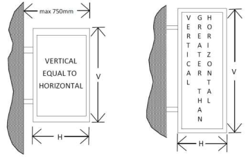
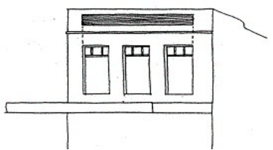
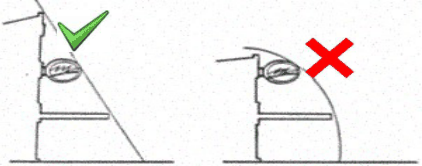
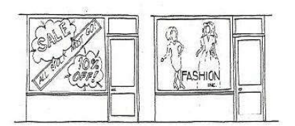

### 14.3 SIGN SPECIFIC CONTROLS

#### Objectives

(a) To ensure that proposed signage is compatible the buildings and surrounding character of the area.

#### Controls

#### 15.4.1 Under-awning signs

(a) Under awning signs must:

(i) Have a minimum clearance of 2.6m above the footpath and be centrally positioned under the awning;

(ii) Not exceed 1.8m(W) x 300mm(H);

(iii) Be setback 600mm from the footpath edge;

(iv) Not project beyond the width of the awning; and

(v) Be separated from other under awning signs by 3m where practicable.

#### 14.3.2 Projecting Wall Signs

(a) Where permitted projecting wall signs shall:

(i) Extend a maximum projection of 750mm from the face of the wall (refer to Figure 31);

(ii) Have a minimum clearance of 2.6m above the footpath;

(iii) Not extend above parapet height;

(iv) Align with signs on adjacent buildings; and

(v) The vertical dimension of the sign shall be equal to or greater than the horizontal dimension.

(b) Council will consider variations to the maximum projection requirement only where, in Council’s opinion, the requirement for a sign of vertical proportion does not suit the style and character of the building, or details and proportions of the façade. In these instances square or circular signs may be considered, having a maximum projection of 1.5m from the facade. In such circumstances, buildings 3 storeys or greater are considered more appropriate to scale and proportion of such signs (refer to Figure 33).

(c) Signs are to be attached to undecorated wall areas. Where projecting wall signs of vertical proportion are proposed, vertical engaged piers present on the facade of older buildings should be used.

#### 14.3.3 Awning fascia signs

(a) Fascia signs are to be flush with the awning and not illuminated.

(b) They shall not project above or below the awning fascia.

(c) Sign writing shall be limited to the street number, name and general nature of the business.

(d) Product identification on an awning fascia shall not be permitted.

(e) Where a building comprises a number of tenants, such as in an arcade, the awning fascia should identify the name of the arcade only.

#### 14.3.4 Flush Façade Panels

(a) Signs are to be attached to undecorated wall areas.

(b) Facade panels should align with windows or doors or be centered on parapets (refer to Figure 32).

(c) Opportunities may exist for flush wall signs on the blank side or rear walls of some buildings, provided that:

(i) The commodities or services advertised are sold within the premises to which the sign is affixed of painted;

(ii) The total area of signage is no greater than 4.5m2; and

(iii) The number of such signs is limited to one only.

#### 14.3.5 Top hamper signs

(a) Top hamper signs:

(i) May project up to 150mm from the building façade;

(ii) Must have a minimum clearance of 2130mm above ground level;

(iii) Shall have dimensions proportionate to the size of the top hamper fascia;

(iv) Shall not exceed 600mm in height, with a maximum length of 4000mm;

(v) Shall be restricted to one sign per premises, unless the Council considers the buildings frontage sufficient to accommodate more than one such sign;

(vi) Should not extend below the level of the head or doorway or window to which they are attached;

(vii) Should allow a proportion of the wall surface area of the top hamper to be exposed; and

(viii) Shall be set back 600mm from side boundaries to satisfy fire regulations.

(b) Signs are to be within the perimeter of the building walls.

(c) Illumination is permitted.

#### 14.3.6 Building Identification Sign

(a) Building identification signs are to be located at building parapet height, for the purpose of identifying the building.

(b) They will be permitted where, in Council’s opinion, there is sufficient wall surface area to display the sign, and where the sign is proportionate to the façade area, and appropriate to the design and decoration of the building.

(c) Where the building comprises a number of tenants, only one identification sign will be permitted where that tenant occupies floor space above awning level.

(d) Building identification signs should be positioned at the local point of the building façade, generally central to the top parapet, and shall not project by more than 300mm from the wall.

(e) Building identification signs shall be integrated with the character and form of the building and not alter its roofline.

#### 14.3.7 Murals

(a) Council may consider the use of a mural as signage for the purposes of building identification and advertisement.

(b) A mural is to be sensitive to the character and amenity of the area.

(c) A mural must not be located on a heritage item or contributory building, or detract from the significance of a heritage conservation area.

(d) Any corporate branding, logos, markings or similar are not to occupy more than 5% of the total mural area.

(e) No third party advertisements are to feature in a mural.

(f) If the mural contains no advertising material and does not act as signage, it may be considered as public art. If the mural is public art, it does not require development approval and is to be carried out in accordance with the Waverley Public Art in the Private Domain Guidelines.

#### 14.3.8 Window signs

(a) Painted signs on shop front windows, particularly those using fluorescent and iridescent paints, shall be temporary in nature, and not cover more than 60% of the window surface area (refer to Figure 34).

(b) Painted window signage which is skeletal in form, identifying only the business name of the premises, may be permanently applied to the window surface.

> [Picture on page 130: a picture, saved as a picture (images/part-b-general-provisions-page-130-17.gif, 150 dpi).]

Figure 31 Dimensions for vertical projecting wall signs

> [Picture on page 130: a picture, saved as a picture (images/part-b-general-provisions-page-130-19.gif, 150 dpi).]

Figure 32 Preferred alignment of façade panels

> [Picture on page 131: a picture, saved as a picture (images/part-b-general-provisions-page-131-1.gif, 150 dpi).]

3 or more storeys is appropriate

Figure 33 Signage for buildings with 3 or more storeys

> [Picture on page 131: a picture, saved as a picture (images/part-b-general-provisions-page-131-4.gif, 150 dpi).]

Temporary Signage        Permanent Signage

Figure 34 Painted shop front window sign

### Public Domain      B15
