#### B17 SOCIAL IMPACT ASSESSMENT

The Waverley Social Impact Assessment Guidelines 2022 seek to highlight the importance of and guide the assessment of social impacts of proposed development. Applicants of all Development Applications should refer to the Guidelines to understand what Social Impact Assessment is and whether a Social Impact Statement is required for application lodgement.

#### Objectives

(a) To encourage positive social impacts and mitigate negative social impacts, and increase the validity and reliability of the Social Impact Assessment,

(b) To maximise community benefits and encourage appropriate behaviours.

(c) To reduce cumulative impact of development and ensure diversity in housing.

(d) To ensure that the local community has input into the Social Impact Assessment.

(e) To reduce interaction between children/students/sensitive beliefs and restricted premises/sex service patrons.

(f) To increase access to public open space.

(g) To identify preferred community consultation methods and key planning matters early.

#### Controls

(a) A Social Impact Statement (SIS) should be prepared if the proposed development is one of the following:

•         Loss of low-rental dwellings (see State Environmental Planning Policy Housing 2021 for definition)

•         Strata subdivision of 4 or more lots

•         $10,000,000 or greater construction cost

•        Gross Floor Area of 3,000sqm or greater (see Waverley Local Environmental Plan for definition)

•         Reduction in dwelling numbers on site Council officers may request a SIS for development not included within the Guidelines at their discretion.

(b) Plan of Management documents prepared as required by the Waverley Development Application Guide should be robust and adhered to.

(c) Co-living development with the capacity to accommodate 20 or more lodgers must have a full-time on-site manager accommodated within the premises.

(d) Applicants must prepare a locality plan identifying the number and size of the same development type/land use within a 3km radius, and justify how the addition of a development requiring an SIA will not produce an adverse cumulative impact given the context. This applies to the following development types: Boarding house accommodation Co-living housing development Backpacker’s accommodation Pubs/registered clubs

#### Annexures

#### ANNEXURES

#### Annexure B1-1

#### Examples of Building Material Reuse

| Material | Reuse/recycling potential |
|---|---|
| Concrete | Reused for filling, levelling or road base |
| Bricks and Pavers | Can be cleaned for reuse or rendered over or crushed for use in landscaping and driveways |
| Roof Tiles | Can be cleaned and reused or crushed for use in landscaping and driveways |
| Untreated Timber | Reused as floorboards, fencing, furniture, mulched or sent to second hand timber suppliers |
| Treated Timber | Reused as formwork, bridging, blocking and propping, or sent to second hand timber suppliers |
| Doors, Windows, Fittings | Sent to second hand suppliers |
| Glass | Reused as glazing or aggregate for concrete production |
| Metals (fittings, appliances and wiring) | Removal for recycling |
| Synthetic Rubber (carpet underlay) | Reprocessed for use in safety devices and speed humps |
| Significant Trees | Relocated either onsite or offsite |
| Overburden | Power screened and used as topsoil |
| Garden Waste | Mulched, composted |
| Carpet | Can be sent to recyclers or reused in landscaping |
| Plasterboard | Removal for recycling, return to supplier |

Note: More information is available at the following link: http://www.epa.nsw.gov.au/warr/index.htm

#### Annexure B1-2

#### Waste and Recycling Generation Rates

This section provides waste and recycling generation rates for different types of developments. In cases where a mixed-use development is proposed, developments should use each sections generation rates for the residential and commercial components of the building.

#### Residential Generation Rates

Waste generation rates apply to all types of residential development unless specifically listed in the tables below (for example boarding houses).

A NSW State Government mandate applies from 1 July 2030 requiring local government to collect organic materials (food and garden waste) from residential premises. Waste generation rates in this section are structured in a way to future proof new development and to facilitate this mandate in relation to current (Non- FOGO) and future (FOGO) waste generation rates.

New development must demonstrate that they can provide for adequate storage waste capacity, based on the specified waste generation rates for current and future services, as outlined below

| Non-FOGO generation Rates |  |  |  |  |
|---|---|---|---|---|
| Dwelling type | General Waste (L/week) | Container Recycling (L/week) | Paper and cardboard Recycling (L/week) | Garden Organics Recycling (L/week) |
| Single Unit Dwelling (House) | 120 | 60 | 60 | 60 |
| All units | 120 | 60 | 60 | 10 |

| FOGO generation rates |  |  |  |  |
|---|---|---|---|---|
| Dwelling type | General Waste (L/week) | Container Recycling (L/week) | Paper and cardboard Recycling (L/week) | Organics (Food and Garden) Recycling (L/week) |
| Single Unit Dwelling (House) | 120 | 60 | 60 | 120 |
| All units | 120 | 60 | 60 | 60 |

The following types of land uses are considered residential under the Local Government Act 1993: Boarding houses/Time shares, Serviced apartments and as such require a domestic waste service, incurring a Domestic Waste Charge. Co-living housing is also considered residential. Appropriate waste generation rates are provided below for a number of these types of land uses.

| Generation Rates |  |  |  |  |
|---|---|---|---|---|
| Dwelling type | General waste L/unit/week | Container Recycling L/unit/week | Paper and cardboard recycling L/unit/week | Organics (Food and Garden) Recycling (L/week) |
| Boarding House/co-living housing/ Time Share studios with kitchen | 60/apartment | 30/apartment | 30/apartment | 20/apartment |
| Boarding House/co-living housing/ Time Share studios without kitchen | 50/apartment | 20/apartment | 20/apartment | 15/apartment |
| Serviced Apartments | 35/apartment | 20/apartment | 20/apartment |  |

Use the figures above to quantify the total waste and recycling over a fortnight. This will assist you to calculate the number of bins and hence the storage space required.

#### Commercial Generation Rates

Waste generation rates for commercial development are to be calculated using the rates below. Floor space includes patron usage area such as seating (indoor and outdoor). To ensure building flexibility for future uses, Council may require a higher generation rate than the proposed use. Where type of premises is not listed, consideration will be given on a case by case basis.

A NSW Government Mandate applies that businesses must provide for an organics collection service over a phased timeline up until July 2029, depending on the level of waste generation. Commercial businesses must comply with the mandate and new development must be designed in a way to facilitate compliance with the mandate.

| Type of Premises | General Waste Garbage Generation Food Premises | Food Organics Generation | Recycling Generation |
|---|---|---|---|
| Restaurants (Including good component of license premise). | 528L*/100m2 floor area/day | 132L/100m2 floor area/day | 200 L/100m2 floor area/day |
| Supermarkets | 528L*/100m2 floor area/day | 132L/100m2 floor area/day | 240 L/100m2 floor area/day |
| Greengrocer/Wholefoods store | 528L*/100m2 floor area/day | 30L/100m2 floor area/dayN/A | 120 L/100m2 floor area/day |
| Convenience Store | 240L/100m2 floor area/day | 30L/100m2 floor area/day N/A | 150 L/100m2 floor area/day |
| Café | 240L/100m2 floor area/day | 60L/100m2 floor area/day | 200 L/100m2 floor area/day |
| Take away/Café (pre- packaged | 12L/100m2 floor area/day | 30L/100m2 floor area/day | 150 L/100m2 floor area/day |

| Butcher | 240 L/100m2 floor area/day | 30L/100m2 floor area/day | 50 L/100m2 floor area/day |
|---|---|---|---|
| Delicatessen | 240L/100m2 floor area/day | 30L/100m2 floor area/day N/A | 50 L/100m2 floor area/day |
| Fish shop | 240L*/100m2 floor area/day | 30L/100m2 floor area/day | 50 L/100m2 floor area/day |
| Minimum generation when no food business type is specified | 150 L/100m2 floor area/day Non Food Premises | 30L/100m2 floor area/day | 50 L/100m2 floor area/day |
| Education and training | 5L/100m2 floor area/day or 0.5L/student/week |  | 5L/100m2 floor area/day or 0.5L/student/week |
| Offices | 10L/100m2 floor area/day |  | 10L/100m2 floor area/day |
| Shop (less than 100m2 floor area) | 50L/100m2 floor area/day |  | 25L/100m2 floor area/day |
| Shop (greater than 100m2 floor area) | 50L/100m2 floor area/day |  | 50L/100m2 floor area/day |
| Showroom | 40L/100m2 floor area/day |  | 10L/100m2 floor area/day |
| Warehouse | 10L/100m2 floor area/day |  | 10L/100m2 floor area/day |
| Childcare | 80L/100m2 floor area/day |  | 80L/100m2 floor area/day |
| Gym | 10L/100m2 floor area/day |  | 10L/100m2 floor area/day 50L (Penrith) |
| Hairdresser/Beauty Salon | 60L/100m2 floor area/day Accomodation |  | 60L/100m2 floor area/day |
| Student housing/Backpacker | 40L/occupant/week |  | 40L/occupant/week |
| Guesthouse | 60L/occupant/week |  | 60L/occupant/week |
| Hotel/Motel/Licensed club | 5L/bed/day 50L/100m2 bar area/day 400L/100m2 dining area/ day |  | 5L/bed/day 50L/100m2 bar area/day 280L/100m2 dining area/day |
| Minimum generation when no non-food business type is specified | 10L/100m2 floor area/day |  | 10L/100m2 floor area/day |

\* Increase by 10% if waste oil is generated (from deep frying).

For commercial waste streams that are not outlined above, supporting documentation is required to validate the proposed volumes for the respective waste streams.

The generation rates for food organics were extracted from the City of Melbourne Guidelines published in

2021\. Appropriate case study/empirical data may be used in place of generation rates above.

#### Annexure B1-3

#### Design Specification for Council Waste Collection Vehicles

Onsite Waste Facility Design Requirements For residential or mixed developments proposing on-site collection, the site entry point, vehicle route of travel and manoeuvring envelopes shall comply in general with the requirements of Australian Standard AS 2890.2 Parking Facilities Part 2: Off Street Commercial Vehicle Facilities (AS 2890.2). The onsite waste facility shall cater for the following:

| Design Vehicle | Requirement |
|---|---|
| Overall Length (m) | 10.5 |
| Operational Length (m) | 12.5 |
| Design Width (m) | 2.8 |
| Design Height (m) | 3.7 |
| Clearance (travel height) (m) | 4.5 |
| Weight Fully Loaded (tonnes) | 22.5 |
| Capacity (m3) | 24 |
| Front Chassis Clearance | 13° |
| Rear Chassis Clearance | 16° |

#### Annexure B1-4

#### Council Supplied Bin Dimensions

| Bin Type | 80L | 140L | 240L | 660L |
|---|---|---|---|---|
| A (TOTAL HEIGHT) | 840mm | 915 mm | 1060 mm | 1220 mm |
| B (BIN HEIGHT) | 795mm | 870 mm | 990 mm | 1090 mm |
| C (BIN DEPTH) | 480mm | 550 mm | 660 mm | 740 mm |
| D (TOTAL DEPTH) | 510mm | 615 mm | 730 mm | 780 mm |
| E (WIDTH) | 450mm | 535 mm | 585 mm | 1210 mm |
| F (HANDLE WIDTH) | 300mm | 395 mm | 400 mm | 980 mm |
| G (WHEEL DIAMETER) | 200mm | 200 mm | 200 mm | 200 mm |

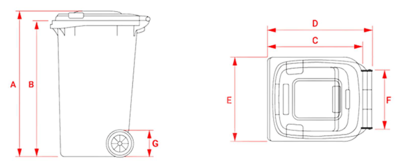

> [Picture on page 154: a picture, saved as a picture (images/part-b-general-provisions-page-154-4.gif, 150 dpi).]

Source:  Sulo Waste Management

#### Annexure B1-5

#### Composting and Worm Farming Guidelines

A composting facility must be provided in all residential use developments. Such facility may comprise either: A dedicated area on the site for the accommodation of a sufficient number of commercially available compost bins or worm farms, or A purpose designed compost area incorporated in the landscaped (low waste garden) area of the site.

#### Location

Conveniently accessible from all dwellings and reasonably close to the waste storage area. The facility should be located so as not to cause any nuisance to the occupants of the building on this or neighbouring sites.

#### Size

The capacity of compost bins for single dwellings is discretionary and will depend on the circumstances in the individual case. In new dwelling houses, an area of 1000mm x 1000mm should be provided. In multi-residential buildings, provision should be made for: A dedicated area to accommodate sufficient compost bins having a minimum capacity of 30 litres for each dwelling unit; or A purpose designed compost structure having a minimum capacity of 1 cubic metre for every 6 dwelling units or part thereof.

#### Construction

A permanent compost facility may be three-sided, two-compartment structure made of solid timber or masonry,

> [Picture on page 155: a picture, saved as a picture (images/part-b-general-provisions-page-155-20.gif, 150 dpi).]

with a cover for weather protection.

> [Picture on page 155: a picture, saved as a picture (images/part-b-general-provisions-page-155-22.gif, 150 dpi).]

#### Compost Bin

#### Worm Farm

Examples of composting and worm farming containers and structures

Note: More information is available at http://compostrevolution.com.au/

Where outdoor space is unavailable, smaller indoor composting systems are encouraged to be utilised within dwellings, and disposed of via Council’s organic waste collection service.

#### Annexure B1-6

#### Garbage Chutes, Compactors and Service Lifts Guidelines

#### Garbage chute design

Garbage chutes must be constructed in accordance with the requirements of the National Construction Code. Garbage chutes must be located and insulated in a manner that reduces noise impacts. Chutes, service openings and charging devices must be constructed of material (such as metal) that is smooth, durable,

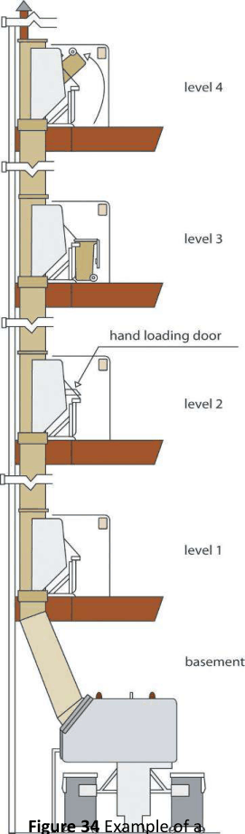

> [Picture on page 156: a picture, saved as a picture (images/part-b-general-provisions-page-156-7.gif, 150 dpi).]

Figure 34 Example of a

impervious, non-corrosive and fire resistant. Chutes, service openings and charging devices must be capable of being

easily

cleaned. Chutes must be cylindrical and should have a diameter of at least

500mm.

There must not be any bends (or sections of reduced diameter) in the

main

shaft of the chute. Internal overlaps in the chute must follow the direction of waste flow. Chutes must deposit rubbish directly into a bin or compactor located

within a

waste/recycling storage room. A cut-off device must be located at or near the base of the chute so

that the

bottom of the chute can be closed when the bin or compacting device

at the

bottom of the chute is withdrawn or being replaced. The upper end of a chute should extend above the roofline of the

building.

The upper end of a chute should be weather protected in a manner

that

doesn’t impede the upward movement of air out of the chute.

#### Garbage chute service room design

The service opening (for depositing rubbish into the main chute) on

each

floor of the building must be located in a dedicated service room. The charging device for each service opening must be self-closing and

must not

project into the main chute. Branches connecting service openings to the main chute are to be no more

than 1m

long. Each service room must include containers for the storage of recyclable

materials.

Signage regarding the materials that can be recycled should be displayed

near

these containers. Each service room must be located for convenient access by users and must be well ventilated and well lit. The floors, walls and ceilings of service rooms must be finished with

smooth,

durable materials that are capable of being easily cleaned. Service rooms must include signage that clearly describes the types of

materials

that can be deposited into the garbage chute and the types of

materials

which should be deposited into recycling bins.

garbage chute system

#### Management

Garbage chutes are not to be used for the disposal of recyclable materials. Signage to this effect should be displayed near service openings. Arrangements must be in place for the regular maintenance and cleaning of garbage chutes and any associated service rooms, service openings and charging devices. Arrangements must be in place for the regular transferal of recyclable materials (which are stored in service rooms) to the main waste/recycling storage room.

#### Service Lifts

A service lift (or service elevator) may be appropriate in place of a waste chute in developments where a caretaker is to be employed. A service lift is a dedicated elevator system for the transport of waste and recycling containers and other equipment required for the operation of the development. A waste service compartment must be provided on each floor of the development to allow residents to store waste and recyclables. Residents place their waste and recyclables in bins provided and these are transported daily by the caretaker to the waste storage room. Each service room must be designed with sufficient space for the storage of two days waste and recycling for all residents on that level. Applicants will need to check with Council whether this option is acceptable.

#### Compactors

Compactors are used to compress the waste (or recyclables) into smaller collection containers. The compaction ratio is typically set at around 2:1. Higher ratios are not used as they may result in heavier bins, causing OH&S problems, mechanical damage and breakage of recyclable materials. Best practice compaction systems compact directly into a 240 litre bin or a skip, reducing the requirement of manually loading the compacted waste into bins or skips. Compactors are extremely useful for mixed garbage, if used for recyclables extreme care must be taken not to cross contaminate the recycling streams. Compactors are less useful for steel containers and should not be used for glass. Compactors require regular maintenance. In particular, systems fed from a chute can be prone to blockages or failure of the “electronic eye”, which can result in garbage overflowing or backing up the chute.  As a result if the 2:1 compaction ratio, the requirement for garbage storage bins is halved. This information was sourced from: Resource NSW (The Department of the Environment and Conservation), “Better Practice Guide for Waste Management in Multi- Unit Dwellings”, 2002. Source: Better Practice Guide for Waste Management in Multi-Unit Dwellings, DECC, 2008.

#### Annexure B1-7

#### Placing a Waste Storage Container in a Public Place

To place a waste storage container (skip) in a public place, such as on a roadway or footpath, a Building Waste Container Company registered with Council must be used.

For the purposes of this Part, a waste storage container means a bulk container, commonly known as a skip, that is used for the temporary storage and transportation (by a registered vehicle) of waste and recycling materials generated by building demolition and construction activities, as well as general household rubbish. Also for the purposes of this Part, a public place means the whole of a public roadway, including any footway and grass verge, but does not include a public park or reserve which is land used for public recreation and like purposes.

A waste container may be placed in a public place, only where there is no suitable space available on the user's premises. Council permits this to encourage source separation and recycling of waste materials. Council encourages the use of multiple containers or careful scheduling of single container collections to enable separation of re-useable and recyclable materials. Details of the container must be marked on the plans presented to Council when applying for a construction certificate.

#### Approval Requirements

Permission to supply and locate a building waste container / skip is granted subject to compliance with the following conditions:

1\. The Company holds a current Council permit to place a waste storage container in a public place;

2\. The Company have lodged an appropriate security deposit with Council to cover the costs for repair of any damage caused to public property;

3\. Containers will be positioned in conformity with the "Interim Guidelines for the Placement of Building Waste Containers" as prepared by the Roads and Traffic Authority of N.S.W;

4\. Containers shall not exceed a width of 2.5m;

5\. No containers shall be located in a public reserve without the prior approval of Council;

6\. Containers shall not be left on a roadway longer than seven (7) days;

7\. Containers shall bear the name and telephone number of the supplier;

8\. Suppliers agree that the site where containers are being placed will be left in a clean and tidy condition with all spillage removed from the area;

9\. Suppliers are to be responsible for any incidence of damage arising from poor placement of containers or spilt debris; and

10\. Suppliers are to agree in writing to indemnify Council against any public liability claim arising from the placement of containers on Council’s roadways and such insurance cover to indemnify Waverley Council for a minimum amount of $10,000,000.

When placing a waste storage container / skip in a public place the following provisions must be complied with:

1\. Public safety and  convenience must be preserved;

2\. The container will not cause any damage to public  property;

3\. The container is a size appropriate to the location;

4\. The container is clearly identifiable;

5\. The container is clearly visible to traffic;

6\. The container does not restrict or obstruct traffic visibility;

7\. The container does not disturb or obstruct the free flow of pedestrian or vehicular traffic; and

8\. The container does not disturb normal stormwater flow.

#### Annexure B3-1

#### Planting List

All species on this list are generally recommended for use throughout Waverley, however, the selection of appropriate plant species for each site should be recommended by a suitably qualified landscape or bushland regeneration professional. Alternative species may be approved by Council. It is strongly recommended that the sourcing of plant material is undertaken well in advance of any development to ensure availability of species required.

Please note that Hedging of any trees (such as Lilly Pillies) will result in their classification as shrubs for the purposes of applying these controls. Note that some of the species in the shrubs medium – large section can be classified as trees, depending on their height at maturity and number of stems.

| TREES |  |
|---|---|
| Botanical Name | Common Name |
| Acacia decurrens | Sydney Green Wattle |
| Acacia implexa | Hickory Wattle |
| Acacia irrorata ssp. irrorata | Green Wattle |
| Acacia longissiuma | Long-leaf Wattle |
| Acacia parramattensis | Sydney Green Wattle |
| Acmena smithii | Lilly Pilly |
| Acronychia oblongifolia | White Aspen |
| Allocasuarina littoralis | Black She-oak |
| Allocasuarina torulosa | Forest Oak |
| Angophora costata | Sydney Red Gum |
| Angophora hispida | Dwarf Apple |
| Archontophoenix cunninghamiana | Bangalow Palm |
| Backhousia citriodora | Lemon Myrtle |
| Backhousia myrtifolia | Grey Myrtle |
| Banksia integrifolia | Coastal Banksia |
| Banksia marginata | Silver Banksia |
| Callicoma serratifolia | Black Wattle |
| Casuarina glauca | Swamp Sheoak |
| Ceratopletalum apetalum | Coachwood |
| Corymbia gummifera | Red Bloodwood |
| Cupaniopsis anacardioides | Tuckeroo |
| Elaeocarpus reticulatus | Blueberry Ash |
| Enidandra sieberi | Corkwood |
| Eucalyptus botryoides | Bangalay |
| Eucalyptus gummifera | Red Bloodwood |
| Eucalyptus haemastoma | Scribbly Gum |
| Eucalyptus piperita | Sydney Peppermint |
| Eucalyptus obstans | Port Jackson Mallee |
| Eucalyptus robusta | Swamp Mahogany |
| Ficus rubiginosa | Port Jackson Fig |
| Ficus coronata | Sandpaper Fig |
| Glochidion ferdinandi | Cheese Tree |
| Hymenosporum flavum | Native Frangipani |

| Livistona australis | Cabbage Palm |
|---|---|
| Melia azederach var. australasica | White Cedar |
| Notelaea longifolia | Large Mock-olive |
| Pittosporum revolutum | Yellow Pittosporum |
| Podocarpus elatus | Plum Pine |
| Syzygium leuhmannii | Riberry |
| Syzygium paniculatum | Magenta Lilly Pilly |
| Syncarpia glomulifera ssp glomulifera | Turpentine |
| Toona ciliata | Red Cedar |
| Tristainiopsis laurina | Water Gum |

| SHRUBS: Medium-Large |  |
|---|---|
| Botanical Name | Common Name |
| Acacia binervia | Coast Myall |
| Acacia linifolia | White Wattle |
| Acacia longifolia | Sydney Golden Wattle |
| Acacia floribunda | White Sally Wattle |
| Acacia sophorae | Coastal Wattle |
| Acacia terminalis | Sunshine Wattle |
| Allocasuarina distyla | Shrubby She-oak |
| Banksia aemula | Wallum Banksia |
| Banksia ericifolia | Heath-leaved Banskia |
| Banksia oblongifolia | Fern-leaved Banksia |
| Banksia marginata | Silver Banksia |
| Banksia serrata | Old Man Banksia |
| Callistemon linearifolius | Netted Bottlebrush |
| Callistemon pinifolius | Pine-leaved Bottlebrush |
| Callilstemon salignus | Willow Bottlebrush |
| Ceratopetalum gummiferum | NSW Christmas Bush |
| Cordyline stricta | Slender Palm Lily |
| Cyathea cooperi | Rough Tree Fern |
| Dicksonia antarctica | Soft Tree Fern |
| Eupomatia laurina | Bolwarra |
| Grevillea linearifolia | Linear-leaf Grevillea |
| Grevillea mucronulata | Green Spider Flower |
| Grevillea speciosa | Red Spider Flower |
| Grevillea sphacelata | Grey Spider Flower |
| Hakea dactyloides | Finger Hakea |
| Hakea gibbosa | Needlebush |
| Hakea teretifolia | Dagger Hakea |
| Kunzea ambigua | Tick Bush |
| Lambertia formosa | Mountain Devil |
| Leptospermum laevigatum | Coastal Tea Tree |
| Leptospermum polygalifolium | Yellow tea-tree |
| Leptospermum squarrosum | Pink tea-tree |

| Lomatia myricoides | River Lomatia |
|---|---|
| Melaleuca armillaris | Bracelet Honey-myrtle |
| Melaleuca linariifolia | Flax-leaved Paperbark |
| Melaleuca nodosa | Ball Honey-myrtle |
| Monotoca elliptica | Tree Broom-heath |
| Myrsine variabilis | Variable Muttonwood |
| Persoonia levis | Broad-leaved Geebung |
| Persoonia linearis | Narrow-leaved Geebung |
| Polyscias sambucifolia | Elderberry Panax |
| Viminaria juncea | Native Broom |

| SHRUBS: Small-Medium |  |
|---|---|
| Botanical Name | Common Name |
| Acacia myrtifolia | Myrtle Wattle |
| Acacai longifolia ssp. sophorae | Coastal Wattle |
| Acacia suaveolens | Sweet Wattle |
| Acacia terminalis | Sunshine Wattle |
| Acacia ulicifolia | Prickly Moses |
| Baeckea imbricata | Heath Myrtle |
| Baeckea linifolia | Swamp Baeckea |
| Banksia robur | Swamp Banksia |
| Banksia spinulosa | Hair-pin Banksia |
| Bauera rubioides | River Dog Rose |
| Bossiaea heterophylla | Variable bossiaea |
| Brachyloma daphnoides | Daphne Heath |
| Breynia oblongifolia | Coffee Bush |
| Callistemon citrinus | Crimson Bottlebrush |
| Callistemon linearis | Narrow-leaved Bottlebrush |
| Correa alba | Coastal Correa |
| Correa reflexa | Native Fuchsia |
| Crowea saligna | Crowea |
| Darwinia fascicularis | Darwinia |
| Dillwynia retorta | Parrot Pea |
| Dodonaea triquetra | Common Hop Bush |
| Eriostemon austalasius | Pink Wax Flower |
| Grevillea linearifolia | Linear-leaf Grevillea |
| Grevillea mucronulata | Green Spider Grevillea |
| Grevillea speciosa | Red Spider Grevillea |
| Grevillea sphacelata | Grey Spider Grevillea |
| Lambertia formosa | Mountain Devil |
| Lasiopetalum ferrugineum | Rusty Petals |
| Lomatia silaifolia | Crinkle Bush |
| Melaleuca thymifolia | Thyme Honeymyrtle |
| Olearia tomentosa | Daisy Bush |
| Ozothamnus diosmifolius | Rice Blower |

| Pimelea linifolia | Slender Rice flower |
|---|---|
| Platysace lanceolata | Native Parsnip |
| Phebalium squamulosum | Forest Phebalium |
| Prostanthera incisa | Toothed Mint Bush |
| Pultenaea linophylla | Halo Bush Pea |
| Ricinocarpus pinifolius | Wedding Bush |
| Westringia fruticosa | Coastal Rosemary |

| GRASSES and GROUNDCOVERS – Upright Grasses, Lillies, Rushes and Sedges |  |
|---|---|
| Botanical Name | Common Name |
| Alocasia brisbanensis | Cunjevoi |
| Austrostipa pubescens | Spear Grass |
| Baumea juncea | Bog Rush |
| Crinum pedunculatum | Swamp Lily |
| Cymbopogon refractus | Barbed Wire Grass |
| Dianella caerulea | Blue Flax Lily |
| Dianella congesta | Coastal Flax Lily |
| Dianella revoluta | Paroo Lily |
| Dichelachne crinita | Long Hair Plume Grass |
| Dichelachne micrantha | Short Hair Plume Grass |
| Echinopogon caespitosus | Tufted Hedgehog Grass |
| Entolasia marginata | Bordered panic Grass |
| Entolasia stricta | Wiry Panic Grass |
| Ficinia nodosa | Knobby Club Rush |
| Gahnia sieberiana | Saw Sedge |
| Imperata cyllindrica | Blady Grass |
| Juncus usitatus | Common Rush |
| Juncus krausii | Sea Rush |
| Lachnagrostis billardierei | Coast Blown Grass |
| Lomandra longifolia | Spiny-headed Mat rush |
| Machaerina juncea | Bare Twig-rush |
| Paspalidium distans | Shotgrass |
| Poa affinis | Tussock Grass |
| Rytidosperma fulvum | Wallaby Grass |
| Themeda australis | Kangaroo Grass |
| Themeda australis Coastal form | Kangaroo Grass (Coastal Form) |
| Xanthorrhoea resinosa | Grass Tree |

| GRASSES and GROUNDCOVERS – Herbs and Subshrubs |  |
|---|---|
| Botanical Name | Common Name |
| Austromyrtus tenuifolia | Midgenberry |
| Brachyloma daphonoides | Daphne Heath |
| Geranium homeanum | Cranesbill |
| Gonocarpus teucrioides | Germander Raspwort |
| Homoranthus flavescens | Homoranthus |

| Leucopogon ericoides | Pink Beard-heath |
|---|---|
| Leucopogon juniperinus | Prickly Beard-heath |
| Lomandra glauca | Pale Mat-rush |
| Lomatia silafolia | Crinkle Bush |
| Mirbelia rubiifolia | Heathy Mirbelia |
| Pelargonium australe | Austral Stork's Bill |
| Plectranthus parviflorus | Cockspur flower |
| Wahlengergia gracilis | Sprawling Bluebell |
| Xerochrysum bracteatum | Paper Daisy |

| GRASSES and GROUNDCOVERS – Climbers and Twiners |  |
|---|---|
| Botanical Name | Common Name |
| Billardiera scandens | Hairy Appleberry |
| Cissus antaractica | Kangaroo Vine |
| Cissus hypoglauca | Five-leaf Water Vine |
| Eustrephus latifolius | Wombat Berry |
| Geitonoplesium cymosum | Scrambling Lily |
| Glycine clandestina | Love Creeper |
| Gynochthodes jasminoides | Sweet Morinda |
| Hardenbergia violacea | False Sarsaprilla |
| Hibbertia dentata | Trailing Guinea-flower |
| Hibbertia scandens | Golden Guinea Flower |
| Hoya australis | Australian Wax Plant |
| Pandorea pandorana | Wonga Wonga Vine |
| Smilax glyciphylla | Sweet Sarsaparilla |
| Stephania japonica var. discolor | Snake Vine |

| GRASSES and GROUNDCOVERS – Low grasses and groundcovers |  |
|---|---|
| Botanical Name | Common Name |
| Carpobrotus glaucescens | Pig Face |
| Carex pumila | Strand Sedge |
| Centella asiatica | Gotu Cola |
| Commelina cynaea | Scurvy Weed |
| Dichondra repens | Kidney Weed |
| Eragrostis brownii | Blown Grass |
| Lomandra glauca | Pale Mat-Rush |
| Microleana stipoides | Weeping Grass |
| Oplismenus aemulus | Basket Grass |
| Oplismenus imbecillis | Basket Grass |
| Scaevola calendulacea | Coastal Fan Flower |
| Selleria radicans | Swamp Weed |
| Tetragonia tetragonioides | Warrigal Greens |
| Viola hederacea | Native Violet |
| Zoyzia macranthra | Prickly Marine Couch |

#### GRASSES and GROUNDCOVERS – Ferns

| Botanical Name | Common Name |
|---|---|
| Adiantum aethiopicum | Maidenhair Fern |
| Asplenium australisicum | Birds Nest Fern |
| Calochlaena dubia | Soft Bracken |
| Doodia aspera | Rasp Fern |
| Histiopteris incisa | Bats Wing Fern |
| Hypolepis muelleri | Harsh Ground Fern |
| Pellaea falcata | Sickle fern |
| Pteridium esculentum | Common Bracken |
| Sticherus flabellatus | Umbrella Fern |

#### Annexure B3-2

#### Tree Canopy Replacement Planting List

| Replacement Plantings |  |
|---|---|
| Botanical Name | Common Name |
| Araucaria columnaris | Cook Island Pine or New Caledonia Pine |
| Araucaria heterophylla | Norfolk Island Pine |
| Casuarina equisetifolia | Horsetail Casuarina |
| Livistona australis | Cabbage Tree Palm |
| Melaleuca armillaris | Bracelet Honey Myrtle |
| Melaleuca lanceolata | Moonah |
| Metrosideros spp | New Zealand Christmas Bush |
| Washingtonia robusta | Cotton Palm |
| Acacia decurrens | Sydney Green Wattle |
| Acacia fimbriata | Fringed Wattle |
| Acacia implexa | Hickory Wattle |
| Acacia irrorata ssp. irrorata | Green Wattle |
| Acacia longissiuma | Long-leaf Wattle |
| Acacia parramattensis | Sydney Green Wattle |
| Acacia sophorae | Coastal Wattle |
| Acmena ingens | Red Apple |
| Acmena smithii | Lilly Pilly |
| Acronychia oblongifolia | White Aspen |
| Agonis flexuosa ‘After Dark’ | Purple-leafed Willow Myrtle |
| Alectryon coriaceus | Beach Birds Eye |
| Allocasuarina littoralis | Black She-oak |
| Allocasuarina torulosa | Forest Oak |
| Angophora costata | Sydney Red Gum |
| Angophora hispida | Dwarf Apple |
| Araucaria columnaris | Cook Island Pine or New Caledonia Pine |
| Araucaria heterophylla | Norfolk Island Pine |
| Archontophoenix cunninghamiana | Bangalow Palm |
| Backhousia citriodora | Lemon Myrtle |
| Backhousia myrtifolia | Grey Myrtle |
| Banksia integrifolia | Coastal Banksia |
| Banksia marginata | Silver Banksia |

| Banksia serrata | Old Man Banksia |
|---|---|
| Brachychiton acerifolius | Illawarra Flame Tree |
| Buckinghamia celsissima | Ivory Curl Tree |
| Callicoma serratifolia | Black Wattle |
| Callistemon | Bottlebrush |
| Callistemon ‘Dawson River’ | Weeping Bottlebrush |
| Callistemon citrinus * | Lemon-Scented Bottlebrush |
| Callistemon 'Dawson River' | Weeping Bottlebrush |
| Callistemon salignus | Willow Bottlebrush |
| Callitris rhomboidea | Port Jackson Pine |
| Casuarina glauca | Swamp Sheoak |
| Ceratopetalum gummiferum | NSW Christmas Bush |
| Ceratopletalum apetalum | Coachwood |
| Corymbia eximia | Yellow Bloodwood |
| Corymbia gummifera | Red Bloodwood |
| Cupaniopsis anacardioides | Tuckeroo |
| Elaeocarpus reticulatus | Blueberry Ash |
| Enidandra sieberi | Corkwood |
| Eucalyptus ‘Summer Red’ | Eucalyptus Summer Red & cultivars |
| Eucalyptus botryoides | Bangalay |
| Eucalyptus gummifera | Red Bloodwood |
| Eucalyptus haemastoma | Scribbly Gum |
| Eucalyptus obstans | Port Jackson Mallee |
| Eucalyptus piperita | Sydney Peppermint |
| Eucalyptus robusta | Swamp Mahogany |
| Ficus coronata | Sandpaper Fig |
| Ficus rubiginosa | Port Jackson Fig |
| Geijera parviflora | Wilga |
| Gleditsia triacanthos | Honey Locust |
| Glochidion ferdinandi | Cheese Tree |
| Hibiscus 'Rubra' | Red-leafed Hibiscus Tree |
| Hymenosporum flavum | Native Frangipani |
| Koelreuteria paniculata | Golden Rain Tree |
| Leptospermum laevigatum | Coastal Tea Tree |
| Livistona australis | Cabbage Tree Palm |
| Lophostemon confertus | Brushbox |
| Magnolia grandiflora | Bull-Bay Magnolia |
| Melaleuca armillaris | Bracelet Honey Myrtle |
| Melaleuca decora | White Feather Honey Myrtle |
| Melaleuca leucadendra | Fine-leafed Paperbark |
| Melaleuca quinquenervia | Broad-leafed Paperbark |
| Melaleuca styphelioides | Prickly Paperbark |
| Melia azederach var. australasica | White Cedar |
| Metrosideros spp | New Zealand Christmas Bush |
| Notelaea longifolia | Large Mock-olive |
| Pittosporum revolutum | Yellow Pittosporum |
| Podocarpus elatus | Plum Pine |
| Stenocarpus sinuatus | Firewheel Tree |
| Sygyium leuhmannii | Riberry |

| Sygyium paniculatum | Magenta Lilly Pilly |
|---|---|
| Syncarpia glomulifera ssp glomulifera | Turpentine |
| Syzygium luehmannii | Riberry |
| Toona ciliata | Red Cedar |
| Tristainiopsis laurina | Water Gum |
| Tristaniopsis laurina | Watergum |
| Washingtonia robusta | Cotton Palm |
| Waterhousea floribunda | Waterhousea |

#### Annexure B5-1

#### Flood Compatible Material

Table 1 List of suitable flood compatible materials

| Building Component |  |
|---|---|
| Flooring and sub-floor | • Concrete slab-on-ground monolith • suspended reinforced concrete slab |
| Floor covering | • clay tiles • concrete, precast or in situ • concrete tiles • epoxy, formed-in-place • mastic flooring, formed-in-place • rubber sheets or tiles with chemicals-set-adhesive • silicone floors formed-in-place • vinyl sheets or tiles with chemical-set adhesive • ceramic tiles, fixed with mortar or chemical-set • asphalt tiles, fixed with water resistant adhesive |
| Wall structure | • Solid brickwork, block work, reinforced, concrete or |
| Roofing structure (for situations where the relevant flood level is | • reinforced concrete construction • galvanised metal construction |
| Doors | • solid panel with water proof adhesives • flush door with marine ply filed with cell foam • painted metal construction • aluminium or galvanised steel frame |
| Wall and ceiling linings | • fibro-cement board • brick face or glazed • clay tile glazed in waterproof mortar • concrete • concrete block • steel with waterproof applications • stone, natural solid or veneer, waterproof grout • glass blocks • glass • plastic sheeting or wall with waterproof adhesive |
| Insulation windows | • Foam (closed cell types) • Aluminium frame with stainless steel rollers or similar corrosion and water-resistant material |
| Nails, bolts, hinges and fittings | • Brass, nylon or stainless steel; • Removable pin hinges • Hot dipped galvanised steel wire nails or similar. |

| Electrical and mechanical equipment For dwellings constructed on land to which this DCP applies, the electrical and mechanical materials, equipment and installation must conform to the following requirements: |  |
|---|---|
| Main power supply | Subject to the approval of the relevant authority the incoming main commercial power service equipment, including all metering equipment, must be located above the design flood level. Means must be available to easily disconnect the dwelling from the main power supply. |
| Wiring | All wiring, power outlets, switches, must be to the maximum extent possible, located above the probably maximum flood level. All electrical wiring installed below this level must be suitable for continuous underwater immersion and must contain no fibrous components. Earth leakage circuit-breaker (core balance relays) or a residual Current Device must be installed. Only submersible type splices must be used below the probably maximum flood level. All conduits located below the relevant design flood level must be so installed that they will be self-draining if subjected to flooding. |
| Equipment | All equipment installed below or partially below the design flood level must be capable of disconnection by a single plug and socket assembly. |
| Reconnection | Should any electrical device and/or part of the wiring be flooded it must be thoroughly cleaned or replaced and checked by an approved electrical contractor before reconnection. |
| Heating and air conditioning systems Where viable, heating and air conditioning systems should be installed in areas and spaces of the house above the probably maximum flood level. If this is not feasible, every precaution must be taken to minimise the damage caused by submersion according to the following guidelines: |  |
| Fuel | Heating systems using gas or oil as fuel must have a manually operated valve located in the fuel supply line to enable fuel cut-off. |
| Installation | Heating equipment and fuel storage tanks must be mounted on and securely anchored to a foundation pad of sufficient mass to overcome buoyancy and prevent movement that could damage the fuel supply line. All storage tanks must be vented to an elevation of 600 millimetres above the design flood level. |
| Ducting | All ductwork located below the design flood level must be provided with openings for drainage and cleaning. Self-draining may be achieved by constructing the ductwork on a suitable grade. Where ductwork must pass through a water-tight wall or floor below the design flood level, a closure assembly operated from above the design flood level must protect the ductwork. |

Note: The above list is not considered to be exhaustive and other materials and methods can be proposed for Council's

consideration as part of any application

#### Annexure B5-2

#### Flood Impact Assessment Requirements

General

A Flood Impact and Risk Assessment (FIRA) must be prepared by a professional engineer who specialises in hydraulic engineering. The FIRA must be prepared in accordance with the relevant sections of this Chapter. Applicants are referred to guidance provided by “Flood impact and risk assessment - Flood risk management guideline LU01” (2023 NSW Department of Planning and Environment) or any amended version or future equivalent replacement document, for detailed guidance for the preparation of a FIRA.

The assessment of impacts should be fit for purpose. Computer modelling may not be required in all circumstances, subject to Council’s advice.

Flood frequencies to be considered

A minimum of the 5% AEP, 1% AEP and PMF flood events must be modelled to assess the impact on existing flood conditions of a proposed development to property, infrastructure and the environment.

When is a FIRA required?

A FIRA may be required for any type of development where the development occurs in the floodplain (i.e. situated within the Flood Planning Area). A FIRA may also be required where the site in question is identified as a Flood Control Lot as defined in State Environmental Planning Policy (Exempt and Complying Development Codes) to aid in the application of the State Environmental Planning Policy.

For the purposes of Council being satisfied that a FIRA is not required, Council will consider the context of the proposed development and site characteristics, inclusive of the following criteria:

the development will be designed to not obstruct the flow of flood waters the development will not materially change existing pervious ground surfaces to impervious ground surfaces the development is not located in a floodway or storage area.

Computer Model Unless it can be demonstrated that hydraulic modelling is not required, the FIRA must be prepared using Council’s TUFLOW model. Once engaged, the consultant must enter into a license agreement for the use of Council’s flood model for the specific purpose of preparing the FIRA for the proposed development only.

Note: a fee is payable for the use of the TUFLOW model.

Flood Impact Assessment Criteria

The following criteria should be applied as part of the consideration of determining whether a development will have a material impact on other developments or land:

The flood impact of the development should not exceed a maximum increase of 10mm on land not associated with the development in a 1% AEP flood.

The flood impact of the development should not exceed a maximum increase of 20mm on land not associated with the development in a 5% AEP flood.

The development should not result in flood flow velocities increasing at the property boundary for any flood up to a 1% AEP flood: o by any amount where the existing condition flow velocity is greater than 1.5 m/s, or o by more than 20% where the existing flow velocity is less than 1.5 m/s.

The development should not result in the change in hazard classification in a 1% AEP flood on adjoining private or public land.

Shelter in Place considerations

Where sheltering in place is required to the prescriptive controls of the DCP, the FIRA shall include an assessment of whether the proposal provides an acceptable flood refuge area. The assessment shall have regard to the “Shelter-in-Place Guideline for Flash Flooding” (Department of Planning, Housing & Infrastructure, 2024) and incorporate the following design features: floor level to be above the PMF within a building that is structurally sound in all floods up to and including a PMF access to the refuge is self-directing and accessible for all likely occupants without reliance on mains electricity weather protection.

For residential development involving more than a single dwelling house and for non-residential development where 5 or more occupants might be required to shelter in place, the additional design features are to be included:

• the refuge is sized for a minimum 2m2 of floor area per likely occupant

• appropriate means to regulate thermal comfort (eg heating, blankets, etc)

• personal hygiene facilities (access to toilet facilities)

• emergency survival pack that is checked and renewed annually (incorporating supplies such as a medical kit, food, water, fire extinguisher, radio, lighting, batteries and/or on-site power systems).

FIRA Report

The FIRA must address the following: Description of the Site (including existing stormwater drainage and local catchment characteristics) and details of the proposed development. Flood affectation to the Site and surrounding land during the 5% AEP, 1% AEP and PMF events under existing (i.e. pre-development) conditions.

Flood affectation to the Site and surrounding land during the 5% AEP, 1% AEP and PMF events under post-development conditions. Overview of the change in flood conditions associated with the proposed development. Overview of the Flood Risk Precinct(s) and associated development controls applicable to the Site for pre and post development conditions. Discussion of adherence to applicable planning controls. Proposed mitigation measures to address any impacts or minimise risk to personal safety of occupants and the risk of property damage. A flood evacuation strategy (Flood Emergency Response Plan) (if required). On site response plan to minimise flood damage and provide adequate storage areas for hazardous materials and valuable goods above the flood level (if required). The architectural/engineering plans on which the assessment is based. Supporting calculations and mapping. The professional qualifications and experience of the author(s).

The FIRA shall be prepared and submitted for the proposed development as part of a development application. In the event the plans and associated reports are updated as part of the assessment process, the FIRA shall be updated to reflect the current version of the proposed development. RLs that reflect AEP flood levels are required to demonstrate compliance with the DCP controls and shall be clearly shown on the development application plans.

The FIRA must include maps and analysis that clearly demonstrate the above considerations.

#### Annexure B5-3

#### Flood Planning Area

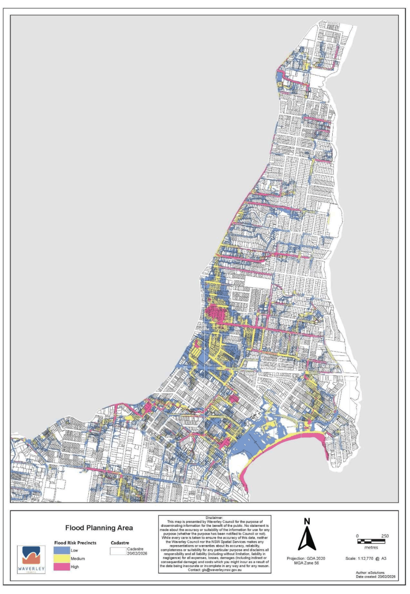

> [Picture on page 172: a picture, saved as a picture (images/part-b-general-provisions-page-172-3.gif, 150 dpi).]

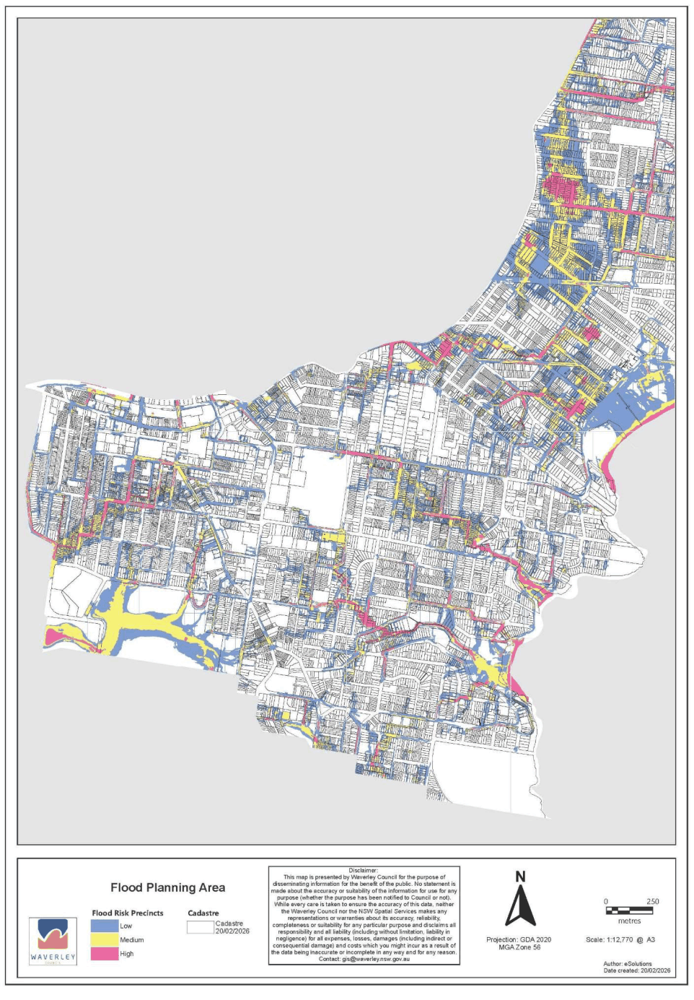

> [Picture on page 173: a picture, saved as a picture (images/part-b-general-provisions-page-173-1.gif, 150 dpi).]

Note: The Flood Planning Area map is provided as a reference and is subject to administrative updates

in line with updates to flood modelling in the Waverley LGA

#### Annexure B8-1

Charing Cross Conservation Area

The following map highlights the study area, as well as an extract of the Charing Cross heritage conservation area (refer to Figure 37).

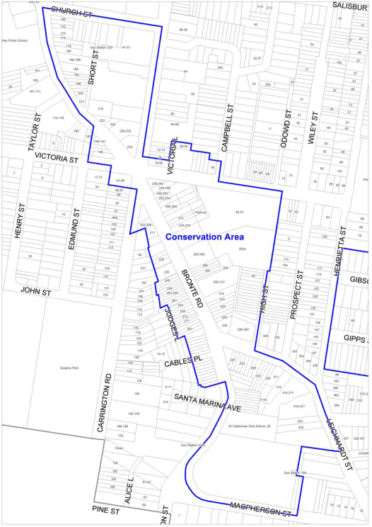

> [Picture on page 174: a picture, saved as a picture (images/part-b-general-provisions-page-174-5.gif, 150 dpi).]

Figure 37 Charing Cross heritage conservation area

The following provides recommendations for future conservation opportunities as well as appropriate colour schemes for the identified properties or property groups. Furthermore, the Charing Cross Streetscape Study provides a physical description of every building or building group within the study area and general recommendations for the overall improvement of the streetscape. All of the buildings included in the study are located in the Charing Cross heritage conservation area.

#### Conservation of Original Fabric

A large amount of original fabric still exists in the street facades of the conservation area, particularly in the upper wall areas above the awnings. However, much of it has been compromised by later additions or is covered by unsympathetic paint schemes. It is recommended that each period of building be respected for its individual contribution to the development of the area and that future treatment will be consistent with the original character of the building.

Original shopfronts are becoming increasingly rare and remaining examples should be conserved. Partial or missing examples of original fabric can be restored or reconstructed to aid interpretation and appreciation of the streetscape, however, this must be done with care and be based on evidence, thorough research and inspection of the physical evidence on site by an experienced conservation architect.

#### Colour Schemes

Cleaning and repainting the facades of the buildings in the study area would be an improvement to the presentation of the street. Many individual buildings have unsympathetic colour schemes that are inconsistent with the style of the building and with the grouping in which they were built. It is desirable that the colour scheme of each building or group of buildings be informed by the period in which it was built and by physical investigation of the early paint layers on the exterior fabric. A conservation architect or heritage practitioner could carry out paint scrapes to determine the early colours. These colours could then be interpreted in a colour scheme that suits the current owners or tenants. Correct tonal relationships (the use of light and dark colours on various elements) are more important than exact replication of hues.

The accompanying inventory sheets for each building or group of buildings contain recommended colour schemes which are based on the period, style, and current treatment of the buildings. For example, in some cases where original face brickwork has been painted over, the colour scheme provides a recommendation to paint the brickwork brown to simulate face brick. These recommended colour schemes are speculative, relying on knowledge of original colour schemes of other buildings of similar periods, and are not based on physical intervention. It is preferable to undertake paint scrapes to determine the original colour scheme of each building, however, if this is not possible, the recommended colour schemes would result in a more historically relevant appearance of the streetscape.

Colour terms used in the inventory sheets relate to the Australian Standard 2700 - Colour Standards for General Purposes as follows:

| Colour name | AS2700 colour name | AS2700 code |
|---|---|---|
| Biscuit | Raffia | X31 |
| Bridge grey | Light grey | N35 |
| Bronze green | Deep bronze green | G63 |
| Brown (to simulate brickwork) | N/A – approve by sample |  |
| Buff | Oatmeal | Y54 |
| Copper beech | Dark brown | X65 |
| Cream | Sandstone | Y53 |
| Crimson | Maroon | R65 |
| Deep Brunswick green | Bottle green | G11 |
| Eau-de-Nil | Palm green | G44 |
| Forest green | Holly | G12 |
| French grey | Storm grey | N42 |
| Grey green | Banksia | G53 |
| Indian red | Deep indian red | R64 |
| Manilla | Manilla | Y45 |
| Mid-brown | Brown | X54 |
| Mountain blue | Blue jay | T24 |
| Off-white | Off-white | Y35 |

| Colour name | AS2700 colour name | AS2700 code |
|---|---|---|
| Olive | Mist green | G54 |
| Pale grey (to simulate render) | N/A – approve by sample |  |
| Pink brown | Cinnamon | X45 |
| Sea green | Lichen | G55 |
| Vellum | Surf green | G43 |
| Venetian red | Venetian red | R62 |
| White | N/A | N/A |

#### Recommended Finishes

All render and plaster should have a semi-gloss finish. All timber and metalwork should have a gloss finish.

#### Annexure B8-2

Queens Park Conservation Area

The Queens Park Conservation Area (QPCA) has been identified as an area that has unique physical qualities and an intrinsic residential character that should be preserved (refer to Figure 38). Any property within the QPCA must have regard for the Desired Future Character as outlined in Annexure B8-2 and adhere to the Objectives and Controls within Part B8.

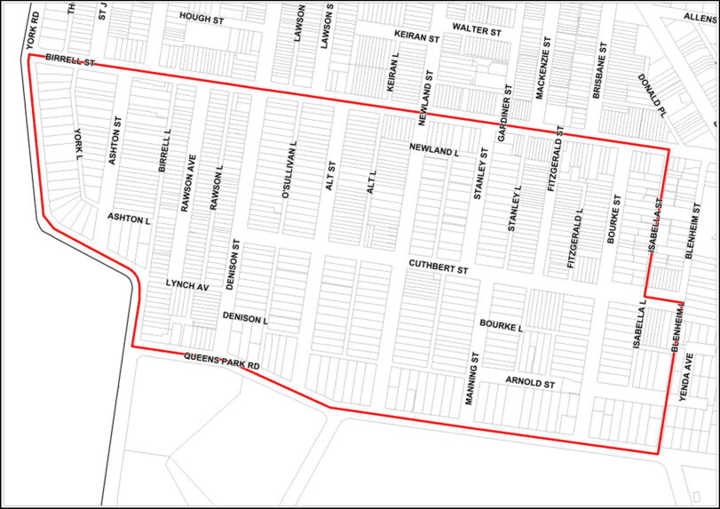

> [Picture on page 177: a picture, saved as a picture (images/part-b-general-provisions-page-177-8.gif, 150 dpi).]

Figure 38 Queens Park Conservation Area

#### Queens Park Heritage Conservation Area

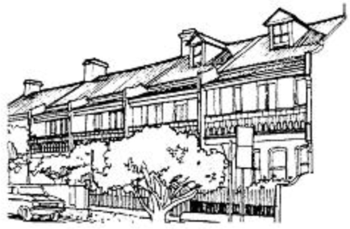

> [Picture on page 178: a picture, saved as a picture (images/part-b-general-provisions-page-178-2.gif, 150 dpi).]

#### Figure 39 Example of Victoria terraces in the area

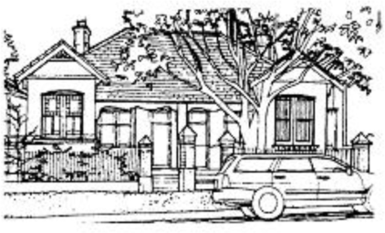

> [Picture on page 178: a picture, saved as a picture (images/part-b-general-provisions-page-178-4.gif, 150 dpi).]

Figure 40 Example of semi-detached dwellings in the area

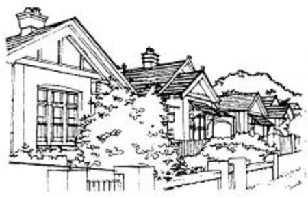

> [Picture on page 178: a picture, saved as a picture (images/part-b-general-provisions-page-178-7.gif, 150 dpi).]

#### Subdivision

Streets in the area are arranged in a grid pattern with most blocks containing internal rear service lanes. The subdivision pattern features three categories of lot size, reflecting the type of dwellings in the area. Small sized lots (typically 100m2 to 250m2) dominate the north-eastern portion of the study area. These lots typically contain Victorian terraces and other attached dwelling styles (refer to Figure 39).

In the central and southern part of the area, lots tend to be larger (typically 200m2 to 400m2) reflecting the semi-detached and detached villa dwelling typology (refer to Figure 40).

The largest lots (500m2 to 800m2) are present on the western and southern edges of the area, fronting onto Queens Park Road and York Road. These lots contain bungalow style dwellings with a large front set back, and a small number of residential flat buildings (refer to Figure 41).

#### Views and Vistas

North-south street axes provide important view corridors to Queens Park. Formal tree plantings in these streets frame views to the open parkland in the distance. Properties in the upper eastern portion of the area enjoy distant views of parklands and the city to the west.

Figure 41 Example of the detached bungalow dwelling style in the area

#### Open Space

Queens Park and Centennial Park are expansive areas of open space bordering the character area to the south and west respectively. These parklands are significant landmarks and provide a contrast to the compact residential character of the area.

#### Landscaping

Vegetation is an important element to the character of this area. Formal plantings of mature fig trees are the most distinguishing characteristic of the inner residential streets and provide a uniting theme throughout the study area. The sense of enclosure created by the avenues of mature trees is in contrast to the openness of the parkland bordering the area to the south and west (refer to Figure 42).

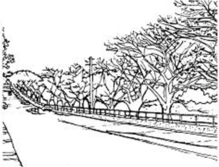

> [Picture on page 179: a picture, saved as a picture (images/part-b-general-provisions-page-179-1.gif, 150 dpi).]

Figure 42 Open views, established street trees and rock outcrops are a unique character of Queens Park

#### Residential Character – Streetscapes

Three distinct types of streetscape character are found within the area. Streets which carry larger volumes of local through traffic (e.g. Birrell Street, Queens Park Road, York Road), inner residential streets (e.g. Manning Street, Alt Street, Ashton Street) and rear access lanes.

The streets with higher volumes of through traffic have a wider carriageway, relatively narrow verges and smaller scale and less dense street plantings. These features contribute to a wider, more open streetscape (refer to Figure

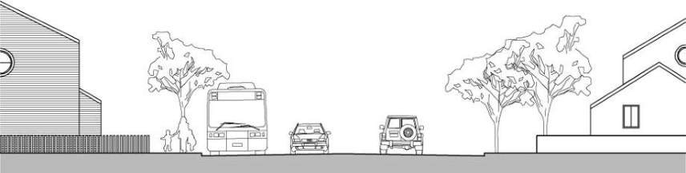

> [Picture on page 179: a picture, saved as a picture (images/part-b-general-provisions-page-179-17.gif, 150 dpi).]

43).

Figure 43 Typical section of a street with high volumes of through traffic

Inner residential streets are characterized by mature trees forming a canopy. These streets are foliage shaded, with a cooler microclimate, and wider verges (refer to Figure 44).

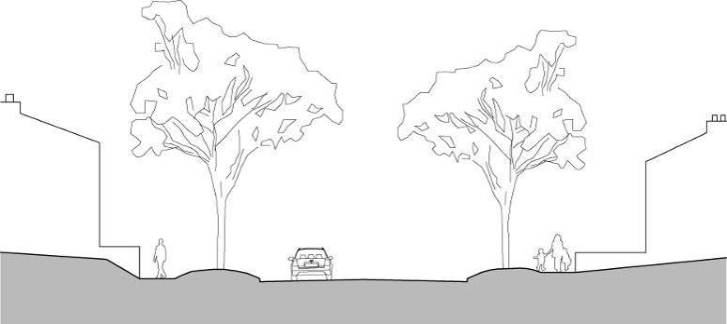

> [Picture on page 179: a picture, saved as a picture (images/part-b-general-provisions-page-179-22.gif, 150 dpi).]

Figure 44 Typical section of an inner residential street

The narrow, corridor like rear access lanes are dominated by garage doors, high fences, walls, landscape screening, and a variety of building setbacks (refer to Figure 45). A variety of front fence styles and setback conditions typify the range of dwelling styles represented in the area. Shallow front setbacks with cast iron front fences are part of the original character of Victorian terraces. While most remain intact, some have been replaced with higher, rendered brick fences. Detached and semi-detached dwellings typically have deeper front setbacks, with low brick or timber picket front fences being the most common styles (refer to Figure 46).

Low, stepped brick fences are used on steeper sites and where no rear lane access is provided, garage doors and sloped landscaping face the street (refer to Figure 47).

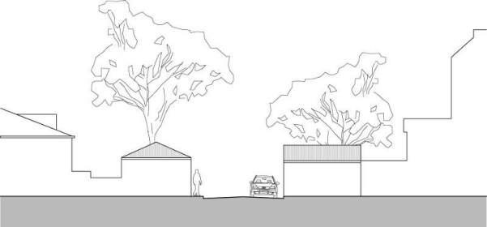

> [Picture on page 180: a picture, saved as a picture (images/part-b-general-provisions-page-180-3.gif, 150 dpi).]

Figure 45 Typical section of a rear access lane.

#### Architectural Style

QPCA is one of the oldest precincts in the Municipality, containing many manmade and natural heritage items, including remnants of walls, stables, buildings, caves and trees. Any development must be sensitive to these items.

A variety of architectural styles reflect the various eras of development in the study area. These include the Victorian Terrace, sandstone Post Regency cottage, Victorian Gothic, Edwardian and Federation semidetached dwellings and larger Federation, Californian and Modern bungalows. Most dwellings are clustered in groups of similar style. Repetition of building elements such as shingled gables, chimneys, doors and windows, terraces, entrances, fences, etc. establishes a coherent streetscape character based on detail and rhythm.

Recent development has increased the vocabulary of the character of the area. New dwellings and alterations and additions range from minor dormer windows to contemporary

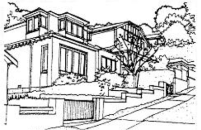

> [Picture on page 180: a picture, saved as a picture (images/part-b-general-provisions-page-180-17.gif, 150 dpi).]

architecture.

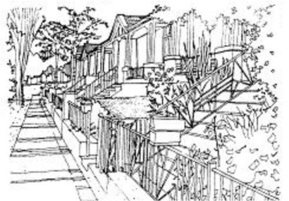

> [Picture on page 180: a picture, saved as a picture (images/part-b-general-provisions-page-180-19.gif, 150 dpi).]

Figure 47 Stepped fences on steeper sites

Figure 46 Example of low and transparent fences which correspond to the established existing character elements.
