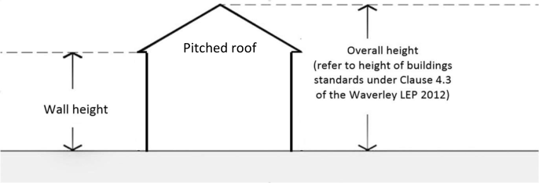
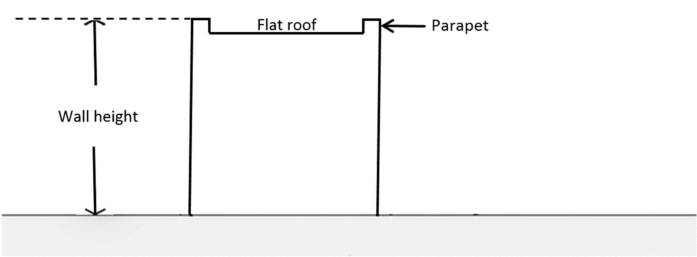
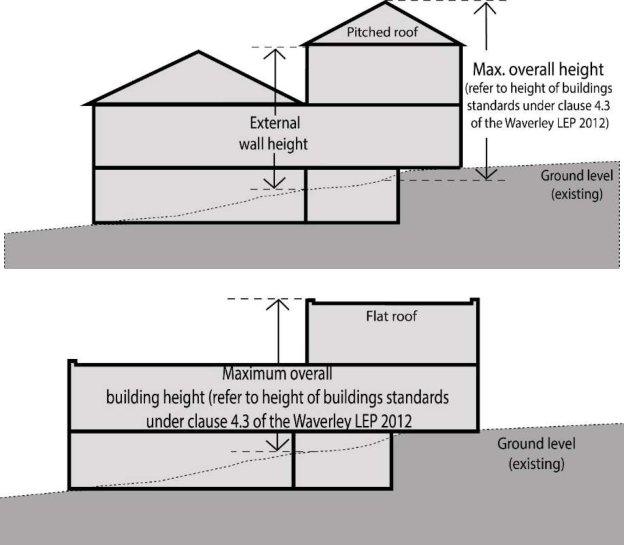

### 1.1 HEIGHT

The WLEP outlines the maximum permissible building height of a site. Achieving the maximum building height may not be appropriate in all cases and should not be considered as prescribed or allowable regardless of circumstance. Amenity or streetscape impacts may require a lower height or additional setbacks. Nothing in this part restricts Council’s ability to require the height of a building to be less than the maximum height as specified in the LEP.

#### Objectives

(a) To provide appropriate building heights for flat or pitched roof forms for lower density residential accommodation.

(b) To ensure the height and scale of development relates to the topography and street character.

(c) To ensure the height and scale of development does not unreasonably impact on views enjoyed by neighbouring and nearby properties.

(d) To ensure that the height and scale of development does not result in unreasonable overshadowing of neighbouring and nearby properties.

(e) To minimise loss of views from, and overshadowing of, public places.

(f) To ensure development in excavation areas does not add to the overall visual bulk of the dwelling.

#### Controls

(a) For a building with a pitched roof the maximum wall height is 7m above existing ground level (refer to Figures 4 and 5), except as determined in Control

(b) below.

(b) For a building with a flat roof, the maximum wall height is 7.5m above existing ground level.

(c) Where it is permissible for buildings to be built to a height greater than 9.5m under WLEP, the wall height will be determined by a merit assessment of the design of the building and its relationship to adjoining dwellings.

(d) Buildings on steep sites are to be stepped down to avoid high columns, elevated platforms and large under croft areas.

> [Picture on page 6: a picture, saved as a picture (images/part-c-residential-development-page-6-1.gif, 150 dpi).]
> Words printed on the picture (title and legend, copied from the PDF):
> Pitched roof

> [Picture on page 6: a picture, saved as a picture (images/part-c-residential-development-page-6-2.gif, 150 dpi).]

Figure 4 How to measure wall height for dwellings with pitched and flat roofs

> [Picture on page 6: a picture, saved as a picture (images/part-c-residential-development-page-6-4.gif, 150 dpi).]

Figure 5 How to calculate height on sloping land
