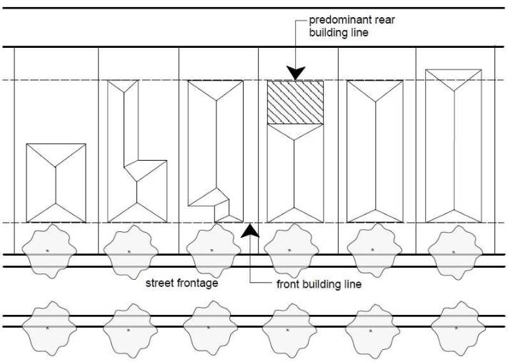
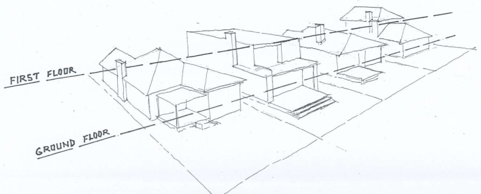

#### 1.2.1 Front and rear building lines

(a) New buildings and extensions to existing buildings are to extend no further than the front and rear predominant building lines (refer to Figures 6 and 7). The predominant building line can be considered to be the three adjacent neighbours on either side.

(b) The predominant rear building line is determined separately for each floor level. Notwithstanding (a) above, development at first floor level and above shall be set back from the rear building line of the ground floor level in order to minimise bulk and scale impacts and provide visual relief for the open space and living areas at adjacent properties (refer to Figure 6).

(c) The siting of dwellings on corner lots should take reference from the setbacks of dwellings on adjacent sites.

(d) Where it is proposed to build beyond the predominant front and/or rear building line at any level, or where there is no predominant front and/or rear building line, or where it is not possible to setback from the rear building line at first floor level, then greater consideration must be given to the following;

(i) Compliance with applicable development standards, including Floor Space Ratio and Building Height;

(ii) Compliance with the landscaped and open space controls;

(iii) Compliance with side setback controls;

(iv) Emergence of a new front and/or rear building alignment beyond the dwellings either side of the subject site (note that any reliance on an emerging front and/or rear building alignment as a precedent can only be justified where the emerging alignment is itself based on compliant development with respect to building height, FSR and side setback controls);

(v) Location and retention of existing significant vegetation;

(vi) Visual aspect of the bulk and scale as viewed from the private open space and living areas of adjoining properties;

(vii) Acceptability of amenity impacts on adjacent properties with regard to solar access, and visual and acoustic privacy;

(viii) Views available from the subject site and adjoining properties including an assessment against the Land and Environment Court Views Planning Principle in Tenacity Consulting v Warringah Council [2004] NSWLEC 140 at 25-29;

(ix) In areas of heritage significance, the importance of preserving the front portion of the building by providing an additional setback from the front building line.

> [Picture on page 8: a picture, saved as a picture (images/part-c-residential-development-page-8-12.gif, 150 dpi).]

Figure 6 Example of front and rear predominant building lines on regular shaped lots

> [Picture on page 8: a picture, saved as a picture (images/part-c-residential-development-page-8-14.gif, 150 dpi).]

Figure 7 Example of ground and first floor level predominant rear building lines
