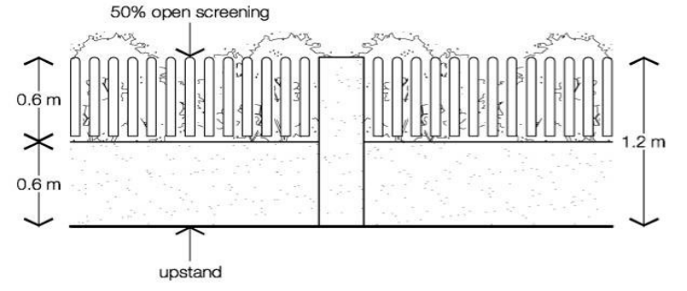
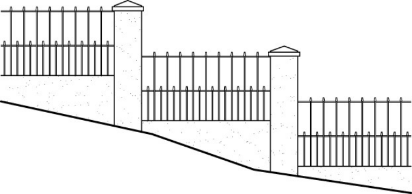
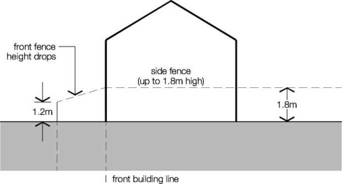

### 1.4 FENCES

#### Objectives

(a) To ensure that fences relate to the period and architectural style of buildings on the site and in the vicinity.

(b) To avoid adverse visual impacts from the creation of high blank walls to the street.

(c) To promote a streetscape where the ground floor front facades of dwellings are visible from the street.

(d) To ensure front fences and entrance porticos do not dominate the streetscape, and that they are cohesive with the character of the streetscape.

(e) To ensure that side and rear fences are not excessive in height, resulting in adverse impacts on adjoining properties.

(f) To ensure boundary treatments of properties adjoining parks are consistent with the materials palette in the relevant Plan of Management to maintain the amenity of parks.

#### Controls

(a) The design of front fences is to take reference from, and complement, the architectural style of the dwelling on the site and dwellings on adjacent sites in terms of style, height and materials.

(b) Front fences should generally not exceed 1.2m in height. Any solid upstand section should be limited to 600mm in height. The top half of the fence should be an open design with a minimum open area of 50%, for visibility to and from the site (refer to Figure 8). Components such as arched gates, piers and the like may exceed the predominant 1.2m height.

(c) On sloping sites, the height limit is averaged so that the fence steps down the slope (refer to Figure 9).

(d) Side and rear boundary fences are not to exceed 1.8m above the existing ground level of adjoining properties and are to taper down from the front building line to match the height of the front fence at the front boundary (refer to Figure 10).

(e) Council may permit front fences up to a height of 1.8m and/or of solid material provided it can be shown that the fence acts as an effective noise barrier as a result of adjoining a street with high traffic volume. Such fences are to be setback from the boundary to allow landscaping to soften the bulk or the structure is to be articulated as an alternative to a solid blank wall.

(f) Where there is dual street frontage, consideration may be given for the allowance of a higher side fence to ensure privacy.

(g) All boundary treatments for properties adjoining public parks are consistent with materials palette from the relevant Plan of Management.

(h) New brickwork increasing the height of brick fences should match the existing wall.

(i) Decoration and/or architectural relief shall be provided to masonry fences, avoiding expansive blank walls facing the street.

(j) No part of a fence, including its footings, is to encroach on the street alignment or adjoining properties.

(k) Gates are not to open into the street alignment or adjoining public parks.

(l) All fence controls are subject to the provision of adequate sight lines for emerging vehicles to enable surveillance of pedestrians using the footpath in front of a dwelling.

(m) A setback is to be provided for pedestrian entry gates.

> [Picture on page 12: a picture, saved as a picture (images/part-c-residential-development-page-12-5.gif, 150 dpi).]

Figure 8 Example of front fence with maximum solid up stand of 600mm and open design top

section

> [Picture on page 12: a picture, saved as a picture (images/part-c-residential-development-page-12-8.gif, 150 dpi).]

Figure 9 Fence height limit is averaged on sloping sites

> [Picture on page 12: a picture, saved as a picture (images/part-c-residential-development-page-12-10.gif, 150 dpi).]

Figure 10 Side fences should taper down from the front building line.
