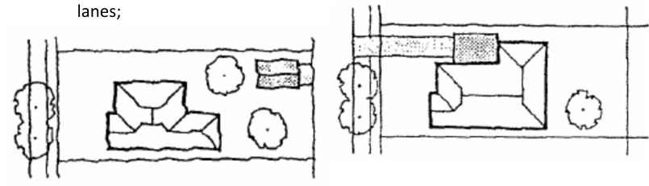
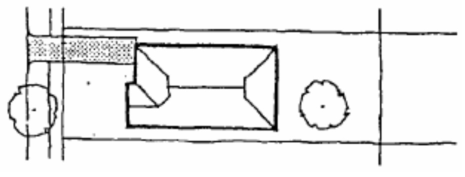

#### 1.8.3 Location

(a) For new dwellings all on-site car parking is to be located behind the front building line.

(b) For existing development, car spaces should be sited having regard to the following hierarchy (refer to Figure 11):

(ii) Hardstand, carport or garage located at the side of the dwelling behind the building alignment; or

(i) Hardstand, carport or garage located at the rear of the site with access from secondary streets or

> [Picture on page 18: a picture, saved as a picture (images/part-c-residential-development-page-18-27.gif, 150 dpi).]
> Words printed on the picture (title and legend, copied from the PDF):
> lanes;

(iii) Hardstand car space forward of the front building line.

> [Picture on page 18: a picture, saved as a picture (images/part-c-residential-development-page-18-29.gif, 150 dpi).]

Figure 11 Hierarchy of preferred car parking locations

(c) Garages on rear lanes must not create conflict with parking in the lane and result in the loss of laneway parking for any property other than the subject site.

(d) A hardstand (in the form of wheel strips) or carport forward of the building line may be permitted where:

(i) There is no rear access;

(ii) The site is of sufficient width where the car space will not dominate the existing building (i.e. does not exceed 45% of the width of the site frontage);

(iii) It is no greater than a single car space;

(iv) The distance between the building and the front property boundary is a minimum of 5.4m so as to provide sufficient space for a standard car;

(v) Public views would not be adversely affected;

(vi) There is a predominance of this form of off street car parking in the immediate vicinity of the site;

(vii) It is designed so that it does not detract from the heritage significance of the building or area;

(viii) There is limited availability to public transport;

(ix) The safety of vehicles, pedestrians and cyclists is maintained; and

(x) There is adequate bin storage space other than on the hardstand.

(e) Where an allotment is subdivided to create a "battleaxe" shaped allotment, the access "handle" is to have a minimum width of 3.5m.

(f) On-site car parking (other than from rear lanes) is not acceptable in heritage conservation areas where it will:

(i) Break a consistent building line;

(ii) Introduce uncharacteristic elements within an established streetscape; and/or

(iii) Adversely impact on the integrity of the listed or contributory building or setting.
