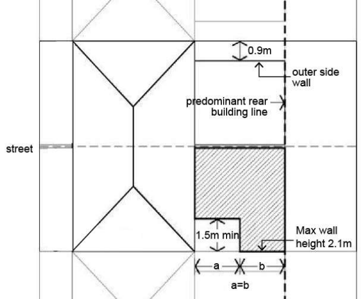

#### 1.13.4 Side setback and courtyard design controls for terraces

(a) The common (or party) wall between a pair of terraces can be built with no side setback along the common boundary where it abuts an existing wall to the neighbouring property or where it can be reasonably expected that a wall to the neighbouring property would be constructed in the future.

(b) The outer side wall of the building (i.e. the wall that is not a shared wall or party wall), should be set back a minimum of 900mm from the outer side boundary (refer to Figure 12).

(c) Part of the outer side wall may be built to the outer side boundary to create an internal courtyard. The wall on this boundary should generally be a maximum of 2.1m in height. Refer to Figure 12.

(d) Internal courtyards must have a minimum 1.5m dimension depth and should be the same width as the outrigger projection (Figure 12)

(e) No openings are permitted for walls built to the side boundary.

(f) The extension should not encroach beyond the predominant rear building line (refer to Figure 12).

> [Picture on page 28: a picture, saved as a picture (images/part-c-residential-development-page-28-1.gif, 150 dpi).]

Figure 12 Example of rear extension to terrace.
