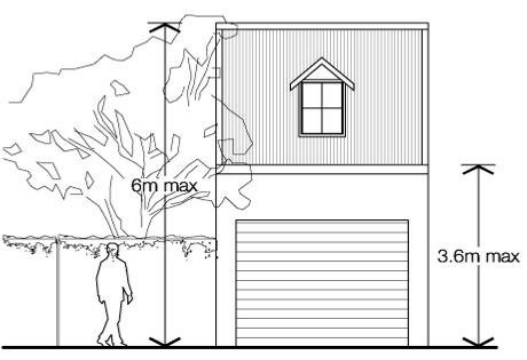
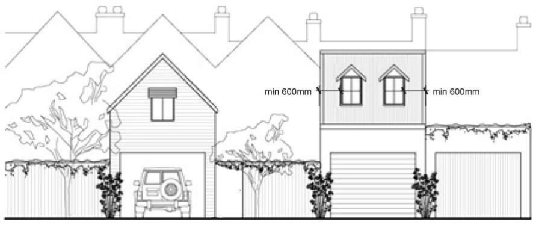
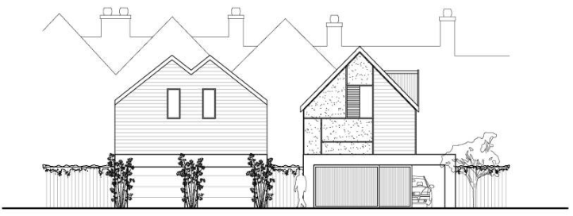

#### 1.14.3 Development in Heritage Conservation Areas Garage Articulation

(a) Garage doors are to be limited to single vehicle widths, with central divide to double vehicle garages (refer to Figure 14).

(b) Roof forms are to reflect those of the Conservation Area in pitch and modulation.

(c) Garage/studio finishes are to reflect the finishes and proportions of traditional construction in the Conservation Area.

(d) Proportions of openings to studios are to maintain the proportions and voids to solid ratios of traditional construction in the Conservation Area.

(e) Windows to above garage studios are to be designed to minimise overlooking of surrounding properties both adjacent to the site and on opposing sides of laneways. Outlook is to be directed into the associated property or into the rear lane.

(f) Treatment of windows and glazed openings to studios is to incorporate privacy screening to or from neighbouring sites including but not limited to obscure glazing, window hoods, awnings and recessed window planes.

(g) Garage studio structures are to be visibly separate from the associated residence. Yard areas and private open space areas are not to be roofed.

(h) The massing and roof line of garage/studio structures are to align with garage/studios on neighbouring sites. Box gutters on side boundaries are to be avoided.  Solar collection panels are to be located to inner roof slopes facing the associated residence or to roof slopes facing side boundaries.

> [Picture on page 31: a picture, saved as a picture (images/part-c-residential-development-page-31-18.gif, 150 dpi).]

Figure 13 Maximum overall and external wall height for laneway development

> [Picture on page 31: a picture, saved as a picture (images/part-c-residential-development-page-31-20.gif, 150 dpi).]

Figure 14 Example of acceptable designs for laneway development

> [Picture on page 32: a picture, saved as a picture (images/part-c-residential-development-page-32-1.gif, 150 dpi).]

Figure 15 Laneway development should not be visible from the primary street frontage
