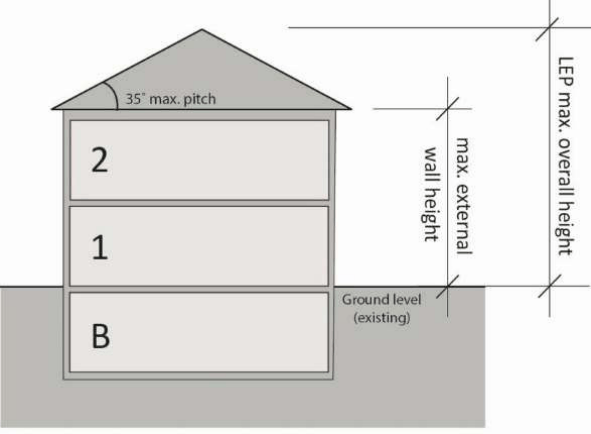
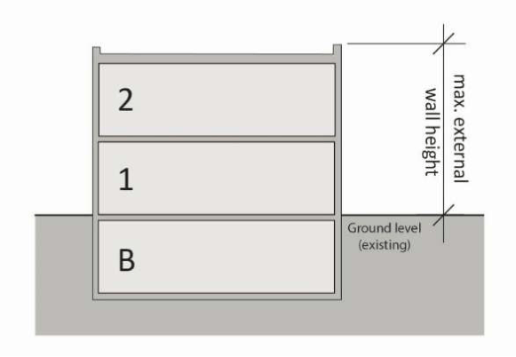
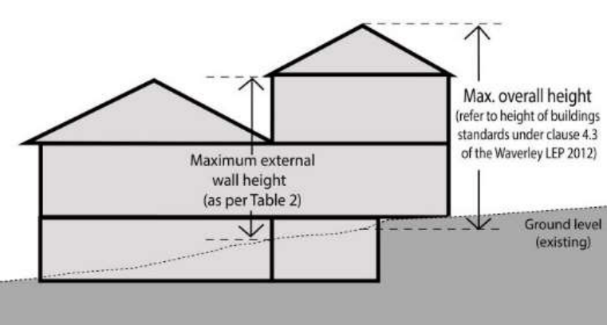
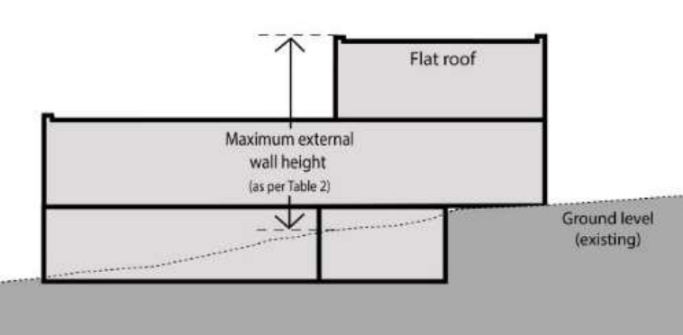

### 2.2 HEIGHT

#### Objectives

(a) To ensure future development responds to the desired scale and character of the street and local area.

(b) To minimise the impact of attics and basement car parks on the overall building height.

(c) To provide good residential amenity for dwellings.

#### Controls

(a) The maximum building height is as set by Clause 4.3 of the WLEP and the Height of Buildings Map.

(b) Development must comply with the maximum external wall height (refer to Figures 16 - 18), as set in Table 2 below:

| Zoning | WLEP Height | Max external wall height |
|---|---|---|
| R3 | 9.5m | 7m |
| R3 | 12.5m | 9.5m |
| R4 | 20m | 17m |
| R4 | 28m | 25m |

Table 2 Height requirements

(c) Council may consider a varied wall height where the following matters are addressed:

(i) Compliance with Floor Space Ratio development standard;

(ii) Compliance with Height development standard;

(iii) Compliance with side setback controls;

(iv) Visual aspect of the bulk and scale, as viewed from the private open space and living areas of adjoining properties;

(v) Amenity of adjacent properties with regard to sunlight, visual and acoustic privacy and views; and

(vi) A high design quality is achieved.

> [Picture on page 40: a picture, saved as a picture (images/part-c-residential-development-page-40-1.gif, 150 dpi).]

Figure 16 How to measure height for a pitched roof building

> [Picture on page 40: a picture, saved as a picture (images/part-c-residential-development-page-40-3.gif, 150 dpi).]

Figure 17 How to measure height for a flat roof building

> [Picture on page 41: a picture, saved as a picture (images/part-c-residential-development-page-41-1.gif, 150 dpi).]

> [Picture on page 41: a picture, saved as a picture (images/part-c-residential-development-page-41-2.gif, 150 dpi).]

Figure 18 How to measure height on sloping land
