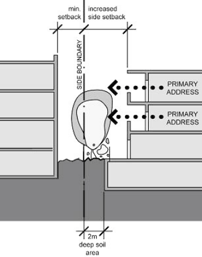

#### 2.3.2 Side and Rear Setbacks Objectives

(a) To provide for visual relief and reduce perceived bulk between buildings

(b) To provide for visual and acoustic privacy, solar access, air circulation and maintaining views between buildings.

(c) To retain and reinforce existing mature vegetation to maximise natural site drainage, protect the water table, and provide screen planting.

(d) To provide sufficient space for new mature landscaping that positively contributes to the landscape of the site, and its presence in the streetscape.

#### Controls

(a) New buildings and extensions to existing buildings are to provide a minimum 6m rear setback, or extend no further to the rear than the predominant rear building line, whichever is the greater setback. The predominant rear setback is determined separately for each level.

(b) Side setbacks are to be consistent with Table 3. Reduced setbacks may be permitted where reduced setbacks are more in keeping with the character of the

area. A Context Analysis (see Part B11.2) is to be provided to support a merit based assessment for a more appropriate setback.

| Height | Side setback to whole building (min.) |
|---|---|
| Height up to 4.5m | 0.9m |
| Height up to 12.5m | 1.5m |
| Height above 12.5m | 1.5 – 2.5m |

Table 3 Minimum side setbacks

(c) Council may require additional setbacks to ensure adequate solar access to adjacent buildings and privacy or to minimise view loss (refer to Figure 19). In particular, additional setbacks will be required for the following:

(i) East-west orientated lots

(ii) Where there is a predominant rear building alignment

(iii) Steep topography

(iv) Retention and protection of significant trees

(d) A landscaped deep soil area of 2m must be provided along one side boundary at

> [Picture on page 43: a picture, saved as a picture (images/part-c-residential-development-page-43-13.gif, 150 dpi).]

a minimum.

Figure 19 Side setbacks
