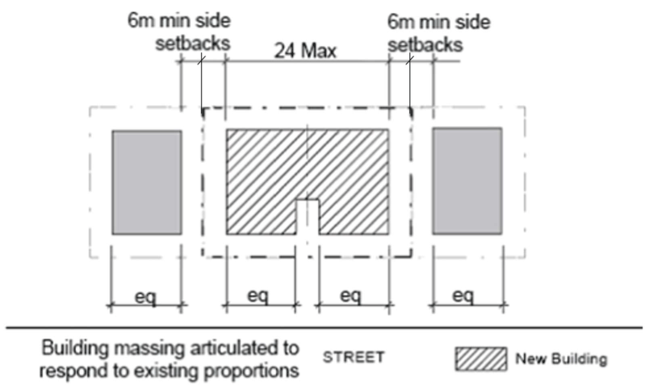

### 2.4 LENGTH AND DEPTH OF BUILDINGS

#### ADG Development: refer to Part 3F of the ADG.

#### Objectives

(a) To ensure development responds to the existing subdivision pattern and the scale of surrounding buildings.

(b) To continue the pattern of sightlines through to the rear of blocks between buildings along the street.

(c) To have a high standard of amenity for occupants of dwellings.

#### Controls

(a) The maximum length of a building along a street is 24m (refer to Figure 20).

(b) Within the maximum length, buildings must be articulated to respond to the established pattern of existing building length along the street.

(c) The maximum depth of any residential flat building is to be 18m.

> [Picture on page 44: a picture, saved as a picture (images/part-c-residential-development-page-44-14.gif, 150 dpi).]

Figure 20 Building length controls
