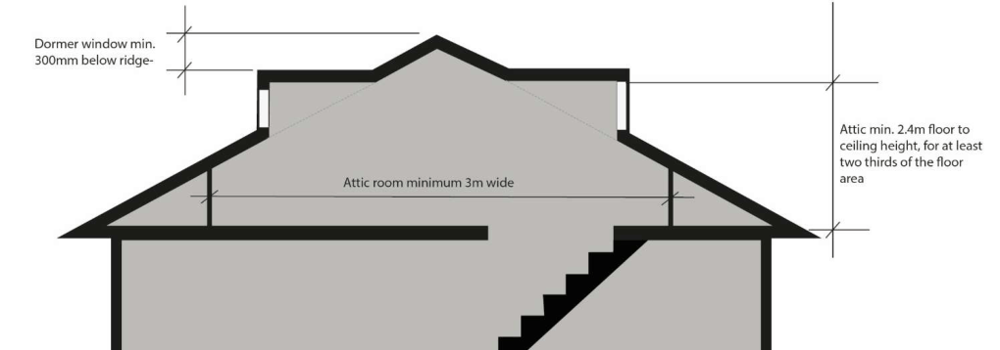

### 2.6 ATTIC AND ROOF DESIGN

Definition: Attic means any habitable space, but not a separate dwelling, contained wholly within a roof above the ceiling line of the storey immediately below, except for minor elements such as dormer windows and the like.

#### Objectives

(a) To ensure attic rooms achieve good residential amenity and environmental performance.

(b) To minimise the impact of attic rooms on the amenity of adjoining properties.

(c) To allow a variety of roof forms in response to the scale and character of the building and streetscape.

#### Controls

(a) Roof design should contribute to the architectural design and the environmental performance of the development.

(b) Roof design should respond to the streetscape character of the area.

(c) Alteration and additions must consider existing streetscape and the impact on neighbouring views.

(d) Contemporary roof forms are permitted to minimise bulk and scale, and respond appropriately to the context.

(e) An attic must be wholly contained within a pitched roof form; that is a hipped or gabled roof, but not a flat or skillion roof (with the exception of dormer windows).

(f) An attic must not increase the bulk and height of the roof.

(g) Attic levels must:

(i) Ensure the pitched roof form is the major visual element of the roof and must respond to the context;

(ii) Not exceed 50% of the floor area of the floor below;

(iii) Not contain independent dwellings and must be accessed via internal stairs only; and

(iv) Be naturally ventilated using cross or stack ventilation.

(h) Attic rooms must have a minimum width of 3m and must have a minimum floor to ceiling height of 2.4m, for at least two thirds of the floor area of the room (refer to Figure 21).

(i) Dormer windows and skylights are to be less than 50% of the area of the roof elevation.

(j) Attic additions must not contain a single expansive dormer window. Multiple smaller dormers are preferred where appropriate.

(k) Where dormer structures are proposed they must:

(i) Be secondary to the primary roof structure; and

(ii) Be set down a minimum of 300mm from the main ridge line.

> [Picture on page 47: a picture, saved as a picture (images/part-c-residential-development-page-47-1.gif, 150 dpi).]

Figure 21 Pitched roof minimum attic dimensions
