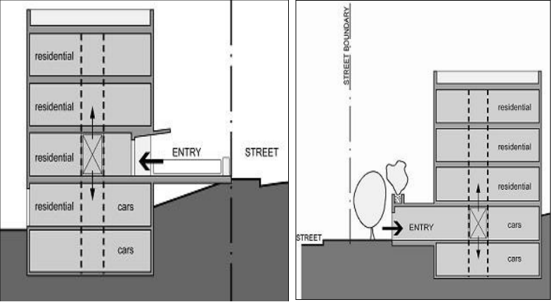

### 2.8 PEDESTRIAN ACCESS AND ENTRY

#### Objectives

(a) To ensure developments provide high quality, accessible and safe pedestrian access to all people who live in and visit the development.

(b) To create entrances which provide a desirable residential identity for the development to orientate visitor(s).

(c) To contribute positively to the streetscape and building façade design.

(d) To promote development that has a strong connection to the street and contributes to the accessibility of the public domain.

#### Controls

(a) Provide main building entries at street level which respond to patterns in the streetscape. Refer to Figure 22.

(b) Provide an accessible path of travel from the street to and through the front door of all dwellings on the ground floor.

(c) To increase accessibility, applicants should consider providing lifts in buildings of more than two habitable levels.

(d) Separate and clearly distinguish between pedestrian access ways and vehicle access ways/building service areas (e.g. garbage rooms).

(e) Locate entries so that they relate to the existing street and subdivision pattern, street tree planting and pedestrian footpath.

(f) Provide main building entries that are legible, safe and well lit.

(g) Provide as direct a physical connection as possible between the street and the building entry.

(h) Where appropriate, provide individual ground floor dwelling entries that address the street.

> [Picture on page 49: a picture, saved as a picture (images/part-c-residential-development-page-49-26.gif, 150 dpi).]

Figure 22 Entry level at low and high side of the street
