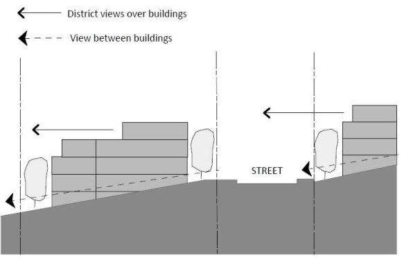
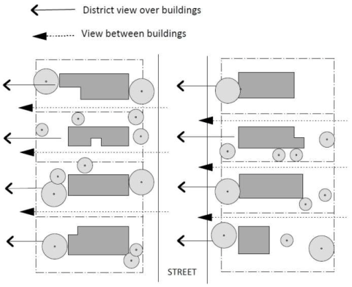

### 2.14 VIEWS AND VIEW SHARING

Many properties in Waverley enjoy views of local and district areas and landmarks, including Sydney Harbour, the coastline, ocean and open space. Views are often available from public places and private properties situated a considerable distance from proposed development.

A distant view does not in itself ‘belong’ to anyone or any property, nor is a view the exclusive right to any one property or to certain individuals. Nonetheless views and vistas are a desirable aspect of amenity and can contribute significantly to the enjoyment of the owners and occupiers of a property and also the general public.

It is difficult to quantify the significance and importance of a view and it can be a highly subjective matter. For this reason, this Part should be read in conjunction with the NSW Land and Environment Court Planning Principle based on Tenacity Consulting v Warringah Council [2004] NSWLEC 140 at 25-29.

#### Objectives

(a) To ensure that views are shared, providing equitable access to views from dwellings.

(b) To protect and enhance views from streets and other public spaces.

(c) To ensure that the desire for view does not conflict with privacy.

#### Controls

(a) New development should be designed to minimise view loss to adjoining and adjacent properties while still providing opportunities for views from the development itself (refer to Figures 23 and 24).

(b) Provide articulation, and minimise the bulk and scale of roof forms on the low side of streets allowing views to the landscape beyond.

(c) Design the landscape to allow for views between buildings, particularly on the low side of streets.

(d) Where the property is adjacent to a Council park or reserve, private landscaping should be sympathetic to and complement the public domain landscaping in order to soften the public-private interface.

(e) Existing significant public views and vistas available from the public domain, including but not limited to ocean, city and parks views are to be maintained where possible by the design of buildings.

(f) In some instances a detailed view loss analysis may be required by Council. Refer to the Waverley Development Application Guide for more information.

(g) Measures to be used to facilitate view sharing include buildings setbacks, gaps between buildings, floor heights, roof forms and use of open materials and balustrades on balconies and decks.

> [Picture on page 57: a picture, saved as a picture (images/part-c-residential-development-page-57-1.gif, 150 dpi).]

Figure 23 Views over buildings

> [Picture on page 57: a picture, saved as a picture (images/part-c-residential-development-page-57-3.gif, 150 dpi).]

Figure 24 Views between buildings
