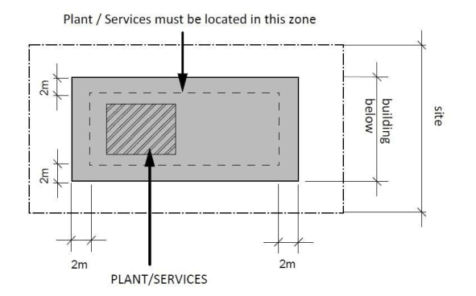

### 2.21 BUILDING SERVICES

#### Objective

(a) To provide and integrate site services and facilities in a sensitive manner such that they relate to the building and landscape design, enable easy access, and require minimal maintenance.

(b) To minimise visual impact by encouraging building services to be located in the basement of buildings, where practicable.

(c) To ensure that adequate space and facilities are provided to allow the natural drying of clothes and the provision of compost facilities.

#### Controls

(a) Ensure that building services are integrated into the design of buildings. Building service elements include garbage rooms, mailboxes, fire hydrant boosters, electrical substations, downpipes, and plant rooms and satellite/communications structures.

(b) The maximum volume permitted for a plant room is the minimum required to meet Australian Standards, accommodate typical dimensions of equipment required and the associated circulation space to access the equipment for maintenance. Plant rooms should be located in underground areas where possible. DA plans should show the approximate location and size of equipment within the plant room.

(c) Provide mailboxes adjacent to the main entrance and integrated into a wall of the building where possible, ensuring that they are secure and can accommodate large articles such as newspapers.

(d) Coordinate and integrate building services within the overall façade and roof design.

(e) Provide adequate space and facilities for outdoor communal clothes drying.

(f) Locate any ancillary structures such as plant rooms and satellite dishes away from the building entry, communal and private open spaces, and bedrooms.

(g) Where located on podium or roof levels, building service elements must not be visible from the street or impact on public or private views. As a guide, a minimum of 2m is to be provided from the building wall. (Refer to Figure 25).

> [Picture on page 65: a picture, saved as a picture (images/part-c-residential-development-page-65-32.gif, 150 dpi).]

Figure 25 Plant and services zone
