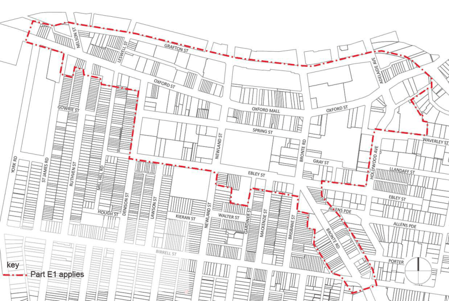

#### E1 BONDI JUNCTION

### 1.1 INTRODUCTION

This Part applies to land as identified in Figure 1. This Part must be read in conjunction with the Public Domain Technical Manual – Bondi Junction Centre, and the WDCP. Where there is an inconsistency between Part E and another Part of this DCP, Part E prevails to the extent of the inconsistency.

All development is to comply with Part B11 Design Excellence.

Note: Character Area B – Oxford Street Mall also includes 4A Brone Road, Bondi Junction for the purposes of Part D 1.3 Hours of Operation in this DCP.

> [Picture on page 3: a picture, saved as a picture (images/part-e-site-specific-development-page-3-10.gif, 150 dpi).]

Figure 1 Bondi Junction Centre
