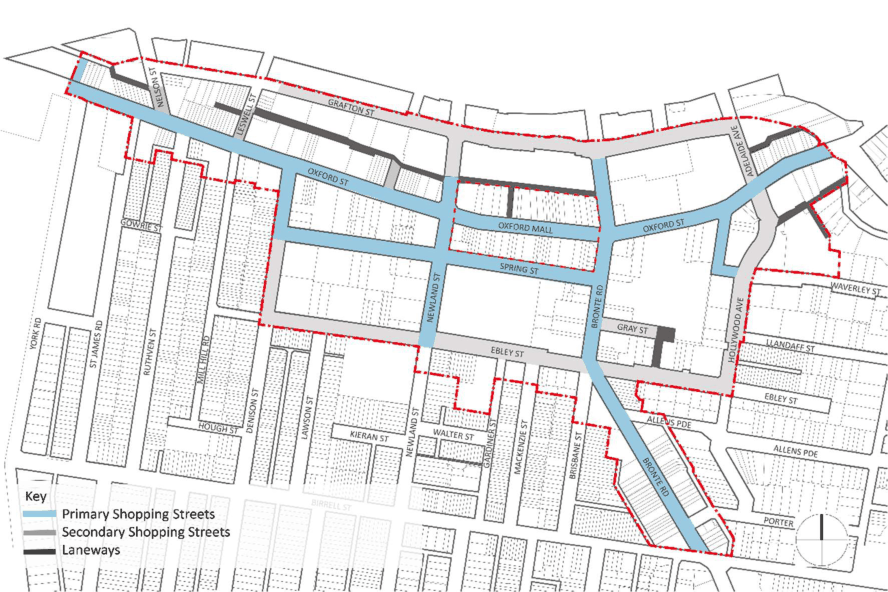

### 1.3 BUILDING USE

#### Objectives

(a) To promote street level activity.

(b) To reinforce the primary role of Bondi Junction as a Commercial Centre through high quality commercial development.

(c) To retain lower levels of buildings for commercial and retail uses.

(d) To increase the diversity and range of shopping and recreational opportunities for people who live, work and visit the Centre.

(e) To enhance community safety by increasing activity in the public domain on week nights and on weekends.

(f) To encourage a variety of uses.

(g) To minimise conflicts between commercial and residential uses.

#### Controls

(a) Comply with Figure 2 for Shopping Street Hierarchy locations.

Primary shopping streets

(b) The Ground Floor of buildings along primary shopping streets must be designed and used for retail purposes.

(c) The First Floor of buildings along primary shopping streets must be designed and used for commercial purposes but not limited to retail.

Secondary shopping streets

(d) The Ground Floor of buildings located on secondary shopping streets must be designed and used for commercial purposes. Retail uses are preferred

(e) The First Floor of buildings located on secondary shopping streets must be designed and used for commercial purposes.

Laneways

(f) Retail and commercial frontages are encouraged along laneways where possible.

(g) Laneway uses are not to interfere with services and vehicle access.

Arcades, squares and through site links

(h) The Ground Floor must be designed and used for retail purposes.

(i) The First Floor must be designed and used for commercial purposes.

> [Picture on page 6: a picture, saved as a picture (images/part-e-site-specific-development-page-6-1.gif, 150 dpi).]

Figure 2  Street Hierarchy
