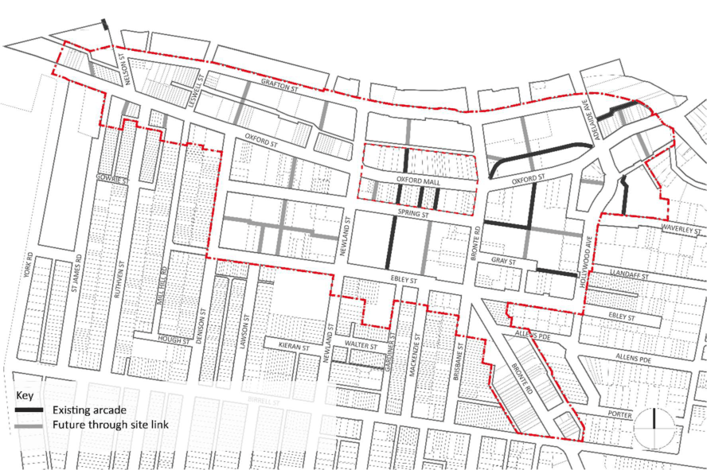
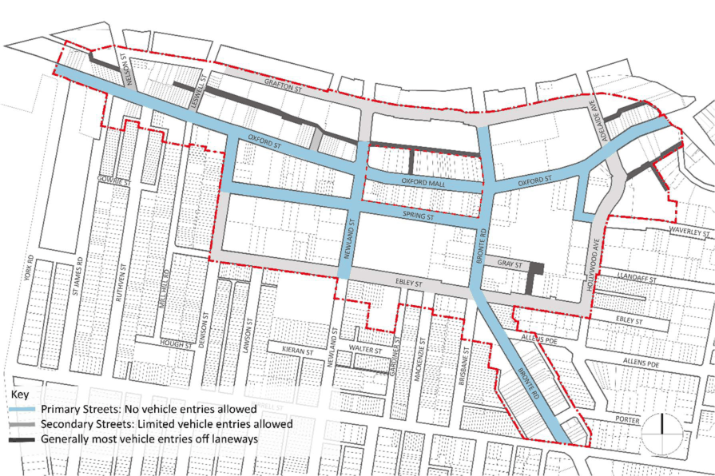

### 1.4 ACCESS AND MOVEMENT

#### 1.4.1 Arcades, Through Site Links and Squares Objectives

(a) To develop a comprehensive, compact, easy to follow, safe and accessible pedestrian network.

(b) To create pedestrian links through large developments to provide a fine grain pedestrian network.

(c) To ensure that private development does not diminish the public nature of streets and laneways at ground.

(d) To ensure that arcades are safe.

(e) To expand and enhance the public domain and promote pedestrian activity throughout the centre.

(f) To increase active street frontages and retail uses throughout the centre.

#### Controls

(a) Arcades, through site links and squares are to comply with the provisions of Part

B15 Public Domain.

(b) Retain and provide arcades and through site links as shown in Figure 3.

(c) New arcades and through site links in addition to those shown in Figure 3 are encouraged.

> [Picture on page 7: a picture, saved as a picture (images/part-e-site-specific-development-page-7-20.gif, 150 dpi).]

Figure 3 Preferred through site links, arcades and squares

#### 1.4.2 Vehicular and Service Access to Lots Objectives

(a) To locate and design vehicle and service entries to promote active frontages, pedestrian safety and undisturbed pedestrian movement.

(b) To ensure that car parking is not visible from the street.

(c) To ensure that the building facade and active frontages are the dominant streetscape element on all streets.

(d) To limit the number of car park entry points to a development.

(e) To minimise the size and quantity of vehicle and service crossings.

#### Controls

(a) Comply with Figure 4 for locations for vehicular and service access.

(b) Car park entries and exits must not occur along primary shopping streets.

(c) All car park entries onto streets and laneways are to be enclosed by entry gates, roller doors or the like located in alignment with the street boundary.

> [Picture on page 8: a picture, saved as a picture (images/part-e-site-specific-development-page-8-15.gif, 150 dpi).]

Figure 4 Vehicular and service access

#### 1.4.3 Pedestrian Overpasses and Underpasses Objectives

(a) To protect and enliven streets by ensuring people circulate at street level.

(b) To protect street level as the primary retail and commercial space of the centre.

(c) To protect view corridors along streets.

(d) To avoid overshadowing on streets.

#### Controls

(a) Underpasses under public streets and laneways are not permitted unless linking directly into the public transport interchange.

(b) Overpasses over public streets and laneways are not permitted.

#### 1.4.4 On-Site Parking Objectives

(a) To avoid compromising street character, building quality, pedestrian amenity and safety through car parking.

(b) To provide adequate space for parking and maneuvering of vehicles (including service vehicles and bicycles).

(c) To recognise the complementary use and benefit of public transport and non-motorised modes of transport such as cycling and walking.

#### Controls

(a) Car parks, car parking structures, vehicular maneuvering areas, private parking bays, loading docks and the like are generally to be located underground. Where this cannot be achieved due to topographic constraints, a maximum protrusion of 1.2m is permissible.
