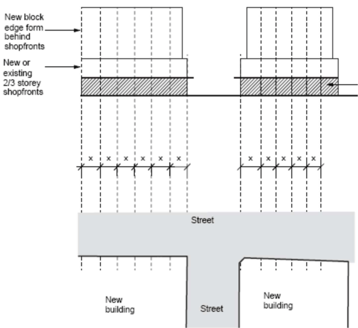
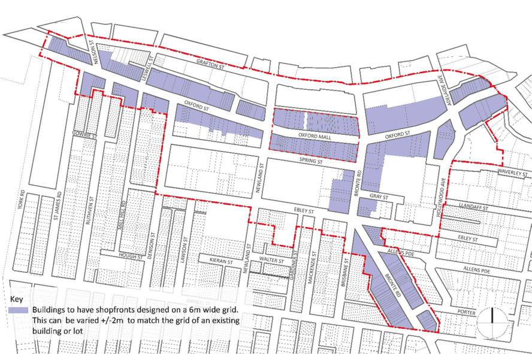

### 1.5 SUBDIVISION

#### Objectives

(a) To reinforce the expression of small lot subdivision pattern in building form.

(b) To enrich the character and diversity within the centre.

(c) To define the public and private domains, maintain street hierarchy, and connection.

(d) To encourage a human scale in building design.

(e) To encourage a diversity of shop fronts along streets.

(f) To encourage the highest and best use of land along shopping streets.

#### Controls

(a) Development is to comply with Part B12 Subdivision.

(b) Development is to retain the small lot subdivision pattern that reflects the original shop fronts along streets in the Bondi Junction Centre.

(c) Where this cannot occur due to amalgamation, the design of building elevations is to interpret the small lot subdivision pattern along the street front on lots (refer to Figure 5).

(d) The design of building elevations on lots is to generally use a 6m grid. This 6m grid can be varied by +/- 2m in order to match an existing grid of an existing building or lot.

(e) Comply with Figure 6 for small lot subdivision locations.

> [Picture on page 10: a picture, saved as a picture (images/part-e-site-specific-development-page-10-21.gif, 150 dpi).]

Figure 5 Interpretation of the patterns of small lot fronts

> [Picture on page 11: a picture, saved as a picture (images/part-e-site-specific-development-page-11-1.gif, 150 dpi).]

Figure 6 Building frontages to express the small lot subdivision pattern
