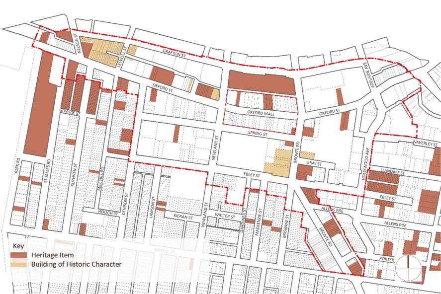
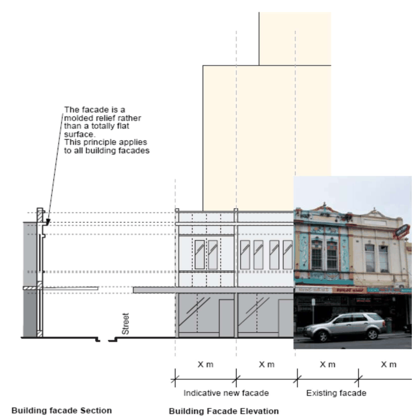
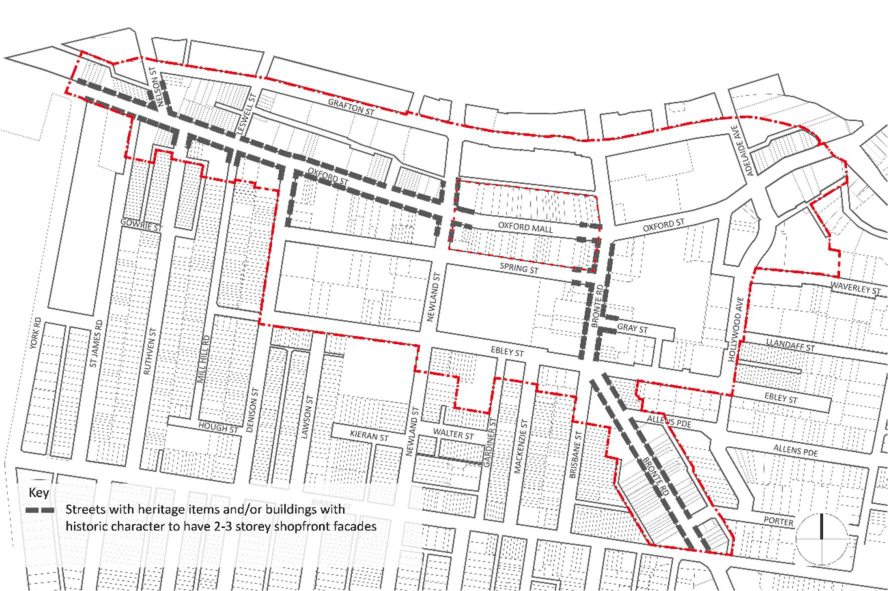

### 1.6 HERITAGE AND BUILDINGS OF HISTORIC CHARACTER

#### Objectives

(a) To ensure buildings of historic character, and original shop fronts, are retained or reinterpreted.

(b) To retain the streetscape setting of sites and buildings of historic, architectural and aesthetic significance.

(c) To recognise the opportunities for heritage sites and contributory buildings to inform streetscape character.

(d) To ensure developments in or adjacent to conservation areas retain and enhance the conservation values of that area.

#### 1.6.1 Buildings of historic character Controls

(a) Lots identified with buildings of historic character are to retain as a minimum the facade (for a depth of 2m) of the building or preferably the whole building (refer to Figure 7).

(b) Where a facade cannot be retained the new buildings are to interpret the scale, facade modelling including the location and percentage of glass to solid wall and the vertical and horizontal proportions of the existing building.

(c) Where the building form, detailing or use of individual buildings of historic character have been inappropriately altered and changed, any application to upgrade or re-use the buildings must clearly demonstrate that the architectural and streetscape value of the building will be enhanced by the proposal.

(d) Any application to demolish an identified building of historic character must clearly demonstrate that a replacement building will possess equal or higher quality contributory value regarding streetscape, character, architectural design and material quality.

(e) New development adjacent to buildings of historic character must have facades sympathetic in vertical and horizontal proportions and alignments.

(f) New buildings adjacent to buildings of historic character or heritage items should display proportions respectful of and build upon proportions similar to adjoining streetscape and forms.

(g) New buildings adjacent to buildings of historic character or heritage items should draw on the predominant pattern of the streetscape. They are to be open & glazed at street level, have emphasis toward a singular enclosed building form at upper levels and be capped by a lighter more articulated element.

> [Picture on page 13: a picture, saved as a picture (images/part-e-site-specific-development-page-13-1.gif, 150 dpi).]

Figure 7 Buildings of historic character

Facades

(h) Original facade elements above awning level such as windows, parapets, balconies and ornamental detailing should be retained where possible.

(i) Consistency should be achieved through; parapet height, string course both at parapet level, window proportions (sill and lintel height), awning height, fenestration and balcony elements, facade depth and modelling (refer to Figure 8).

Height

(j) Match the streetscape proportions and scale of the heritage or contributory building facade.

(k) The height of the building at the facade shall take into consideration existing parapets and other facade details of established surrounding development.

(l) The height of awnings of heritage or contributory building should correspond to the surrounding area.

Materials

(m) Ensure there is a positive integration of contemporary prefabricated building materials. Using materials similar to or compatible with the existing context (generally rendered or painted masonry).

Windows

(n) When restoring a facade that has been subject to substantial alterations over time, look to similar examples in the street to determine correct window proportion, style and materials.

(o) Ensure the window area is proportionate to the wall mass.

(p) Prefabricated aluminium windows will not be appropriate.

Awnings

(q) Existing box section awnings, cantilever, or suspended by tie rods, should be retained. New awnings should match the form of adjacent awnings and maintain the same alignment.

(r) Pitched or domed awnings of plastic, glass or canvas construction are not permitted.

Colour

(s) Achieve a sympathetic juxtaposition of colour on adjacent building forms.

(t) Ensure that a row of shops which are homogeneous or symmetrical in style adopt a uniform tonal distribution over the facade without limiting individual colour expression on each shop.

> [Picture on page 14: a picture, saved as a picture (images/part-e-site-specific-development-page-14-12.gif, 150 dpi).]

Figure 8 Interpretation of buildings with historic character

#### 1.6.2 Streets with Heritage and Buildings of Historic Character Objectives

(a) To ensure that the scale of existing height of original 2-3 storey shop fronts is retained along streets.

(b) To enhance the streetscape setting adjacent to heritage sites.

(c) To retain and reinforce a pedestrian scale to streets.

(d) To encourage ongoing adaptive re-use of buildings of historic character.

#### Controls

(a) Buildings on lots with frontages identified in Figure 9 are to have a 2-3 storey façade along the street and are to be built to the street alignment.

(b) Balconies to the street facade are to be recessed behind the principle building facade.

(c) Open spaces and external building forecourts at street level are discouraged on streets with heritage buildings.

> [Picture on page 15: a picture, saved as a picture (images/part-e-site-specific-development-page-15-15.gif, 150 dpi).]

Figure 9 Street Frontage in streets with heritage
