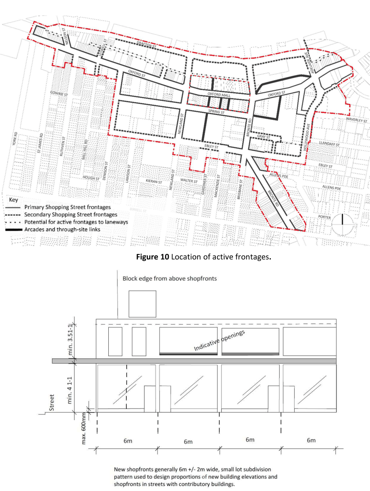

### 1.7 ACTIVE STREET FRONTAGES

#### Controls

(a) Active Street Frontages are to be provided in accordance with Figure 10, Part

B15 Public Domain and the WLEP Active Street Frontages Map.

> [Picture on page 16: a picture, saved as a picture (images/part-e-site-specific-development-page-16-5.gif, 150 dpi).]

Figure 10 Location of active frontages.

Figure 11 Primary shopping street active frontage
