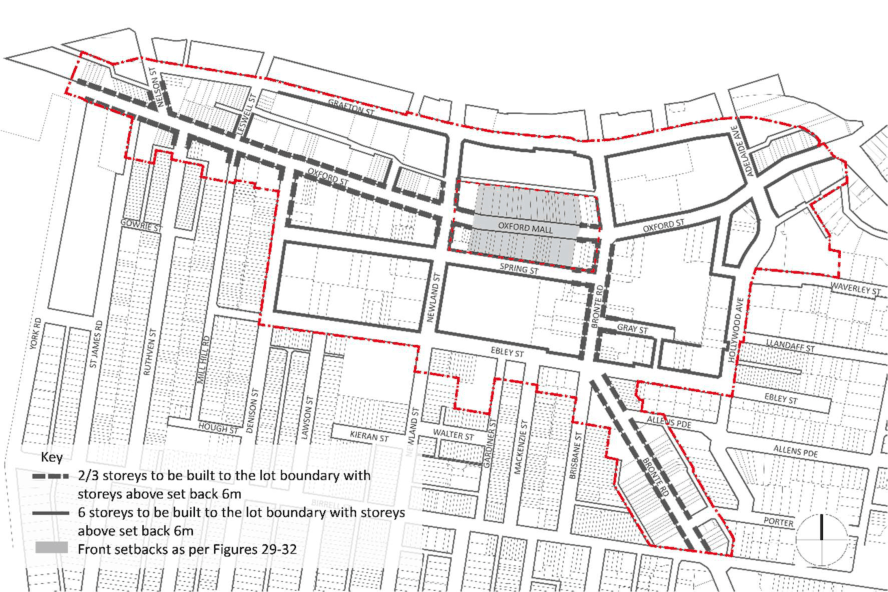
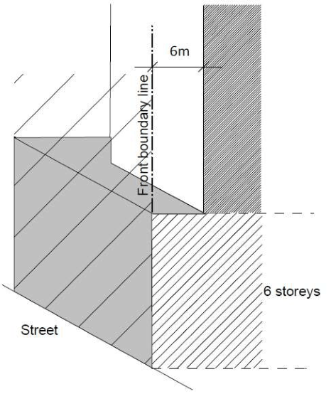
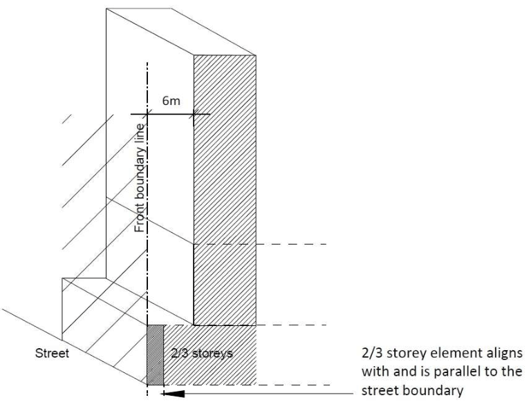
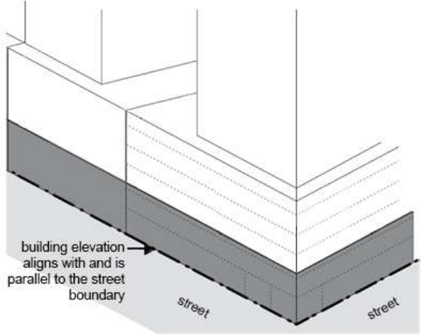
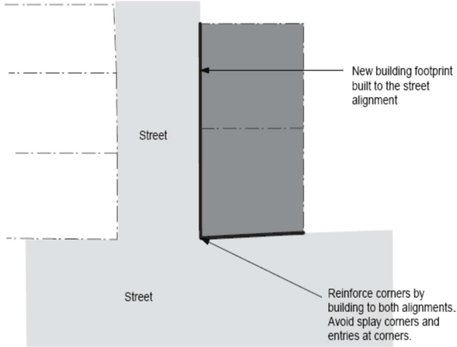

### 1.9 STREET ALIGNMENT

#### Objectives

(a) To reinforce the character of the commercial centre through consistent setbacks.

(b) To enhance streets as the commercial and civic space for the centre.

(c) To provide easy and legible pedestrian access ways and entrances into buildings.

(d) To create consistent and unified building elevations along streets.

(e) To improve the quality of the public domain.

(f) To ensure building facades create a human scale to the street.

(g) To define the space of public streets and other public spaces such as squares and parks.

(h) To maximise safety within public places.

#### Controls

General Controls

(a) Buildings are to have front elevations aligned to the street boundary with setbacks in accordance with Figures 12-14.

(b) A continuous street frontage is to be provided.

(c) Situations where a variation to building in alignment with the street boundary may occur includes where the building is adjacent to a heritage building that may have a curtilage, setback or important building elevation facing the side boundary. In such cases a site specific heritage response is required, or the creation of a forecourt.

(d) Open spaces at the street front for private buildings are not permitted.

Podium

(e) Corner sites are to be built to both street alignments.

(f) Development in streets with heritage, identified in Figure 12, are to include a 2/3 storey street wall, with a minimum 6m setback to built form above the street wall (refer to Figure 14).

(g) Developments on all other lots are to have front building elevations built to the street alignment to 6 storeys (refer to Figures 12 and 13).

Tower

(h) Towers are to be setback a minimum of 6m from the street wall and parallel to the street boundary (Figures 13 and 14).

#### Calculation rules

- The front setback is measured from the lot boundary along the street to the outer most edge of the building elevation (not the garage or car parking area).

- Setbacks are measured at 90 degrees from the lot boundary and include any articulation to the building elevation as well as including roofed or external living areas.

> [Picture on page 19: a picture, saved as a picture (images/part-e-site-specific-development-page-19-1.gif, 150 dpi).]

Figure 12 Street alignment.

> [Picture on page 19: a picture, saved as a picture (images/part-e-site-specific-development-page-19-3.gif, 150 dpi).]

Figure 13 Setbacks from the street: buildings in street without heritage

> [Picture on page 20: a picture, saved as a picture (images/part-e-site-specific-development-page-20-1.gif, 150 dpi).]

Figure 14 Setbacks from the street – buildings in streets with heritage

> [Picture on page 21: a picture, saved as a picture (images/part-e-site-specific-development-page-21-1.gif, 150 dpi).]

Figure 15a Corner sites build to boundary

> [Picture on page 21: a picture, saved as a picture (images/part-e-site-specific-development-page-21-3.gif, 150 dpi).]

Figure 15b Corner sites build to boundary - Plan
