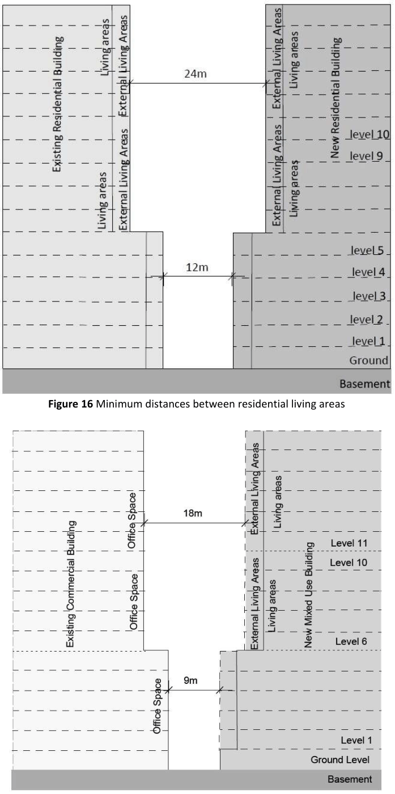
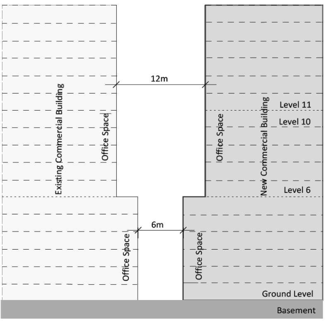

### 1.10  SEPARATION DISTANCES

#### Objectives

(a) To provide amenity and liveability in new buildings.

(b) To protect the amenity and liveability of existing buildings.

(c) To facilitate visual and acoustic privacy between buildings.

(d) To facilitate light and air to buildings.

#### Controls

(a) Development is to comply with the separation distances in Figures 16-18, and the Apartment Design Guide where applicable.

(b) In podiums, windows must not be located or oriented to the side boundary for a distance of 8m from the front boundary to allow a continuous street wall to be provided.

(c) Nil side setbacks can occur where separation distances permit, i.e. there are no windows or balconies within the relevant separation distance.

#### Calculation Rules - Separation

Building orientation refers to the direction of the external face of the building that provides the primary source of light, air and outlook to both residential uses (living room windows/doors and external living areas) and commercial uses (office or shop windows).

The measurement is to be taken from the windows/doors of the living room that give the rooms its primary source of outlook, light and air. Living areas include living rooms and external living areas such as balconies and terraces. For an external living area the measurement is taken from the outermost point of the balustrade.

Primary windows: For living rooms that have more than one orientation, the orientation that provides the primary source of light, air and outlook is to be used. These windows are described in the controls as primary windows.

All other windows: This includes bedroom windows and windows to non-habitable rooms. Living rooms that have a second orientation can also provide outlook, light and air to the room but in the case that greater privacy is required these windows/doors can be of opaque material, fixed, shaded or smaller in size.

> [Picture on page 23: a picture, saved as a picture (images/part-e-site-specific-development-page-23-1.gif, 150 dpi).]

Figure 16 Minimum distances between residential living areas

Figure 17 Separation distances between residential living areas and commercial uses

> [Picture on page 24: a picture, saved as a picture (images/part-e-site-specific-development-page-24-1.gif, 150 dpi).]

Figure 18 Separation distances between commercial uses
