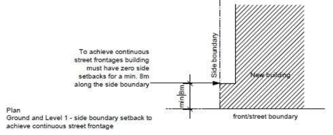
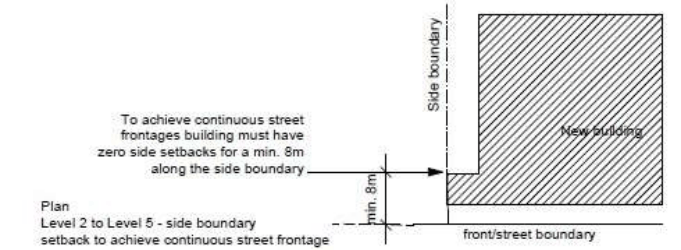
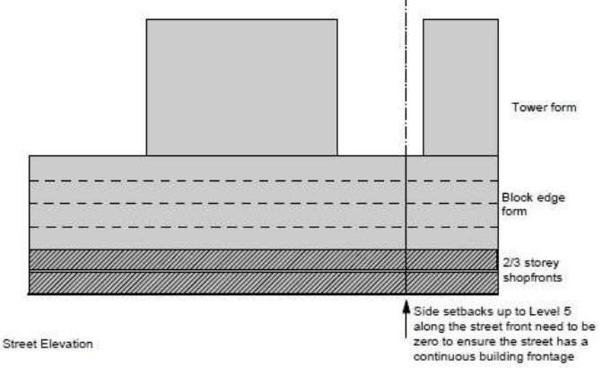
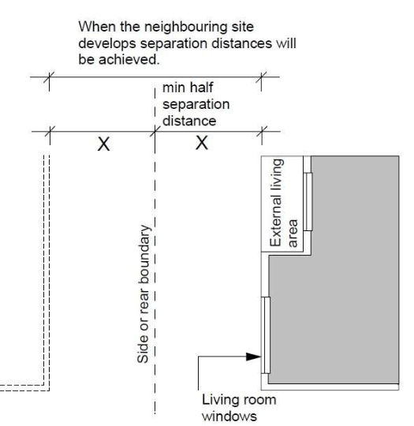
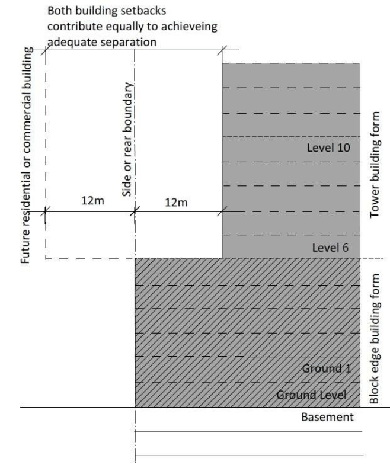
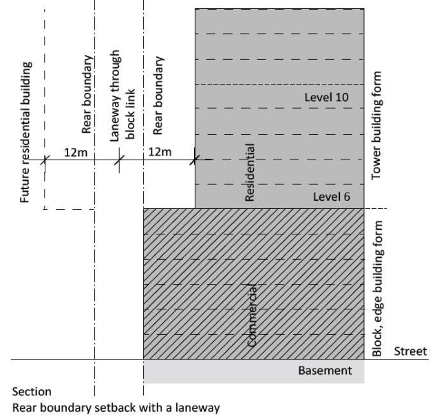
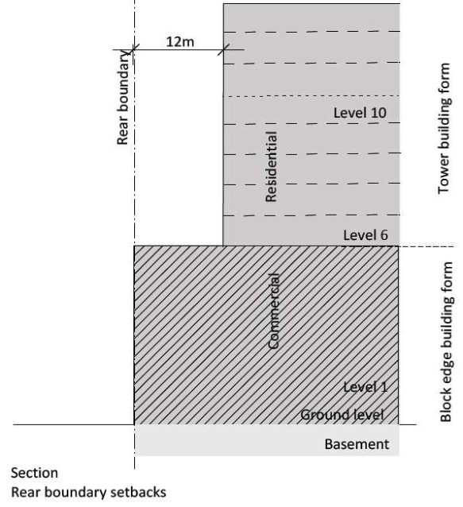

### 1.11 SIDE AND REAR BOUNDARY SETBACKS

#### Objectives

(a) To define the street space.

(b) To facilitate visual and acoustic privacy between buildings.

(c) To facilitate light and outlook.

#### Controls

(a) Refer to Figures 19, 20 and 21.

Podium

(b) Where a blank wall exists on the adjacent property boundary wall, a nil setback is to be provided.

(c) The podium nil side setback must be provided for a minimum of 8m measured from a front boundary (refer to Figure 19).

(d) Where existing neighbouring buildings have windows or balconies at podium levels facing a side boundary, the following side setback distances apply:

| 9m min. | Primary windows of living areas/balconies |
|---|---|
| 4.5m min. | All other windows |
| 3m min. | All other windows on small sites (24m wide or smaller) |

(e) On lots with rear laneways, the rear boundary setback can be nil if adequate separation distances are met. The laneway is to be included in the separation distance (refer to Figure 21).

Tower

(f) Where existing neighbouring buildings have windows or balconies at podium levels facing a side boundary, the following side setback distances apply:

| 12m min. | Primary windows of living areas/balconies |
|---|---|
| 6m min. | All other windows |

#### Calculation rules

Side setbacks are measured from the lot’s side boundary to the outermost edge of the building elevation i.e. edge of balustrades to balconies, rather than the glass line. Setbacks are measured at 90 degrees to the lot boundary and are measured to the outer most edge of the building elevation including balconies, terraces and porches. Rear boundaries may be either on a laneway or where two lots back onto one another. Lots that extend from street to street do not have rear boundaries but rather have two street frontages.

> [Picture on page 26: a picture, saved as a picture (images/part-e-site-specific-development-page-26-1.gif, 150 dpi).]

Figure 19a Side boundary setbacks – Ground and Level 1

> [Picture on page 26: a picture, saved as a picture (images/part-e-site-specific-development-page-26-3.gif, 150 dpi).]

Figure 19b Side boundary setbacks – Level 2 to Level 5

> [Picture on page 26: a picture, saved as a picture (images/part-e-site-specific-development-page-26-5.gif, 150 dpi).]

Figure 19c Side boundary setbacks - Elevation

> [Picture on page 27: a picture, saved as a picture (images/part-e-site-specific-development-page-27-1.gif, 150 dpi).]

Figure 20a Plan - Side and rear boundary setbacks to prevent overlooking

> [Picture on page 27: a picture, saved as a picture (images/part-e-site-specific-development-page-27-3.gif, 150 dpi).]

Figure 20 Elevation - Side and rear boundary setbacks to prevent overlooking

> [Picture on page 28: a picture, saved as a picture (images/part-e-site-specific-development-page-28-2.gif, 150 dpi).]

Figure 21a Section – Rear boundary setbacks with a laneway

> [Picture on page 28: a picture, saved as a picture (images/part-e-site-specific-development-page-28-4.gif, 150 dpi).]

Figure 21b Section - Rear boundary setbacks
