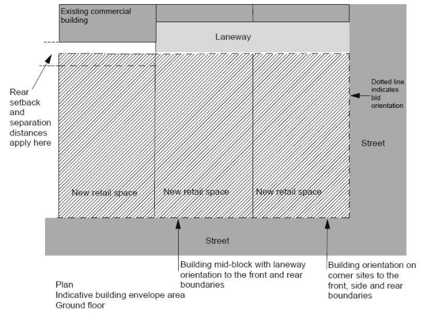
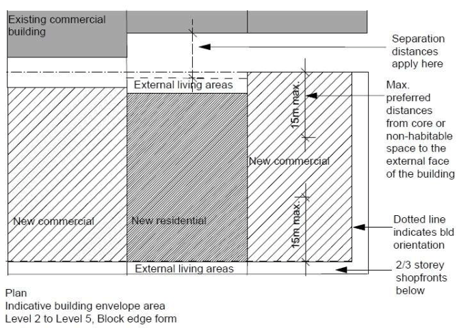
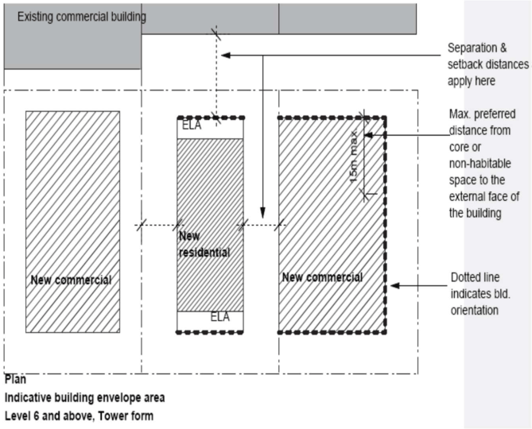
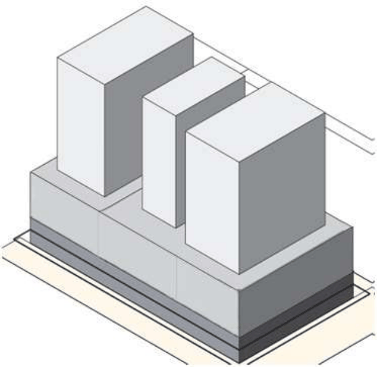

### 1.12 BUILDING FOOTPRINT

#### Objectives

(a) To reinforce the street edge.

(b) To provide amenity in terms of solar access and natural ventilation.

(c) To promote sustainable design that is less reliant on artificial heating, cooling and lighting by encouraging thin cross section buildings.

(d) To provide ground and first floor plates which cater for commercial uses and to encourage commercial uses within the whole podium.

(e) To provide for flexible commercial or residential uses in the tower components of buildings.

(f) To ensure that shop fronts line commercial shopping streets.

#### Controls

General Controls

(a) To achieve narrow cross section buildings consider using atria, light wells and courtyards open to the sky to achieve additional daylight and or stack and cross ventilation.

(b) The use of skylights to provide the primary source of daylight and ventilation to habitable rooms is not permitted.

(c) Provide common areas such as corridors and entrances with natural light and cross ventilation i.e. openable windows.

(d) Maximise daylight to all areas such as lobbies, corridors, kitchens and bathrooms by limiting the depth of buildings.

(e) Avoid or minimise the reliance on mechanical ventilation or air conditioning to these areas.

Podium

(f) Commercial:

(i) Commercial uses are to be provided in podium floors.

(ii) Podium floor plates may have a maximum 100% site coverage provided setback and separation controls are met (refer to Figure 22).

Tower

(i) Commercial:

(i) Tower building forms are to be designed so that no habitable space is more than 15m from a source of daylight (refer to Figure 23).

(j) Residential:

(i) Residential tower buildings are to comply with the Apartment Design Guide.

#### Calculation rules

Building depth refers to the dimension measured from the buildings front or street elevation to the rear elevation. Building depth includes the internal plan depth of the dwelling; it does not include external living areas.

Building width is measured from side building elevation to side building elevation. Building width is set by the width of the site minus the required side setback.

Mixed-use buildings may have a deeper ground level footprint to accommodate commercial uses with a narrower residential footprint above.

Some sites may have irregular site conditions such as topography or site shape. Such sites may require particular footprint design solutions that address such irregularities. For example buildings on narrow sites may require slender footprints to protect the amenity of neighbouring sites and to achieve the required setbacks. Sites on steep topography may require detached building footprints to account for the differences in grade.

> [Picture on page 30: a picture, saved as a picture (images/part-e-site-specific-development-page-30-8.gif, 150 dpi).]

Figure 22a Indicative building footprints on a small site: Ground and Level 1

> [Picture on page 30: a picture, saved as a picture (images/part-e-site-specific-development-page-30-10.gif, 150 dpi).]

Figure 22 Indicative building footprints on a small site: Levels 2 - 5

> [Picture on page 31: a picture, saved as a picture (images/part-e-site-specific-development-page-31-1.gif, 150 dpi).]

Figure 23 Indicative building footprint on a small site: tower building form

> [Picture on page 31: a picture, saved as a picture (images/part-e-site-specific-development-page-31-3.gif, 150 dpi).]

Figure 24 Indicative block 3D modelling of three footprint components
