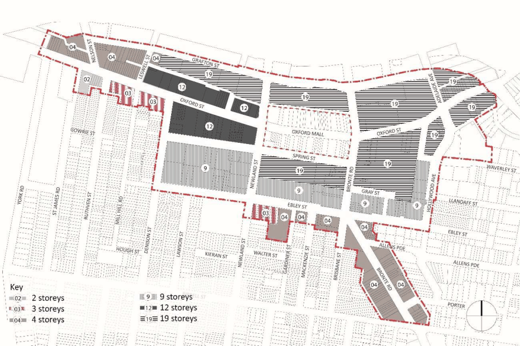

### 1.13 NUMBER OF STOREYS

#### Objectives

(a) To ensure that internal amenity is not compromised to maximise development potential.

(b) To ensure adequate internal amenity is provided through appropriate floor to ceiling heights.

(c) To ensure buildings create a human scale to the street.

(d) To encourage development and redevelopment potential.

(e) To provide a transitional scale between commercial and residential.

(f) To strengthen the urban form with consistent heights along streets.

#### Controls

(a) Refer to the WLEP Maximum Height of Buildings map for absolute building heights.

(b) Development may not achieve the maximum numeric heights due to topography or other site conditions.

(c) Development must not exceed the maximum number of storeys for the site as specified on Figure 25.

(d) Lots are to ensure they do not overshadow neighbouring or adjacent residential lots so as to preserve solar access to private open space.

(e) Lots to the southern side of Ebley Street, and the southern side of Bronte Road are to drop to 2 storeys at the rear to achieve solar access for adjacent properties.

> [Picture on page 32: a picture, saved as a picture (images/part-e-site-specific-development-page-32-23.gif, 150 dpi).]

Figure 25 Maximum number of storeys
