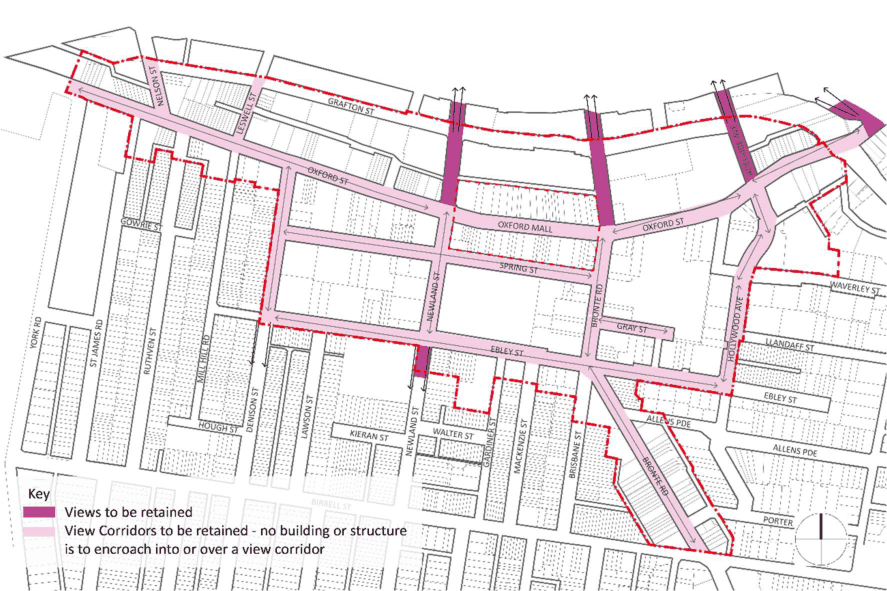

### 1.14 VIEWS, VISTAS AND TREE PRESERVATION

Bondi Junction is located on a ridge which provides Bondi Junction with vistas of the Woollahra ridge slopes and Harbour Foreshore glimpses to the north down Newland Street and Bronte Road. To the south, there are vistas of the suburbs of Queens Park, Randwick and Clovelly.

The most important views within Bondi Junction occur along its streets. These views along streets frame the overall visual quality of the centre and help to define and differentiate different places within the centre. As such they are intrinsic to the quality of the urban environment and are to be retained and enhanced in the future.

#### Objectives

(a) To retain significant vistas.

(b) To recognise the importance of Bondi Junction Centre or street views.

(c) To enhance views and vistas throughout the centre.

(d) To retain significant trees and vegetation.

#### Controls

(a) Retain vistas along Newland Street, Bronte Road and Grosvenor Street both to the south and the north.

(b) No building or structure is to build into or on a street view corridor.

(c) Development proposals that open up significant vistas from the public domain are encouraged, particularly north-south vistas.

(d) Comply with Figure 26 for locations of views and vistas referred within this section.

> [Picture on page 33: a picture, saved as a picture (images/part-e-site-specific-development-page-33-23.gif, 150 dpi).]

Figure 26 Views and vistas
