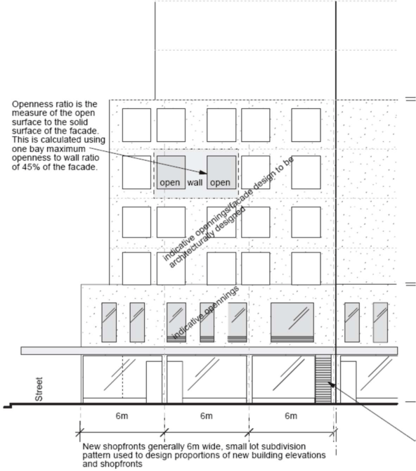
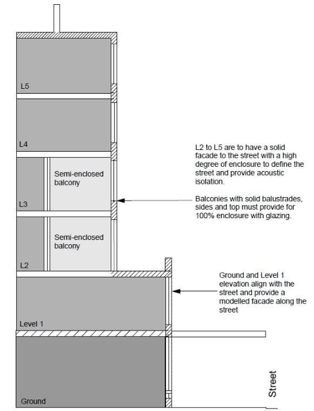

### 1.16 BUILDING ELEVATIONS

#### Objectives

(a) To establish a building’s identity in the streetscape and contribute to the centre as a whole.

(b) To ensure elevations reflect the use of the building, and address environmental conditions.

(c) To promote high architectural quality in buildings.

(d) To create buildings which respond to environmental conditions.

(e) To reduce reliance on mechanical heating and cooling.

(f) To improve visual quality of communal spaces and public places.

#### Controls

(a) All elevations must be architecturally designed and contribute to the character of the street in which they are located.

(b) Design building elevations which incorporate the principles of passive design and the properties of thermal mass, glazing and insulation, to reduce the need to artificially heat or cool.

(c) Provide openable windows to living and working environments.

(d) Facades are not to be totally flat but rather to have relief modelling.

(e) Refer to Figures 27 and 28 for indicative elevations and facades.

First Floor elevation

(f) Elevations are to be composed of a solid wall with punched openings. The solid wall is to have relief modelling.

(g) The horizontal proportions of the facade must relate to the ground level shop fronts.

(h) Facades can have an openness ratio of up to 35% of one bay of a facade, the remaining 65% must be solid.

Second to fifth floor elevation

(i) Elevations are to be composed of a solid wall with punched openings.

(j) The horizontal proportions of the facade must relate to the ground level shop fronts.

(k) Building facades can have an openness ratio of up to 45% of one bay of a façade, the remaining 55% must be solid.

(l) Balconies must be recessed from the main elevation.

(m) The tower component of buildings can be highly individual in character.

Above fifth floor elevation

(n) The maximum unarticulated wall length is 25m2.

(o) Use solar protection elements appropriate to north facing facades such as awnings, deep reveals, roof overhangs.

(p) Use solar protection elements appropriate to east or west facing facades such as external louvers, shutters, screens. These may be used in conjunction with awnings, deep reveals, roof overhangs.

> [Picture on page 36: a picture, saved as a picture (images/part-e-site-specific-development-page-36-1.gif, 150 dpi).]

Figure 27 Elevations

> [Picture on page 36: a picture, saved as a picture (images/part-e-site-specific-development-page-36-3.gif, 150 dpi).]

Figure 28 Façade section
