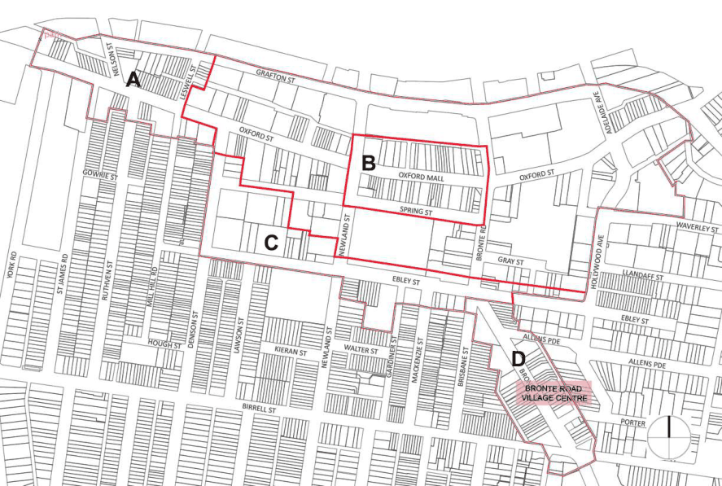
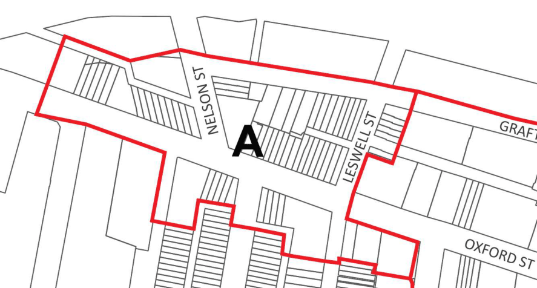
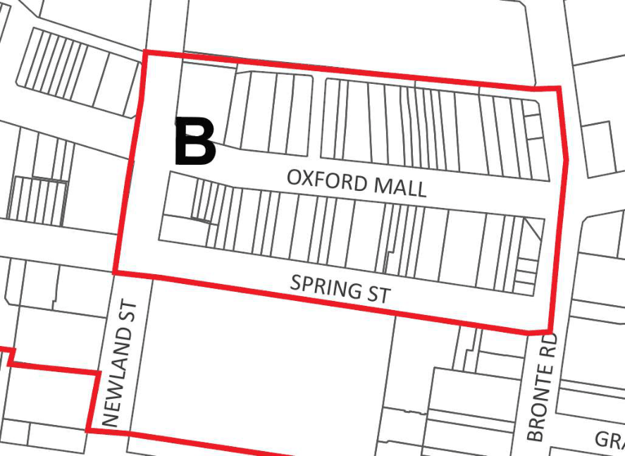
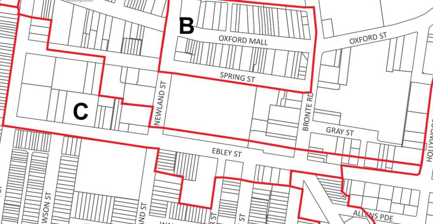
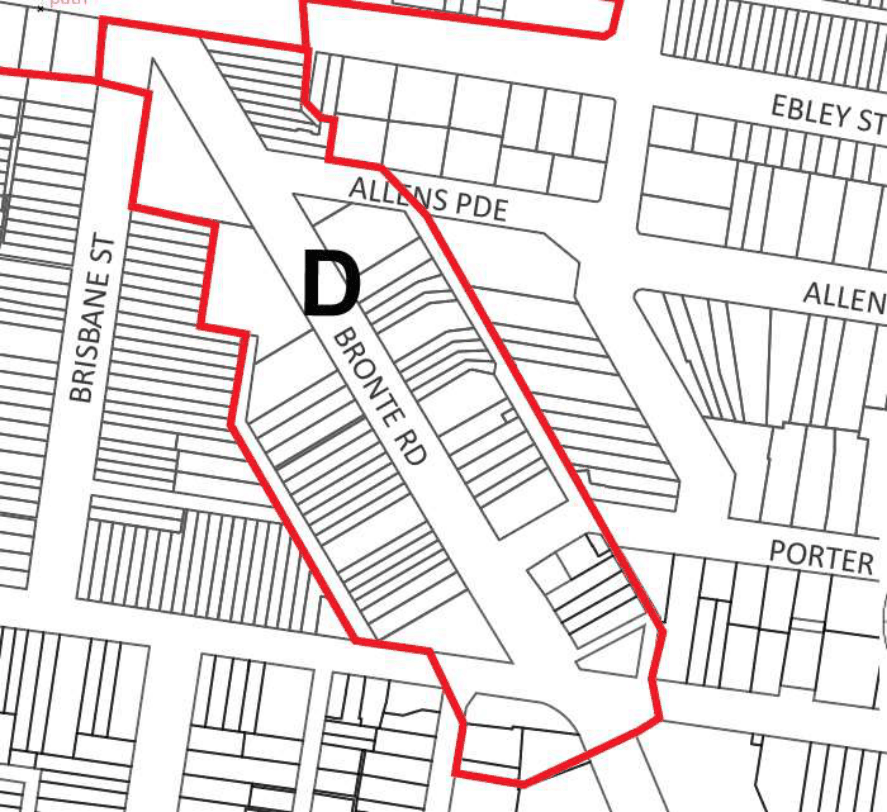

### 1.21 CHARACTER AREAS

Bondi Junction contains a number of areas that contain similar characteristics and development potential, and are known as Character Areas as shown in Figure 29.

These include:

A – West Oxford Street B – Oxford Street Mall C – Ebley Street Transition Corridor D – Bronte Road Village Centre

The additional provisions provided in Part E1 apply to these Areas.

> [Picture on page 42: a picture, saved as a picture (images/part-e-site-specific-development-page-42-10.gif, 150 dpi).]

Figure 29 Neighbourhood Areas

#### Objectives

(a) To ensure that development is consistent with the desired future character of the Bondi Junction centre.

#### Controls

(a) Development within the Bondi Junction centre must be consistent with the desired future character objectives for that area.

#### 1.21.1 West Oxford Street

> [Picture on page 43: a picture, saved as a picture (images/part-e-site-specific-development-page-43-2.gif, 150 dpi).]

#### Figure 30 West Oxford Street Area

#### Existing Character and Built Form

West Oxford Street has a “village”-feel character with low-density built-form. The majority of existing development contains ground floor awnings and minimal front setbacks. Little development exceeds two storeys in scale.

The Area contains a mix of both large and small lots, providing opportunity for a mix of retail and commercial formats.

#### Desired Future Character Objectives

(a) To protect the residential amenity of surrounding residential sites.

(b) To retain established low-density character and “village” feel.

#### 1.21.2 Oxford Street Mall

> [Picture on page 44: a picture, saved as a picture (images/part-e-site-specific-development-page-44-2.gif, 150 dpi).]

#### Figure 31 Oxford Street Mall Area

#### Refer to Part E1.22 of this DCP.

#### 1.21.3 Ebley Street Transition Corridor

> [Picture on page 45: a picture, saved as a picture (images/part-e-site-specific-development-page-45-2.gif, 150 dpi).]

#### Figure 32 Ebley Street Transition Corridor Area

#### Existing Character and Built Form

Larger format non-residential land uses, including civic buildings and retail are provided within this area, facilitated by the larger lot sizes.

#### Desired Future Character Objectives

(a) To facilitate larger format non-residential land uses.

(b) To provide for a visual transition between the higher density development to its north, and the lower density development to its south.

#### 1.21.4 Bronte Road Village Centre

> [Picture on page 46: a picture, saved as a picture (images/part-e-site-specific-development-page-46-2.gif, 150 dpi).]

#### Figure 33 Bronte Road Village Centre Area

#### Refer to Part E3.1.1 of this DCP.
