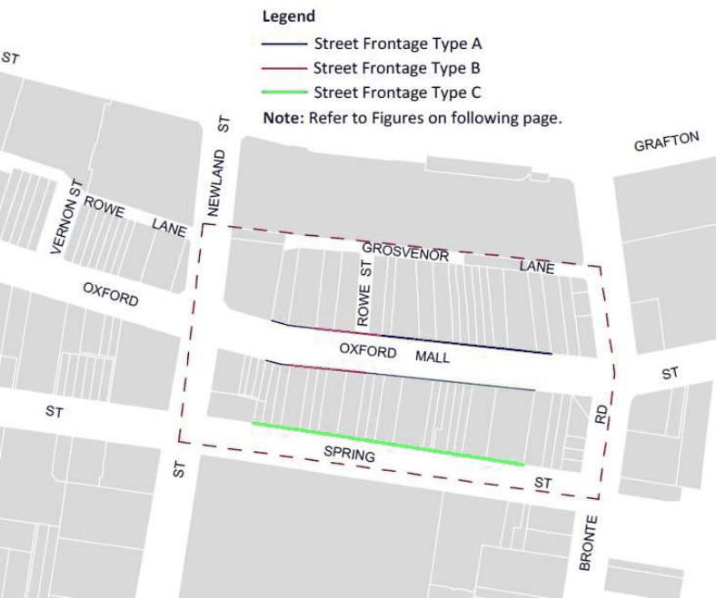
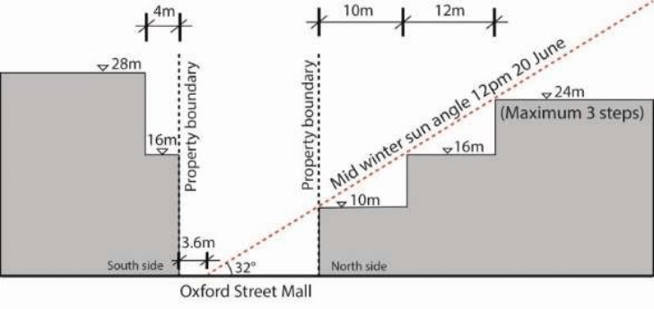
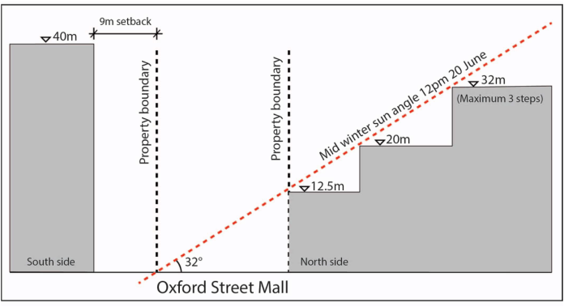
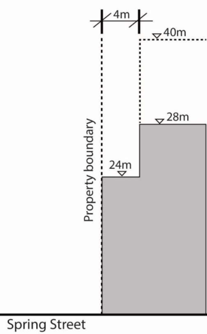
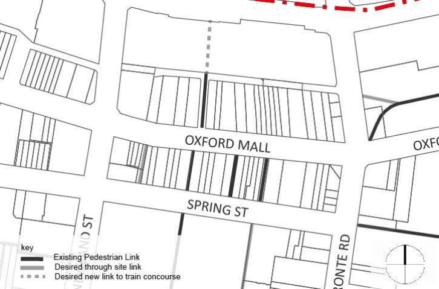
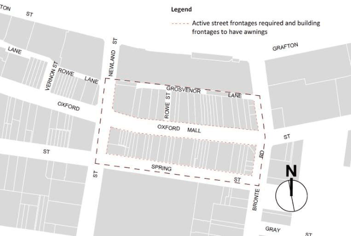
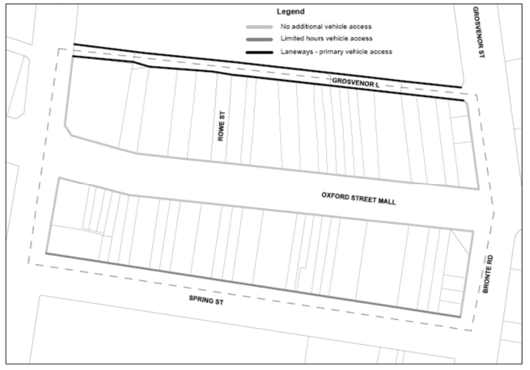
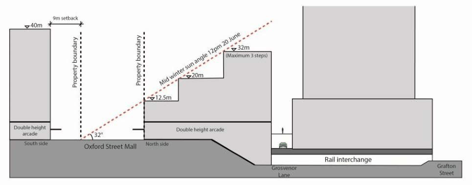

### 1.22 OXFORD STREET MALL PROVISIONS

#### 1.22.1 Building to street alignment and street setbacks Objectives

(a) To provide street edges that reinforce, improve or support the hierarchy and character of specific streets.

(b) To establish desirable spatial proportions within the street and definition of street edge.

(c) To create a clear transition between public and private space.

(d) To locate active uses, such as shop fronts, closer to pedestrian activity areas.

(e) To assist in achieving visual privacy to apartments from the street.

(f) To create good quality entry spaces to lobbies, foyers or individual dwelling entrances.

(g) To allow an outlook to, and surveillance of, the street.

(h) To maintain sun access to the public domain.

#### Controls

(a) Buildings in Oxford Street Mall are to be built to the street alignment as set out in Figure 34.

(b) Minor projections into front building lines and setbacks for sun shading devices, entry awnings and cornices are permissible.

#### 1.22.11 Noise attenuation for residential accommodation Objectives

(a) To support a vibrant and safe nighttime economy.

(b) To manage amenity and expectations relating to nighttime economic activity.

(c) To establish appropriate internal noise criteria that balances vibrancy associated with late night trading in the Oxford Street Mall and a reasonable and commensurate level of amenity for residential accommodation.

#### Controls

(a) Residential accommodation must be designed in a way which includes noise attenuation measures to achieve the criteria set out in Table 1.

(b) In seeking to achieve the noise attenuation measures set out in Table 1, the design of the development should consider, but not limited to, measures relating to:

(a) Building and room layout.

(b) Glazing.

(c) Ventilation.

(c) Where noise attenuation measures impact the provision of natural ventilation, alternative ventilation must be provided to ensure the proposal complies with the National Construction Code.

(d) A Noise Impact Assessment prepared by suitably qualified acoustic consultant may be required when submitting a development application for new residential accommodation in the Oxford Street Mall. The Noise Impact Assessment is to outline the required noise attenuation measures to achieve the criteria set out in Table 1.

(e) For alterations and additions, only apply the internal noise criteria in Table 1 to new or modified floor space.

Table 1 – Sensitive receiver internal noise criteria

| Sensitive receiver - Residential accommodation | Broadband (dBLAeq – 15 minutes) | Octave band criteria (dBZ) |
|---|---|---|
| Habitable rooms (excluding bedrooms) | 35b – All hours | 31.5 Hz - 59 63 Hz – 52 125 Hz - 46 |
| Bedrooms | 35db – 7am – 10pm 30db – 10pm – 7am | 31.5 Hz - 59 63 Hz – 52 125 Hz - 46 31.5 Hz - 54 63 Hz – 47 125 Hz - 41 |

#### 1.22.2 Street Frontage Heights Objectives

(a) To strengthen the urban form of Oxford Street Mall with consistent street wall heights.

(b) To achieve comfortable street environments for pedestrians in terms of daylight, scale, sense of enclosure and wind mitigation as well as a healthy environment for street trees.

(c) To enhance the distinctive character of streets within Bondi Junction Centre.

(d) To protect solar access to key streets and public spaces.

#### Controls

(a) Buildings must comply with the relevant street frontage heights as shown in Figures 34 - 37

(b) All new buildings and additions or alterations to existing buildings on the north side of Oxford Street Mall must comply with the sun access plane illustrated in Figures 35 and 36, irrespective of the existing height of nearby buildings.

(c) The erection of a building so that any part of the building is above the envelope specified in the relevant sun access diagram is not permitted, unless that part of the building is a minor architectural roof feature.

> [Picture on page 49: a picture, saved as a picture (images/part-e-site-specific-development-page-49-9.gif, 150 dpi).]

Figure 34 Street frontage heights

> [Picture on page 49: a picture, saved as a picture (images/part-e-site-specific-development-page-49-11.gif, 150 dpi).]

Figure 35 Street frontage Type A – Oxford Street Mall

> [Picture on page 50: a picture, saved as a picture (images/part-e-site-specific-development-page-50-1.gif, 150 dpi).]

Figure 36 Street frontage Type B – Rowe Street

> [Picture on page 50: a picture, saved as a picture (images/part-e-site-specific-development-page-50-3.gif, 150 dpi).]

Figure 37 Street frontage Type C – Street frontage

#### 1.22.3 Building Depth and Bulk Objectives

(a) To promote the design and development of sustainable buildings.

(b) To promote living and working environments with good internal amenity and minimise the need for artificial heating, cooling and lighting.

(c) To provide viable and useable commercial floor space.

(d) To achieve usable and pleasant streets and public domain at ground level by controlling the size of upper level floor plates of buildings.

(e) To allow for view sharing and view corridors.

(f) To reduce the apparent bulk and scale of buildings by breaking up expanses of building wall with modulation of form and articulation of facades.

#### Controls

(a) On land zoned E2 Commercial Centre, above street frontage height the preferred maximum floor plate area of a building is 1000m2 GFA.

(b) All points on an office floor should be no more than 10m from a source of daylight (e.g. window, atria, or light wells). The preferred depth for office floors with openings on one side is 10m. The preferred depth for office floors with openings on two opposite sides is 20m.

(c) Use atria, light wells and courtyards to improve internal building amenity and achieve cross ventilation and/or stack effect ventilation.

#### 1.22.4 Pedestrian Amenity Objectives

(a) To improve access in Oxford Street Mall area by providing new through site links and enhancing existing links as redevelopment occurs.

(b) To ensure through site links have active frontages along their length where possible.

(c) To provide for pedestrian amenity and safety.

(d) To retain and further develop laneways and small spaces as useful and interesting pedestrian connections as well as for service access.

#### Controls

General Controls

(a) Through site links, arcades, shared ways and laneways are to be provided as shown in Figure 38.

(b) Retain all arcade connections and walkways.

(c) Where possible, existing dead end lanes are to be extended through to the next street as redevelopment occurs and should provide clear sightlines from one end to the other.

(d) New through site links should be connected with existing and proposed through site lanes, shared zones, arcades and pedestrian ways and opposite other through site links to enhance legibility to the whole laneway system.

(e) Existing publicly and privately owned lanes are to be retained.

(f) The design and finish of new through site links need to be provided in accordance with Council’s Public Domain Technical Manual for Bondi Junction Centre.

Pedestrian links

(g) Through site links for pedestrians are to be provided as shown in Figure 38 and have active ground floor frontages; be legible and direct throughways for pedestrians; provide public access at all business trading times or as otherwise stipulated by Council’s conditions of approval; have a minimum width of 3m non-leasable space clear of all obstructions (including columns, stairs and escalators); where practicable, have access to natural light for at least 30% of their length; where air conditioned, have clear glazed entry doors comprising at least 50% of the entrance; have signage at street entries indicating public accessibility and the street to which the through site link connects; and maximise opportunities for integration of public art installations.

(h) Internal arcades will not be approved in preference to activation of an existing or required lane. Where developments front a lane that is also a pedestrian route, provide an active frontage and design details that create visual interest such as landscaping, awnings, paved finishes and good lighting.

(i) When a publicly accessible pedestrian connection is proposed to link directly to the railway line, Transport for NSW must approve connections to railway stations and approve designs. In addition, the developer will be required to enter into an agreement with Transport for NSW defining the controls to be implemented in managing access.

(j) Due to its proximity to Bondi Junction Station and substantial foot traffic, Bronka Arcade is to have a minimum width of 6m, a minimum height of two storeys and have active frontages on both sides. (Note: A greater Floor Space Ratio and maximum building height is available for 153-165 Oxford Street in order to provide this through site link.)

> [Picture on page 52: a picture, saved as a picture (images/part-e-site-specific-development-page-52-29.gif, 150 dpi).]

Figure 38 Through-site links

#### 1.22.5 Active Street Frontages and Address Objectives

(a) To promote pedestrian activity and safety in the public domain.

(b) To maximise active street fronts in Bondi Junction.

(c) To define areas where active streets are required or are desirable.

(d) To encourage an address to the street outside of areas where active street frontages are required.

#### Controls

Active Street Frontages

(a) Provide active street frontages to all development identified in Figure 39 in accordance with Part B16.2 Active Street Frontages.

Active frontage above Ground Floor

(b) Extend active frontages above ground floor level with uses and building design that provide transparency and visual contact with the street.

(c) Integrate landscaping above ground floor levels to provide interest in design and amenity for uses of these spaces.

Street Address

(d) Street address is defined as entries, lobbies, and habitable rooms with clear glazing to the street not more than 1.2m above street level and excluding car parking areas. Street address is required on Ground Level of all areas identified in Figure 39.

(e) Provide multiple entrances for large developments including an entrance on each street frontage.

#### 1.22.6 Awnings Objectives

(a) To increase pedestrian amenity by providing protection from wet weather and sunlight with awnings and colonnades.

(b) To create a protected transition area between internal and external spaces for public and commercial buildings.

(c) To improve pedestrian amenity by extending the footpath at ground floor level, and providing shelter and opportunities for outdoor dining.

#### Controls

(a) Continuous street frontage awnings are to be provided for all new developments as indicated in Figure 39 in accordance with B15.4 Awnings and Colonnades.

(b) Awning design must match building facades and be complementary to those of adjoining buildings.

(c) Wrap awnings around corners for a minimum 6m from where a building is sited on a street corner.

> [Picture on page 54: a picture, saved as a picture (images/part-e-site-specific-development-page-54-1.gif, 150 dpi).]

Figure 39 Active street frontages required and front facade of buildings are to have awnings

#### 1.22.7 Vehicle Footpath Crossings Controls

Location of Vehicle Access

(a) No additional vehicle entry points will be permitted into the parking or service areas of development along those streets identified in Figure 40.

(b) In all other areas, one vehicle access point only (including the access for service vehicles and parking for non-residential uses within mixed use developments) will be generally permitted.

> [Picture on page 54: a picture, saved as a picture (images/part-e-site-specific-development-page-54-11.gif, 150 dpi).]

Figure 40 Vehicle access restrictions

#### 1.22.8 Building Exteriors Objectives

(a) To contribute positively to the streetscape and public domain by means of high quality architecture and robust selection of materials and finishes.

(b) To provide richness of detail and architectural interest especially at visually prominent parts of buildings such as lower levels and roof tops.

(c) To present appropriate design responses to nearby development that complement the streetscape.

(d) To clearly define the adjoining streets, street corners and public spaces and avoid ambiguous external spaces with poor pedestrian amenity and security.

(e) To maintain a pedestrian scale in the articulation and detailing of the lower levels of the building.

#### Controls

(a) Adjoining buildings (particularly heritage buildings) are to be considered in the design of new buildings in terms of: appropriate alignment and street frontage heights; setbacks above street frontage heights; appropriate materials and finishes selection; facade proportions including horizontal or vertical emphasis; and the provision of enclosed corners at street intersections.

(b) Articulate façades so that these address the street and add visual interest.

(c) External walls should be constructed of high quality and durable materials and finishes with ‘self-cleaning’ attributes, such as face brickwork, rendered brickwork, stone, concrete and glass.

(d) Finishes with high maintenance costs, those susceptible to degradation or corrosion that result in unacceptable amenity impacts, such as reflective glass, are to be avoided.

(e) To assist articulation and visual interest, avoid expanses of any single material.

(f) Limit opaque or blank walls for ground floor uses to 30% of the street frontage.

(g) Maximise glazing for retail uses, but break glazing into sections to avoid large expanses of glass.

(h) Highly reflective finishes and curtain wall glazing are not permitted above ground floor level.

(i) A materials sample board and schedule is required to be submitted with applications for development over $1 million or for that part of any development built to the street edge.

(j) The design of roof plant rooms and lift overruns is to be integrated into the overall architecture of the building.

#### 1.22.9  Site Facilities and Services Objectives

(a) To ensure that site facilities are effectively integrated into the development and are unobtrusive.

(b) To establish appropriate access and location requirements for servicing.

(c) To ensure service requirements do not have adverse amenity impacts.

#### Controls

(a) All site facilities are to be integrated into the design of the building.

(b) For developments where a fire brigade vehicle is required to enter the site, vehicular access, egress and maneuvering must be provided to, from and on the site in accordance with the NSW Fire Brigades Code of Practice – Building Construction – NSWFB Vehicle Requirements. Generally, provision must be made for NSW Fire Brigade vehicles to enter and leave the site in a forward direction where: NSW Fire Brigade cannot park their vehicles within the road reserve due to the distance of hydrants from the building or restricted vehicular access to hydrants; or the site has an access driveway longer than 15m.

#### 1.22.10 Special Areas Objectives

(a) The Rowe Street and Bronka Arcade sites, on the north and south sides of Oxford Street Mall, lie at the crossing of important pedestrian routes through Bondi Junction. These sites offer an opportunity to enliven Oxford Street Mall and the centre of the Bondi Junction Centre area more broadly, by activating the area through increased pedestrian traffic and enhanced permeability of the area.

(b) On the Rowe Street site, a major new link is to be created between Oxford Street Mall and the railway interchange. This link will encourage greater pedestrian traffic on the Mall, improving the desirability of retail floor space in the Bondi Junction Centre.

(c) On the Bronka Arcade site, existing connections are to be maintained and enhanced by a more generous, double height arcade connection to Spring Street.

#### Controls

Built form

(a) On the Rowe Street site, new development must comply with the solar access plane illustrated in Figure 41, which ensures that new development on this site does not overshadow the Oxford Street Mall in winter. On the Bronka Arcade site, new development is permitted to rise to 40m from the 9m setback to Oxford Street Mall.

Public Domain Interface

(b) In order to ensure a high quality interface with the retail frontage along its length, the covered arcade connecting Oxford Street Mall and the railway concourse/Tiffany Plaza development should have the same finished floor level as the mall, and should be level along its entire length. The connection down to the railway station and up to the Tiffany Plaza development should consist of escalators, stairs and a lift, contained within an arcade-style development with active frontages. Development on the Rowe Street site is to be serviced from Grosvenor Lane.

(c) In order to encourage the activation of Spring Street, development on the Bronka Arcade site is to be serviced below ground, or on a limited hours basis from Spring Street.

(d) Because of limited opportunities for vehicle access, new developments are encouraged to consolidate parking.

> [Picture on page 57: a picture, saved as a picture (images/part-e-site-specific-development-page-57-3.gif, 150 dpi).]

Figure 41 Section showing intended Transport Interchange Upgrade

### Bondi Beachfront Area      E2
