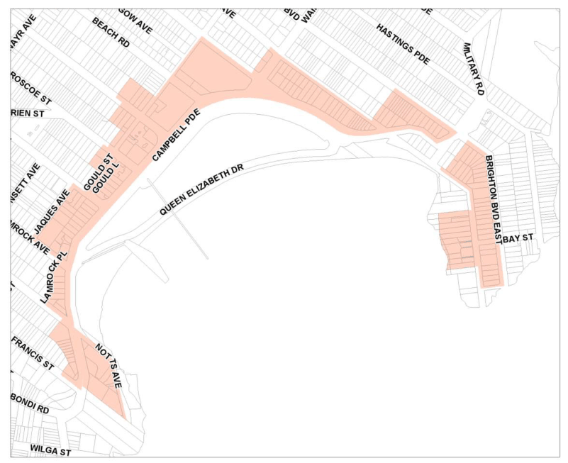

#### E2 BONDI BEACHFRONT AREA

Bondi Beach is an iconic location, including one of Australia’s most famous beaches. Bondi Beach has local, state and national heritage significance and is a major tourist attractor as well as a popular spot for locals due to its eclectic character and services.

This Part plays an integral role in maintaining the area’s unique qualities while providing urban design controls for residential and commercial development including controls relating to building height, parking, setbacks and building appearance.

This Part applies to land located within the Bondi Beachfront Area.

This Part applies to the land commonly known as the Bondi Beachfront Area shaded in Figure 42.

> [Picture on page 58: a picture, saved as a picture (images/part-e-site-specific-development-page-58-12.gif, 150 dpi).]

Figure 42 Bondi Beachfront Area Centre

This Part contains general objectives and controls for development within the Bondi Beachfront Area as well as specific objectives and built form controls for five (5) Character Areas. A development is required to meet the general objectives and controls as well as the specific objectives and built form controls for the area in which the development is located.
