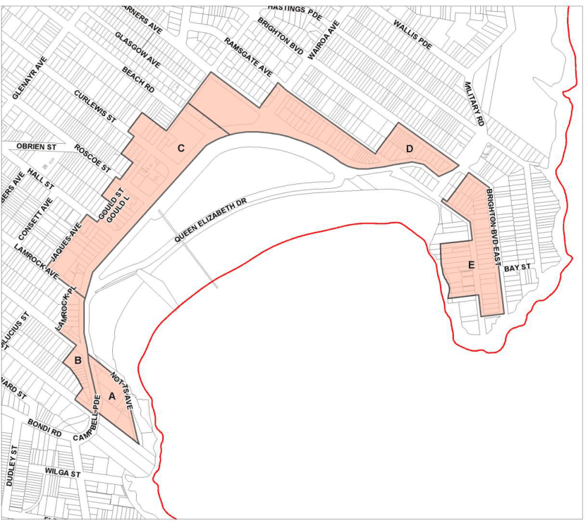
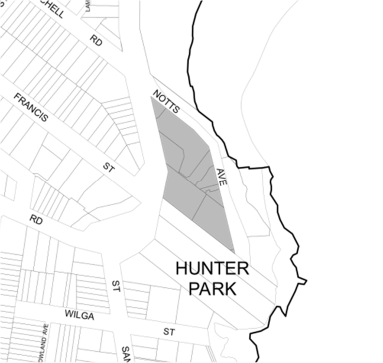
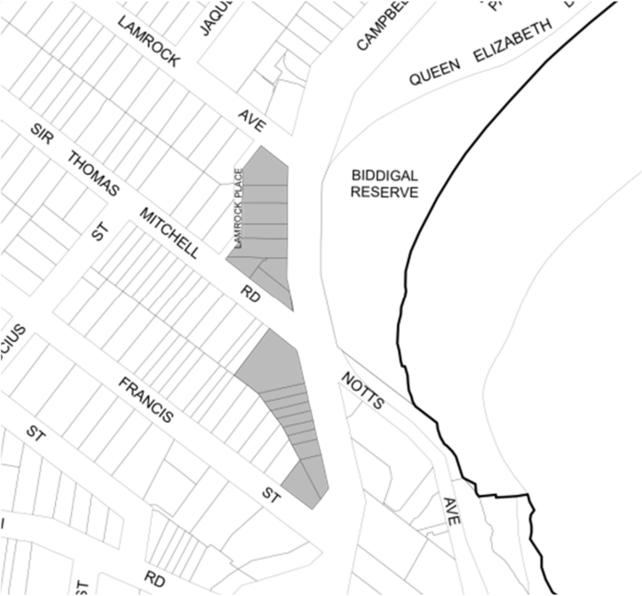
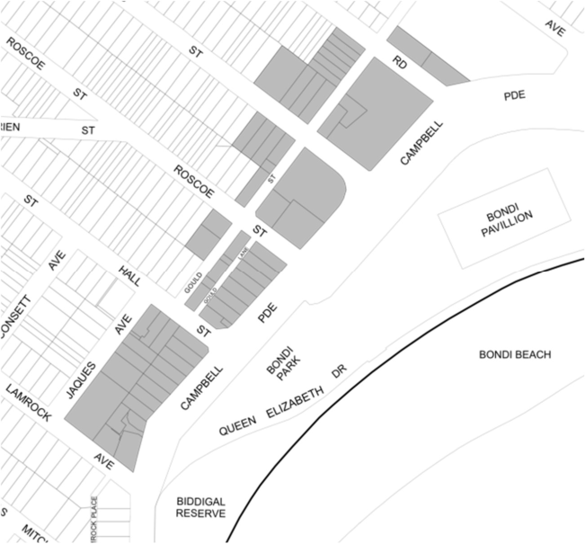
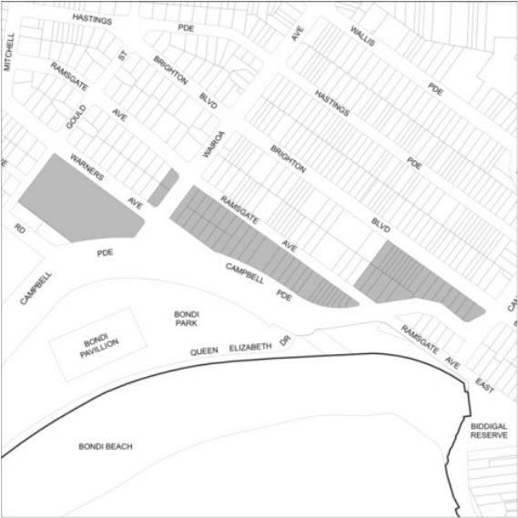
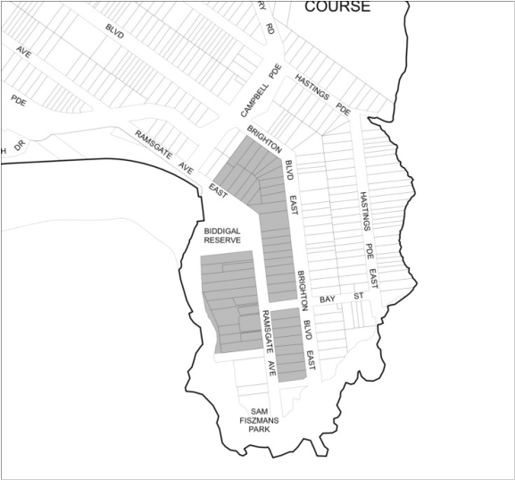

### 2.2 CHARACTER AREAS

The Bondi Beachfront Area contains a number of areas that contain similar characteristics and development potential and are known as Character Areas as shown in Figure 43 and includes:

A - Notts Avenue; B - Campbell Parade South; C - Campbell Parade Centre; D - Campbell Parade North; and E - Ramsgate Avenue East.

> [Picture on page 64: a picture, saved as a picture (images/part-e-site-specific-development-page-64-10.gif, 150 dpi).]

Figure 43 Character Areas

#### 2.2.1 Notts Avenue Existing Character and Built Form

Notts Avenue is a residential area comprising a variety of housing forms including street defining residential flat buildings along Notts Avenue and a tower on top of the headland along Campbell Parade (refer to Figure 39). Buildings are generally oriented to the north to take advantage of the aspect and elevated views over Bondi Beach. It has an irregular subdivision pattern.

Existing buildings in this area are predominantly rendered masonry with flat and pitched roofs. Buildings have a variety of expressions from the strongly horizontal emphasis of the building at the corner of Notts Avenue and Campbell Parade to vertical flat buildings.

Notts Avenue is characterised by blank street walls and a raised pedestrian footway at ground level with some garage openings and buildings located on top of a sloping topography. The Campbell Parade frontage is not street defining and contains residential uses at ground level.

> [Picture on page 65: a picture, saved as a picture (images/part-e-site-specific-development-page-65-15.gif, 150 dpi).]

Figure 44 Notts Avenue Character Area

#### Desired Future Character Objectives

(a) To maintain a residential character and support a diversity of residential accommodation in the area.

(b) To ensure that vehicular entries do not dominate Notts Avenue.

(c) To retain established building levels along Notts Avenue.

(d) To encourage buildings along Campbell Parade and Notts Avenue to be built to the street edge with no setbacks.

#### Controls

(a) Land use

(i) Developments are to retain the predominantly residential character of the area.

(ii) Developments fronting Campbell Parade are encouraged to have active ground floor frontages with retail.

(b) Height and Bulk

(i) A maximum of 3 storeys is permitted.

(ii) A maximum external wall height of 10m is permitted.

(c) Setbacks

(i) Buildings fronting Campbell Parade are to be built to the street edge with no setbacks.

(ii) Buildings are to provide sufficient rear setbacks to provide courtyards.

(iii) Buildings fronting Campbell Parade must have zero side setbacks for min. 10m from the Campbell Parade street wall for the height of the street wall.

(d) Façade Materials and Finishes

(i) Blank, flat and unarticulated facades are not permitted.

(ii) Buildings must not use materials that are highly reflective.

(iii) Windows must be composed as part of the overall form of the building.

(iv) Dark or tinted glazing is not permitted.

(e) Balconies and Balustrades

(i) Balconies along Campbell Parade must be recessed into the building envelope and should not project forward of the principal façade.

(ii) Balconies along Campbell Parade must be screened.

(iii) Balconies adjacent to a public open space or on side boundaries must be screened.

(v) Balconies must be designed as part of the overall form of the building.

(f) External Sun Shading

(i) External sun shading must be constructed of materials that are suitable to the environmental conditions of the site.

(ii) External sun shading must be consistent with the style and articulation of the building.

(g) Roofs and Parapets

(i) Roofs must be flat and edged by parapets along Campbell Parade and at the corners with Notts Avenue and Hunter Park for 10 metres back from the corner.

(h) Façade Colours

(i) Light to mid colours must be used.

(ii) Dark colours are not permitted.

(i) Awnings

(i) Awnings are required along Campbell Parade.

(j) Parking

(i) Car parking should be located below ground level and should not be visible from the street.

(ii) Car parking access via Campbell Parade is not permitted.

(iii) Car parking at or above ground level is discouraged. If there is no alternative - it should be screened behind habitable uses to a minimum depth of 8 metres. Car parking must not be visible from the street or from a public place

#### 2.2.2 Campbell Parade South Existing Character and Built Form

Campbell Parade is the principal street that follows the curve of Bondi Beach and is an integral element of the tourist image, providing retail, food and other services for the transient day/night time population, short-term residents and local community (refer to Figure 45). A regular pattern of secondary streets run perpendicular to Bondi Beach, creating visually prominent corners at Francis Street, Sir Thomas Mitchell Road and Lamrock Avenue. The land slopes steeply from Sir Thomas Mitchell Road to the top of the southern headland at Hunter Park.

Existing buildings have narrow frontages built to the street alignment, with notable facades that contribute to its Interwar heritage. Buildings are predominantly rendered masonry with parapets and a vertical expression through the use of bay or vertically proportioned windows, pilasters and a few balconies, typically enclosed. Existing buildings generally have a north-eastern orientation that takes advantage of the aspect and views over Bondi Beach.

Many sites contain heritage items and a large proportion of the area is located within the heritage urban conservation area. Many sites contain contributory buildings worthy of retention as they contribute to the overall character of the Area. These buildings are generally intact and consistent with other 1920s/30s precincts in Sydney.

> [Picture on page 68: a picture, saved as a picture (images/part-e-site-specific-development-page-68-20.gif, 150 dpi).]

Figure 45 Campbell Parade South Character Area

#### Desired Future Character Objectives

(a) To support and maintain the iconic role and unique character of the Campbell Parade retail strip as a separate area within the wider Bondi Beach Town Centre in providing local shops, services and residential accommodation for day visitors and the local community.

(b) To maintain the mixed-use character of the centre by locating small shops and services at ground level and level one with a diversity of residential accommodation above.

(c) To encourage outdoor seating on top of awnings along Campbell Parade.

(d) To ensure new development and major renovations are consistent with the existing character of the area.

(e) To encourage development that addresses the street and is built to the street alignment along Lamrock Place.

#### Controls

(a) Land use

(i) Developments are to retain the mixed use character of the area by locating commercial at ground and level 1 and residential above.

(b) Height and Bulk

(i) A maximum of 4 storeys is permitted.

(ii) A maximum external wall height of 12.5m is permitted.

(c) Setbacks

(i) Buildings are to be built to the street edge with no setbacks.

(ii) Buildings are to be built to the side boundaries for minimum 10m from the front street wall.

(iii) Balconies and terraces may extend over the ground floor awning where commercial is proposed.

(iv) Where a building is to be extended by the construction of additional floors, the new section is to be setback from the existing façade line by a minimum distance of 3m.

(v) Attic levels or part additional floors must be setback minimum 3 metres from the street wall.

(d) Heritage and contributory buildings

(i) Maintain the existing character of the area including narrow frontages and vertical expression.

(ii) Where a building is to be constructed in conjunction with a retained façade, the new construction is to be setback and integrated with the preserved section of the building.

(iii) Corner sites require architectural treatment which emphasises the prominent role filled by these sites in the urban context.

(e) Façade Materials and Finishes

(i) New facades must be predominately rendered masonry with parapets and have a vertical expression.

(ii) Blank, flat and unarticulated facades are not permitted.

(iii) Access to residential dwellings above ground level should not occupy more than 20% of the principal street frontage of any development.

(iv) Developments on corner sites are to be designed to accentuate the corner and provide a transition between one streetscape and the next.

(v) Windows above ground level must have vertical proportions.

(vi) Windows should be integral with the façade and not applied decoration.

(vii) Dark or tinted glazing is not permitted.

(f) Balconies and Balustrades

(i) Balconies along Campbell Parade must be recessed into the building envelope and should not project forward of a principal façade.

(ii) Balustrades along Campbell Parade, must be predominantly solid with no or minimal glazing.

(iii) Balconies must be composed as part of the overall form of the building.

(g) External Sun Shading

(i) External sun shading must be constructed of materials that are suitable to the environmental conditions of the site.

(ii) External sun shading must be consistent with the style and articulation of the building.

(iii) Sun shading must not project beyond the principal façade.

(h) Roofs and Parapets

(ii) Parapets must be predominantly rendered masonry.

(iii) Roofs must be flat with parapets.

(iv) Roofs must not be visible from Campbell Parade, unless there is a contextual reason for providing a pitched roof to relate to an adjacent heritage item or contributory building.

(v) The roofline of buildings, predominately comprising lift motor rooms and plant rooms shall be designed as an integral part of the buildings architectural form.

(i) Façade Colours

(i) Colours should be consistent with, retained or reinstated on heritage items and contributory buildings (refer to Annexure E2-1).

(ii) Light to mid colours must be used on all other buildings.

(iii) Dark colours are not permitted.

(j) Parking

(i) Vehicle entries are not permitted along Campbell Parade.

(ii) Where parking is permitted, it should be located below ground level and should not be visible from the street.

#### 2.2.3 Campbell Parade Centre Existing Character and Built Form

Campbell Parade is the principal street that runs parallel to Bondi Beach. Gould Street and Jacques Avenue are secondary streets that run parallel to Campbell Parade (refer to Figure 46). A regular pattern of secondary streets run perpendicular to Campbell Parade, creating visually prominent corners at Lamrock Avenue, Hall Street, Curlewis Street and Beach Road.

Campbell Parade is an integral element of the tourist image, providing retail, food and other services for the transient day/night time population and local community. Gould Street is an increasingly vibrant secondary street, providing specialist retail for visitors and the surrounding neighbourhood.

Buildings between Roscoe Street and Lamrock Avenue have narrow frontages and are built to the street alignment, with notable facades that contribute to its Interwar heritage. These buildings are predominantly rendered masonry with parapets with a vertical expression through the use of bay or vertically proportioned windows, pilasters and few balconies, typically enclosed. Existing buildings generally have a south-eastern orientation that takes advantage of the views over Bondi Beach, generally without balconies.

Many sites contain heritage items or contributory buildings and a large proportion of the area is located within the heritage urban conservation area. These buildings are generally intact and consistent with other 1920s/30s precincts in Sydney.

> [Picture on page 71: a picture, saved as a picture (images/part-e-site-specific-development-page-71-22.gif, 150 dpi).]

Figure 46 Campbell Parade Centre Character Area

#### Desired Future Character Objectives

(a) To support and maintain the iconic role and unique character of the Campbell Parade retail strip as a separate area within the wider Bondi Beach Town Centre in providing local shops, services and residential accommodation for day visitors and the local community.

(b) To increase access links between Campbell Parade and Gould Street to encourage pedestrian movement that supports local shops and increase the retail frontage.

(c) To maintain the mixed-use character in the centre by locating small shops and services at ground level and level one with a diversity of residential accommodation above.

(d) To ensure new development and major renovations are consistent with the existing character of the area.

(e) To minimise heritage impacts on identified heritage items and conservation areas within this and adjoining areas.

#### Controls

(a) Land use

(i) Developments are to retain the mixed use character of the area by locating commercial at ground and 1st floor level and residential above.

(ii) New developments should provide pedestrian through site access links between Campbell Parade and Gould Street.

(b) Height and Bulk

(i) A maximum of 4 storeys is permitted except for buildings fronting Curlewis Street, Beach Road or the western side of Gould Street where a maximum of 3 storeys is permitted.

(ii) A maximum external wall height of 12.5m is permitted except for buildings fronting Curlewis Street, Beach Road or the western side of Gould Street where a maximum of 10m is permitted.

(iii) An attic level or part additional floor may be permitted.

(c) Setbacks

(i) Buildings within the E1 Local Centre zone are to be built to the street edge with no setbacks.

(ii) Buildings are to be built to the side boundaries for a minimum of 10m from the front street wall

(iii) Where a building is to be extended by the construction of additional floors, the new section is to be setback from the existing façade line by a minimum distance of 3m.

(iv) Attic levels or part additional floors must be setback minimum 3 metres from the street wall.

(d) Heritage and contributory buildings

(i) Maintain the existing character of the area including narrow frontages and vertical front facade expression.

(ii) Where a building is to be constructed in conjunction with a retained façade, the new construction is to be similarly setback and integrated with the preserved section of the building.

(iii) Corner sites require architectural treatment which emphasises the prominent role filled by these sites in the urban context.

(e) Façade Materials and Finishes

(i) New facades must be predominately rendered masonry with solid parapets and have a vertical expression.

(ii) Blank, flat and unarticulated facades are not permitted.

(iii) Access to residential dwellings above ground level should not occupy more than 20% of the principal street frontage of any development.

(iv) Developments on corner sites are to be designed to accentuate the corner and provide a transition between one streetscape and the next.

(v) Fenestrations above ground level must have a vertical proportion, unless the existing character is otherwise.

(vi) Dark or tinted glazing is not permitted.

(f) Balconies and Balustrades

(i) Balconies along Campbell Parade must be recessed into the building envelope and should not project forward of a principal façade.

(ii) Balustrades along Campbell Parade, must be predominantly solid with no or minimal glazing.

(iii) Balconies adjacent to a public open space or on side boundaries must be screened.

(iv) Balconies must be composed as part of the overall form of the building.

(g) External Sun Shading

(i) External sun shading must be constructed of materials to suit the environmental conditions of the site.

(ii) External sun shading must be consistent with the style and articulation of the building. Sun shading must not project beyond the principal façade.

(h) Roofs and Parapets

(i) Parapets must be predominantly rendered masonry.

(ii) Roofs must be flat with parapets.

(iii) Roofs must not be visible from Campbell Parade, unless there is a contextual reason for providing a pitched roof to relate to an adjacent heritage item or contributory building.

(iv) The roofline of buildings, predominately comprising lift motor rooms and plant rooms shall be designed as an integral part of the buildings architectural form.

(i) Façade Colours

(i) Colours should be consistent with, retained or reinstated on heritage items and contributory buildings (refer to Annexure E2-1).

(ii) Light to mid colours must be used on all other buildings.

(iii) Dark colours are not permitted.

(j) Awnings

(i) New awnings must step to reflect the topography.

(k) Parking

(i) Vehicle entries are not permitted along Campbell Parade.

(ii) Parking should be located below ground level and should not be visible from the street.

#### 2.2.4 Campbell Parade North Existing Character and Built Form

Campbell Parade is the principal street that follows the gentle curve of Bondi Beach. A regular pattern of secondary streets runs perpendicular with the Campbell Parade retail strip. The land is steeply sloping towards Dover Heights and the secondary streets generally run along the contours (refer to Figure 47).

This area has a variety of building types including dwelling-houses, townhouses and residential flat buildings. Shop-top housing is generally located towards the corners.

Existing buildings along Campbell Parade have narrow frontages and are built to the street alignment, with notable facades that contribute to its Interwar heritage. Many sites contain contributory buildings which contribute to the overall character of the Area. These buildings are generally intact and consistent with other 1920s/30s precincts in Sydney.

Existing buildings are predominantly rendered masonry with parapets with a vertical expression through the use of bay or vertically proportioned windows, pilasters and few balconies, typically enclosed.

Buildings are generally oriented to the south to take advantage of the view over Bondi Beach, with some balconies. The orientation and narrow frontages limit solar access and cross ventilation.

> [Picture on page 75: a picture, saved as a picture (images/part-e-site-specific-development-page-75-20.gif, 150 dpi).]

Figure 47 Campbell Parade North

#### Desired Future Character Objectives

(a) To support the unique mixed use character of this section of Campbell Parade.

(b) To discourage residential accommodation at street level along Campbell Parade.

(c) To ensure new development and major renovations are consistent with the existing character of the area.

(d) To ensure development is built to the street with no setbacks along Campbell Parade.

#### Built Form Controls

(a) Land use

(i) Developments are to retain the predominantly residential character of the area with retail at street level encourages with properties fronting Campbell Parade.

(b) Height and Bulk

(i) A maximum of 4 storeys is permitted.

(ii) A maximum external wall height of 12.5m is permitted.

(iii) An attic level or part additional floor may be permitted.

(iv) New buildings must address the character of adjoining buildings and generally reproduce the side setbacks, bulk and scale of adjoining built form.

(c) Setbacks

(i) Buildings with frontages to Campbell Parade are to be built to the street edge with no setbacks.

(ii) Buildings with frontages to Ramsgate Avenue and Brighton Boulevard are to have a front setback of 3m.

(iii) Buildings are to provide front and rear setback back for floors above street level to provide balconies.

(iv) Balconies and terraces may extend over the ground floor awning where commercial is proposed.

(v) Where a building is to be extended by the construction of additional floors, the new section is to be setback from the existing façade line by a minimum distance of 3m.

(d) Façade Materials and Finishes

(i) New facades must be predominately rendered masonry with parapets and have a vertical expression.

(ii) Blank, flat and unarticulated facades are not permitted.

(e) Heritage and contributory buildings are to conform to the following controls:

(i) Maintain the existing character of the area including narrow frontages and vertical front facade expression.

(ii) Where a building is to be constructed in conjunction with a retained façade, the new construction is to be similarly setback and integrated with the preserved section of the building.

(iii) Existing face brick building exteriors should be retained and not painted or rendered.

(f) Façade Materials and Finishes

(i) New facades must be predominately rendered masonry with parapets and have a vertical expression.

(ii) Blank, flat and unarticulated facades are not permitted.

(iii) Buildings within the visual catchment of Bondi Beach must not use materials that are highly reflective.

(iv) Windows above ground level must have a vertical proportion.

(v) Dark or tinted glazing is not permitted.

(g) Balconies and Balustrades

(i) Balconies along Campbell Parade must be recessed into the building envelope and should not project in front of a principal façade.

(ii) Balustrades along Campbell Parade, must be predominantly solid with no or minimal glazing.

(iii) Balconies adjacent to a public open space or on side boundaries must be screened.

(iv) Balconies must be composed as part of the overall form of the building.

(h) External Sun Shading

(i) External sun shading must be suitable to the environmental conditions of the site.

(ii) External sun shading must be consistent with the style and articulation of the building. Sun shading must not project beyond the principal façade.

(i) Roofs and Parapets

(i) Parapets must be predominantly rendered masonry.

(ii) Roofs must be flat with parapets.

(iii) Roofs must not be visible from Campbell Parade, unless providing a pitched roof relates to an adjacent heritage item or contributory building.

(iv) The roofline of buildings, predominately comprising lift motor rooms and plant rooms shall be designed as an integral part of the buildings architectural form.

(j) Façade Colours

(i) Colours must be consistent with, retained or reinstated on heritage items and contributory buildings (refer to Annexure E2-1).

(ii) Light to mid colours must be used on all other buildings.

(iii) Dark colours are not permitted.

(k) Awnings

(i) Awnings must be provided where there are retail uses at ground floor.

(l) Parking

(i) Vehicle entries are not permitted along Campbell Parade.

(ii) Parking should be located below ground level and should not be visible from the street.

(iii) Car parking should not take the place of shop fronts at street level.

#### 2.2.5 Ramsgate Avenue East Existing Character and Built Form

The area generally has a regular subdivision pattern with narrow frontages to the street. It is a residential area comprising a variety of housing including dwelling-houses, two to three storey townhouses and residential flat developments. Buildings are generally oriented towards the west to take advantage of the elevated views over Bondi Beach. There is some shop-top housing at the western Ramsgate Avenue East, opposite Biddigal Reserve.

Existing buildings in this area are predominantly masonry, rendered and face brick, with pitched roofs but there are some flat and curved roofs. They have a variety of expressions with large fenestrations to the west and balconies are common. There are no heritage items in the area and it is located outside the heritage urban conservation

area. Many sites contain buildings that are worthy of retention as they contribute to the overall character of the Area.

Brighton Avenue East has wide landscape strip with street trees with buildings setback from the street (refer to Figure 48).

> [Picture on page 78: a picture, saved as a picture (images/part-e-site-specific-development-page-78-17.gif, 150 dpi).]

Figure 48 Ramsgate Avenue East Character Area

#### Desired Future Character Objectives

(a) To maintain the residential character of the area and support a diversity of residential accommodation, with some shops at ground level opposite Biddigal Reserve.

(b) To encourage development to address the street on the low-side of Ramsgate Avenue East.

(c) To encourage built form with a vertical expression, constructed primarily of masonry with a consistent street wall height and attic levels setback from the street with balconies.

(d) To discourage uncovered car parking and carports within the front setback.

(e) To ensure that balconies and bay windows on side boundaries maintain visual and acoustic privacy between buildings.

(f) To encourage balconies and operable screens that are integrated into the overall design of the building and that are constructed of materials appropriate to the exposed site conditions.

(g) To maintain existing building setbacks.

(h) To maintain and enhance existing view corridors.

#### Built Form Controls

(a) Land use

(i) Developments are to retain the residential character of the area.

(b) Height and Bulk

(i) A maximum of 3 storeys is permitted for buildings fronting Ramsgate Avenue and Brighton Boulevard.

(ii) Additional storeys are permitted where properties have dual frontage to Ramsgate Avenue East and the Coastline or where the topography permits.

(iii) An attic level or part additional floor may be permitted.

(c) Setbacks

(i) Buildings are to have a minimum front setback equal to the average setback of the adjoining two houses on each side and 3m for properties fronting Ramsgate Avenue East.

(ii) Buildings are to provide rear setbacks for floors above street level to provide balconies. Where a building is to be extended by the construction of additional floors, the new section is to be setback from the existing façade line by a minimum distance of 3m.

(d) Façade Materials and Finishes

(i) New facades must be predominately rendered masonry with a vertical expression.

(ii) Blank, flat and unarticulated facades are not permitted.

(iii) Buildings within the visual catchment of Bondi Beach must not use materials that are highly reflective.

(e) Heritage items and contributory buildings

(i) Maintain the existing character of the area including narrow frontages and vertical expression.

(ii) Where a building is to be constructed in conjunction with a retained façade, the new construction is to be similarly setback and integrated with the preserved section of the building.

(iii) Existing face brick building exteriors should be retained and not painted or rendered.

(f) Fenestrations

(i) Fenestrations must have a vertical proportion.

(ii) Dark or tinted glazing is not permitted.

(iii) Fenestrations along a side boundary must ensure visual and acoustic privacy is maintained between buildings.

(g) Balconies and Balustrades

(i) Balustrades fronting the coastline must be predominantly solid with no or minimal glazing.

(ii) Balconies must be composed as part of the overall form of the building.

(iii) Multiple balconies must be arranged with a vertical expression.

(iv) Balconies along the coastline must be recessed into the building envelope and should not project in front of the principal façade.

(v) Balconies adjacent to a public open space or on side boundaries must be screened.

(h) External Sun Shading

(i) External sun shading must be consistent with the style and articulation of the building.

(ii) Sun shading must not project beyond the principal façade.

(i) Roofs and Parapets

(i) The roofline of buildings, predominately comprising lift motor rooms and plant rooms shall be designed as an integral part of the buildings architectural form.

(j) Façade Colours

(i) Colours should be consistent with, retained or reinstated on heritage items and contributory buildings (refer to Annexure E2-1).

(ii) Light to mid colours should be used on all other buildings.

(iii) Dark colours should be avoided.

(k) Awnings

(i) Awnings are not permitted.

(l) Parking

(i) Car parking at ground level is discouraged. If there is no alternative, it should be screened behind habitable uses to a minimum depth of 8 metres.

(ii) Car parking must not be visible from the street or from a public place.

### Local Village Centres      E3
