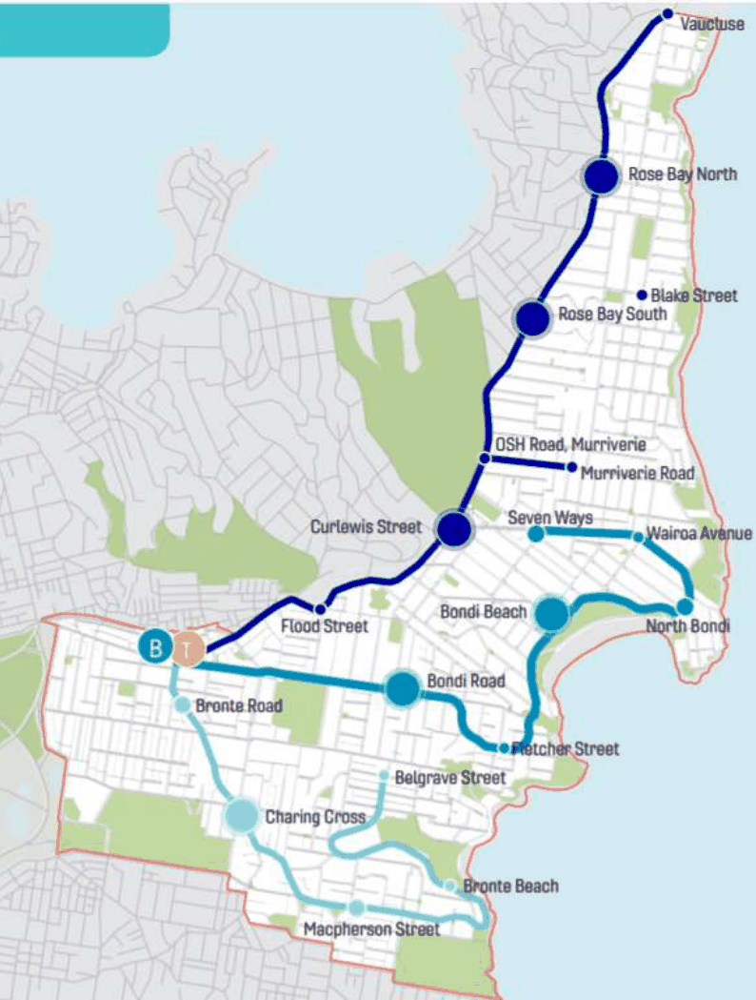

#### E3 LOCAL VILLAGE CENTRES

Throughout Waverley there are a number of local village centres. These are smaller centres serving the local community, separate to the regional role of Bondi Junction and Campbell Parade at Bondi Beach.

The centres enjoy unique position and character. Some of these centres are small, but all provide valuable services and facilities to local residents and users.

The purpose of this part is to strike a balance between upgrading and improving the public and private domain in village centres, while maintaining their character and affordability.

The zones reflect a hierarchy, where E1 Local Centre is either a cluster of shops (neighbourhood centre), a larger centre or high-street strip of shops, E2 Commercial Centre is a major centre with office buildings and major retail, while MU1 Mixed Use supports a mix of commercial and residential particularly in strategic centres around a E2 Commercial Centre zone.

| CENTRE NAME | CENTRE TYPE |
|---|---|
| Bronte Road Corridor |  |
| Bronte Road, Bondi Junction | Strategic Centre |
| Charing Cross | Local Centre |
| Macpherson Street | Neighbourhood Centre |
| Bronte Beach | Neighbourhood Centre |
| Belgrave Street | Neighbourhood Centre |
| Old South Head Road Corridor |  |
| Flood Street | Neighbourhood Centre |
| Curlewis Street | Local Centre |
| OSH Road, at Murriverie Road | Neighbourhood Centre |
| Rose Bay South | Local Centre |
| Blake Street | Neighbourhood Centre |
| Rose Bay North | Local Centre |
| Murriverie Road | Neighbourhood Centre |
| Vaucluse | Neighbourhood Centre |
| Bondi Road Corridor |  |
| Bondi Road | Local Centre |
| Fletcher Street | Neighbourhood Centre |
| Bondi Beach | Local Centre |

| Seven Ways | Neighbourhood Centre |
|---|---|
| North Bondi | Neighbourhood Centre |
| Wairoa Avenue | Neighbourhood Centre |

Table 1 Local Village Centres and centre hierarchy

Note: Planning controls and objectives for the Bronte RSL site at 113 Macpherson Street, Bronte are in Part E4 113 Macpherson Street, Bronte of this DCP.

> [Picture on page 82: a picture, saved as a picture (images/part-e-site-specific-development-page-82-5.gif, 150 dpi).]

Figure 49 Village Centres (Our Liveable Places Centres Strategy)
