### 3.1 VILLAGE CENTRE SPECIFIC CONTROLS

This section provides an outline of the 19 [excluding Bondi Beachfront Area and Bondi Junction] identified village centres and detail the desired future character of each centre. The desired future character is to be taken into consideration when designing the built form of the proposed development.

#### 3.1.1  Bronte Road, Bondi Junction

Part E1 Bondi Junction also applies to the Bronte Road village centre.

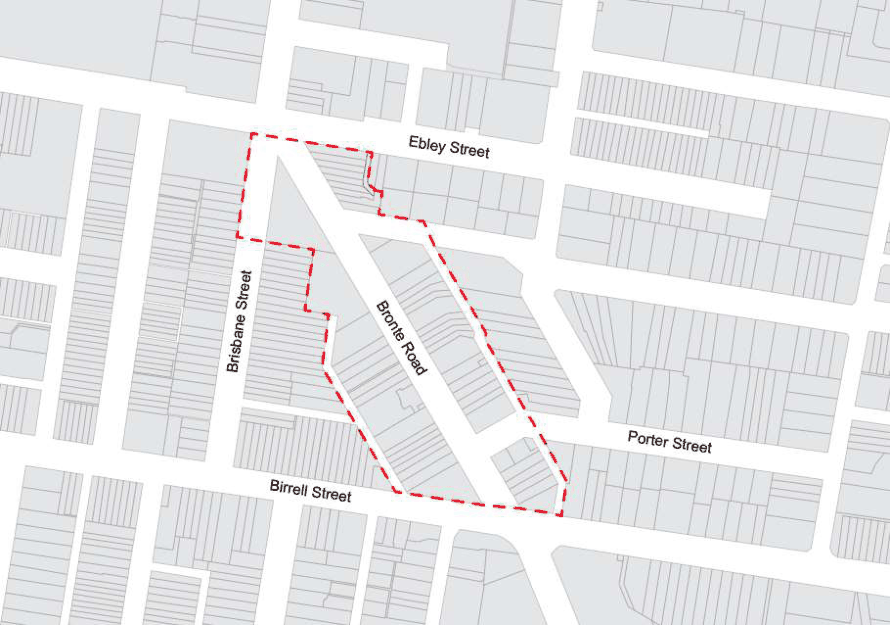

> [Picture on page 83: a picture, saved as a picture (images/part-e-site-specific-development-page-83-8.gif, 150 dpi).]

Figure 50 Bronte Road Centre

#### Existing Character and Built Form

The Bronte Road centre forms one key entrance route to the Bondi Junction Strategic Centre. It is broken up by existing residential lots and larger lots with little activity. The centre predominantly hosts bulky good retail services and other local businesses and lacks a cohesive character when compared to other centres within the LGA.

The Bronte Road centre has small pockets of consistency towards the north-east end, with local cafes providing the ‘hub’ for activity towards Bondi Junction. It’s location within the LGA is definitely unique, as it sits adjacent to multiple residential streets with large mature trees and other landscape conservation areas, however the centre itself lacks greenery and adequate public domain treatment.

#### Desired Future Character Objectives

(a) To enable a diversity of businesses, including commercial and urban services, catering to the needs of the broader community.

(b) To provide places for the arts, entertainment, and culture.

(c) To support a high level of pedestrian activity and connectivity within and from the centre to Bondi Junction, Queens Park and Charing Cross.

(d) To promote well-maintained mid-rise buildings of varying styles which form a consistent boulevard of ground floor shop fronts with residential uses on upper floors setback.

(e) To ensure new buildings provide for a high quality of living with a street frontage that gives comfort to human scale.

(f) To encourage mid-rise buildings that create a transition between the built form scale of Bondi Junction and Bronte Road in between Ebley Street and Birrell Street.

(g) To facilitate new housing, commercial opportunities, community facilities and public open space.

(h) To provide new development on non-heritage sites which maintain a consistent street frontage with adjacent developments, or follow existing street frontages but change materials to promote fine grain-variety of palette, and consider overshadowing to street and back lanes or buildings.

#### 3.1.2  Charing Cross

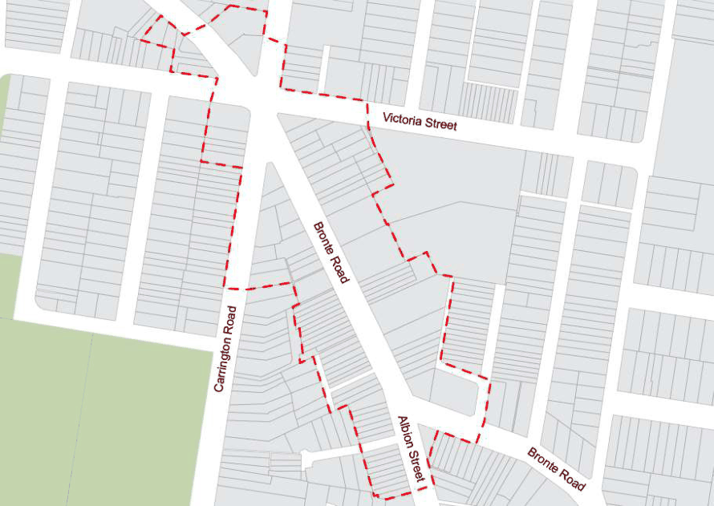

> [Picture on page 84: a picture, saved as a picture (images/part-e-site-specific-development-page-84-20.gif, 150 dpi).]

Figure 51 Charing Cross Centre

#### Existing Character and Built Form

The Charing Cross local village centre is located along a strip of Bronte Road connecting the eastern beaches, Bondi Junction, Centennial Park and the City.

The centre has a diverse range of local shops and services that support the daily needs of local residents and also workers and visitors who frequent the area. The centre has a "high street"

character, supporting the local commercial strip as well a major public transport route to and from the City.

The centre continues to fulfill a valuable social role and meeting place for local residents and for the children attending and travelling to the surrounding schools. The diverse local population also includes aged housing within the centre.

The centre is contained within an existing Heritage Conservation Area, reflecting the high heritage significance of the centre. The area maintains a two (2) storey character, with near-complete rows of highly intact Federation terraces (with continuous lateral pitched roofs) and Victorian terraces (with ornate parapet), interspersed with some examples of two storey Interwar and Art Deco apartments.

These buildings of historic character are all of masonry construction, many with painted plaster render with highly decorative finishes. The buildings are mixed-use and maintain a consistent retail ground floor with residential upper storeys and also support awnings over the entire pavement width.

Narrow passages between terraced groups give access to the rear of properties and laneways. Buildings address Bronte Road and do not address the laneways, although some newer buildings have not maintained this approach to the detriment of the Bronte Road streetscape. Numerous buildings within this area possess elements of, or largely intact, original shop fronts. Many others preserve the original entry configuration (i.e. with inset doorway to one side) reconstructed with contemporary materials.

Important views of historic buildings, available from the public domain, include those of the St Mary’s Immaculate Catholic Church and associated buildings (a listed State Heritage group), viewed across the community centre at 280-282 Bronte Road.

Appreciation of the high heritage quality of the building stock of this area is compromised by intrusive suspended power lines and the placement above the line of awnings of other built elements such as advertising structures and air conditioning units.

Buildings are a variety of colours in this area which positively contributes to the character of the

area. Where a number of adjoining buildings have been painted the same colour the scale and rhythm of the street has been diminished.

The Eastern Suburbs Legion Club is an important community-based use in the centre, although the building is an intrusive element in the existing Conservation Area.

At present the public domain is not particularly well defined, blurring into the adjacent residential areas, particularly at the northern and southern ends of the high street.

#### Desired Future Character Objectives

(a) To limit the scale of redevelopment and infill development at the street edge to match the height of the existing heritage parapet façades and roof lines, with setbacks to further levels where appropriate.

(b) To ensure that the design of infill development remains consistent with the regular division of frontages, where regular divisions occur.

(c) To ensure an integrated approach and consistent treatment to the conservation of terrace groups of buildings of historic character.

(d) To minimise ‘visual clutter’ through control of peripheral building elements.

(e) To encourage the conservation of historic architectural details and reconstruction of missing or degraded elements.

(f) To maintain the continuity of awnings where present.

(g) To maintain Bronte Road as the primary streetscape in the centre with lanes and side passages as secondary frontages.

(h) To promote Charing Cross as a destination rather than a thoroughfare, where people visit, stay and enjoy.

(i) To provide places for the arts, entertainment and culture.

(j) To increase urban greening where appropriate.

(k) To promote a high level of pedestrian activity and connectivity within and from the centre to Bondi Junction, Queens Park and Bronte Beach.

(l) To maintain a prevailing and consistent streetscape, comprising distinctive and well-maintained low-rise Victorian, Federation and Inter-war buildings and shopfronts, reflective of the historical evolution of Waverley’s oldest commercial centre.

(m) To protect the setting of and views to landmark buildings, including the Bell Towers at St Marys Immaculate Church, that are visible across the LGA aided by the centre’s ridgeline topography.

(n) To ensure development is well designed and responsive to existing built form, history and heritage, with appropriate street frontage heights and upper storey setbacks.

(o) To ensure any new building, or alterations or additions must respect the HCA and its design characteristics without mimicking heritage detailing.

(p) To ensure that new development should respect the traditional patterns and proportions of the existing development. Additions should be carefully designed to respect the scale, massing and proportions of the existing building and its key design elements and involve the least amount of alterations to significant fabric

(q) To ensure that no additions are permitted within the front setback of existing buildings unless it can be clearly demonstrated that the new structure will not dominate the streetscape, obscure views to the building or adversely impact the cultural significance of the place.

(r) Corner development should accentuate the corner and provide a transition from one street to another.

(s) Larger building façades should be articulated in a regular rhythm to respond to the late 19th Century and early 20th century streetscape characteristic of the HCA.

#### 3.1.3  Macpherson Street

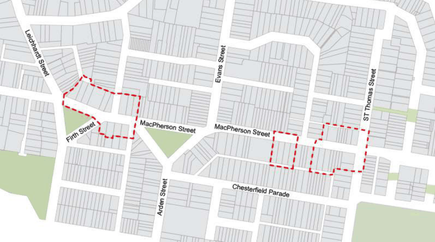

> [Picture on page 87: a picture, saved as a picture (images/part-e-site-specific-development-page-87-2.gif, 150 dpi).]

Figure 52 Macpherson Street Centre

#### Existing Character and Built Form

The Macpherson Street local village centre provides approximately 60 small commercial premises spread out along the length of the street, stretching from Leichhardt Street in the West to St Thomas Street in the East. The range of shops provide for the daily needs of the local community. To the East, near St Thomas Street, the building stock along the ridge-top road is characterised by three (3) storey, mixed-use masonry buildings of diverse styles, both pre-War (c1900) and Interwar. Characteristic buildings have ground floor shops under continuous awnings, residential upper storeys, and some possess intact shop-fronts, or some original elements.

A number of buildings at the west end are higher density residential buildings, while other buildings retain original shop-fronts. Intrusive buildings along Macpherson Street include multi-storey residential and large non-residential buildings. To the West, near Lugar Street, the area is characterised by two (2) storey Interwar commercial buildings of masonry construction, with both decorative face brick and rendered and painted finishes.

Significant views of the ocean exist east along Macpherson Street and to Clovelly looking south from the junction of Macpherson and St Thomas Streets.

Simpson and Macpherson parks are located at the junctions of Macpherson Street with Firth and Carlton streets. These contribute significantly to the character of the centre, allowing clear southern vistas and valued open space. The existing buildings are of two (2) to three (3) storeys in height.

#### Desired Future Character Objectives

(a) To maintain the built form arising from the historical subdivision pattern and the small shop character at street level.

(b) Maintain the public views and outlook at the eastern end of the centre, as well as outlook over open space at the western end of the centre.

(c) To create and maintain a cohesive and vibrant streetscape, with leafy trees, verge gardens and areas for people to stop and congregate.

(d) To maintain a physical and visual connection to the coast.

(e) To maintain low-rise (human-scale) built form of varying styles, with active shopfronts that are open to the public domain.

(f) To ensure new buildings are of human scale and provide for a high quality of living.

(g) To maintain fine grain shop-fronts.

#### 3.1.4 Bronte Beach

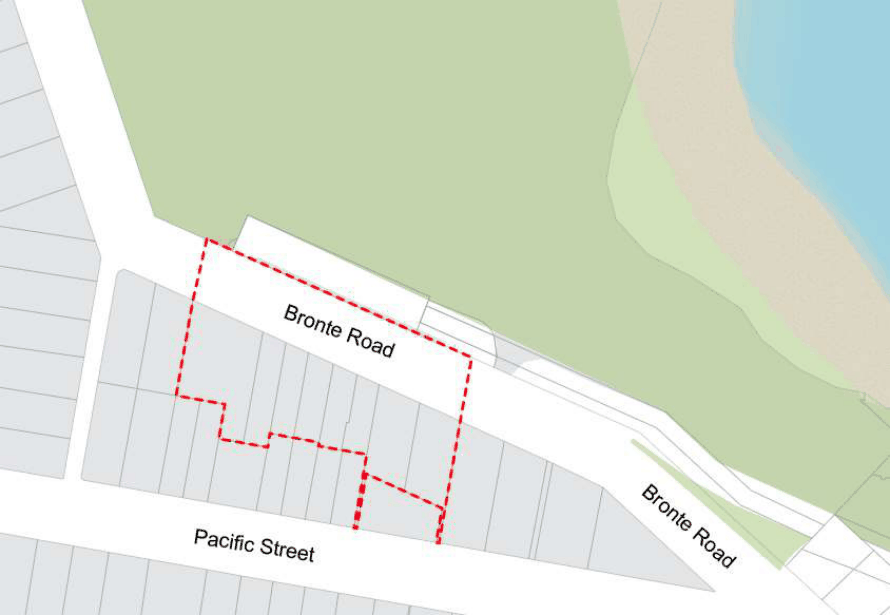

> [Picture on page 88: a picture, saved as a picture (images/part-e-site-specific-development-page-88-9.gif, 150 dpi).]

Figure 53 Bronte Beach Centre

#### Existing Character and Built Form

The Bronte Beach Neighbourhood Centre is typified by a single stretch of two (2) to three (3) storey mixed-use, largely Interwar, buildings with retail frontage at ground level under continuous awnings. Upper storeys (that is, storeys above ground level) are used for residential purposes.

Whilst there are street awnings, those to the western end of the strip are less consistent and successful than those to the eastern end. At the western end both glass and canvas awnings exist which vary from the overall uniform character of the pedestrian experience established at the eastern end.

All buildings of historical character are of brick construction, with painted, rendered, and/or face brick finishes.

Significant views (some partly screened by trees along the bus terminus) of Bronte Beach, Bronte Park and the ocean are possible from all points along this section of Bronte Road.

#### Desired Future Character Objectives

(a) To maintain the existing scale of the small centre.

(b) To maintain mixed use developments in the centre, with ground floor local shops and services and upper level residential use.

(c) To maintain, and where possible in the future, enhance, the range of local shops and services to meet the day to day needs of local residents.

(d) To provide a diversity of businesses and retail offerings, located in smaller uniform shopfronts, that cater to local and visitor needs.

(e) To retain the low-rise distinctive heritage and character buildings that frame the street, comprising ground floor business and retail offerings, with residential uses on the upper floors.

(f) To retain the through-site link from Pacific Street to Bronte Road.

(g) Protect views to Bronte Beach by reduction of visual clutter created by signage, large public domain fixtures and plantings.

#### 3.1.5 Belgrave Street

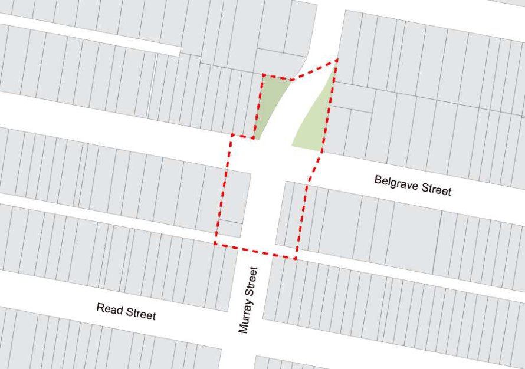

> [Picture on page 89: a picture, saved as a picture (images/part-e-site-specific-development-page-89-16.gif, 150 dpi).]

Figure 54 Belgrave Street Centre

#### Existing Character and Built Form

This centre is made up of a collection of four (4) shops located at the intersection of Belgrave and Murray Streets. This area has a modern, post-war suburban character, with few clear historical elements and varied building typology.

The centre is surrounded by predominantly small lot and medium density residential housing. Though the centre is small, it serves the local residential catchment and passing trade from the Bronte Public School (located towards the south). 45 Belgrave Street is a two storey mixed-use,

red brick corner shop, while 47-49 Belgrave Street are Federation shops and housing. ‘Pocket’ parks exist on opposite corners to these buildings providing a landscape feature to the area. The ‘shop house’ buildings of 47-49 Belgrave Street are of a scale and detail appropriate to the location providing a degree of character to the area.

#### Desired Future Character Objectives

(a) To maintain the existing scale of the small centre.

(b) To maintain mixed use developments in the centre, with ground floor local shops and services and upper level residential use.

(c) To maintain, and where possible in the future, enhance, the range of local shops and services to meet the day to day needs of local residents.

(d) To promote local business and retail offerings catering to neighbourhood needs.

(e) To ensure a cohesive and vibrant streetscape, with verge landscaping and a well-maintained community park.

(f) To encourage upgrades to the facades of existing buildings.

#### 3.1.6 Flood Street

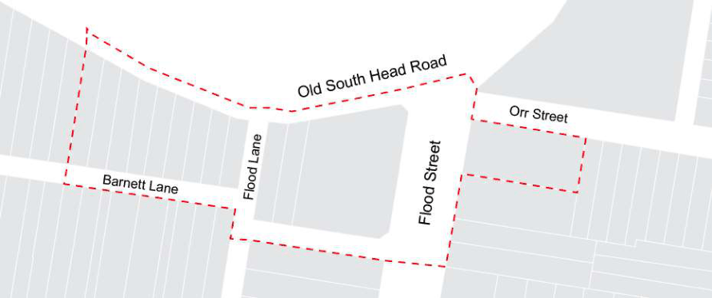

> [Picture on page 90: a picture, saved as a picture (images/part-e-site-specific-development-page-90-16.gif, 150 dpi).]

Figure 55 Flood Street Centre

#### Existing Character and Built Form

The buildings in this local centre occupy a bend in the corner of Old South Head Road. They are of mixed architectural fabric. The immediate environment is dominated by traffic and the commercial/retail use of some of the buildings provides a buffer between the road and the residential buildings that sit behind these uses.

The centre has a number of late Victorian, Federation, and Inter-War style dwellings with commercial uses being housed within modern structures.

Height varies between one and three storeys, with buildings located to the front of the property boundaries. Buildings are typically of masonry construction, with residential buildings possessing decorative face and painted brick work.

#### Desired Future Character Objectives

(a) To maintain the active uses  of the centre by way of shops and services at ground level.

(b) To provide an attractive location for small businesses with exposure to Old South Head Road.

(c) To provide a safe and walkable public domain.

(d) To retain low-rise distinctive heritage and character buildings that frame the street, comprising ground floor business and retail offerings, with residential uses on the upper floors.

#### 3.1.7 Curlewis Street

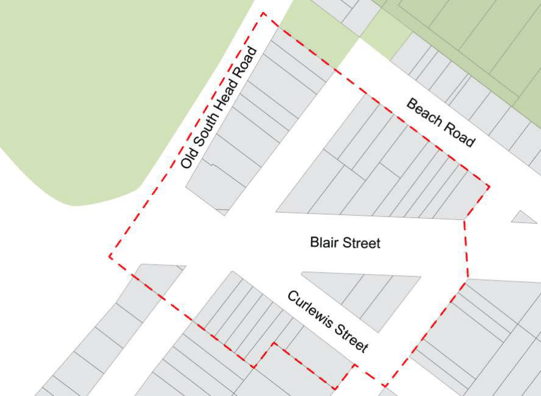

> [Picture on page 91: a picture, saved as a picture (images/part-e-site-specific-development-page-91-8.gif, 150 dpi).]

Figure 56 Curlewis Street Centre

#### Existing Character and Built Form

This intersection is a prominent marker along the length of Old South Head Road, dominated by traffic and providing little pedestrian amenity.

The buildings are mixed architecturally with no predominant style or built form. The relative importance and scale of the intersection is not reflected in the scale of development.

Buildings are of varied height, yet most contain a retail/commercial ground floor and residential upper storeys, and possess some historic character.

#### Desired Future Character Objectives

(a) To accommodate a potential increase in the general scale of development in this section of the centre, subject to appropriate site consolidation and satisfying amenity considerations and impacts on adjoining sites.

(b) To maintain and expand on the current range of land uses, including automotive repairs and service station.

(c) The site 14-28 Curlewis Street is considered key to the long term objectives of this Part and public domain environment of this precinct. The development of this site to address each of the three (3) street boundaries by building to each property boundary is considered key. The resultant building form will anchor the built form of the intersection while ensuring that each street, Blair and Curlewis streets, is given an improved urban form and scale.

(d) To create a vibrant streetscape, marking the ‘entrance’ to Bondi Beach and Waverley LGA, with consistent verge landscaping and signage.

(e) To promote a diversity of businesses, catering to the needs of the local community.

(f) To promote the provision of important urban services that cater to the needs of the broader community.

(g) To provide increased urban greening through climate appropriate planting, canopy trees and raingardens.

(h) To ensure that new buildings and/or refurbishment of existing buildings are well designed and responsive to existing built form.

(i) To grow and consolidate the commercial area within the centre.

(j) To maintain special features of character buildings at 1-7, 2 and 9 Curlewis Street.

(k) To ensure that new building and/or the refurbishment of existing buildings are well designed with quality materials, respecting existing built form and character if historical in nature, whilst accommodating a potential increase in scale (where appropriate).

#### 3.1.8 Old South Head Road, at Murriverie Road

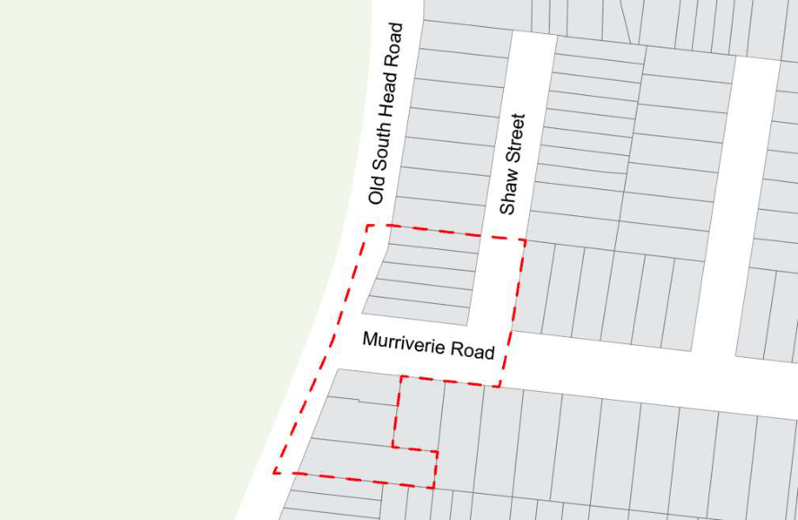

> [Picture on page 92: a picture, saved as a picture (images/part-e-site-specific-development-page-92-24.gif, 150 dpi).]

Figure 57 OSH Rd, at Murriverie Road Centre

#### Existing Character and Built Form

This section of the centre provides a break in the residential streetscape and contains a set of retail/commercial shops with residential uses above. The scale is predominantly two storeys.

The area is also dominated by traffic movement and the commercial strip consists of trade shops and outlets, with no local convenience shops.

This section of the centre contains no heritage items, or heritage conservation area listings. With a varied building typology, including some pre-war items, this area does not possess a uniform or identifiable character.

#### Desired Future Character Objectives

(a) To maintain the predominantly two storey scale, with any additional levels (if appropriate) being set back from the street edge.

(b) To maintain and remediate original shop fronts as part of any future development.

(c) To maintain the mixed-use character of the centre by way of shops and services at ground level and residential units above.

(d) To provide a clean environment, with waste disposal managed efficiently.

(e) To ensure that the centre provides universal access to all users.

(f) To promote low-rise well-maintained buildings, comprising ground floor business and retail offerings.

(g) To ensure that new buildings and/or refurbishment of existing buildings are well designed and responsive to existing low-rise built form, with appropriate setbacks at upper levels.

(h) To retain and enhance character buildings through the centre including 369A-371 and 377-381 Old South Head Road.

#### 3.1.9 Rose Bay South

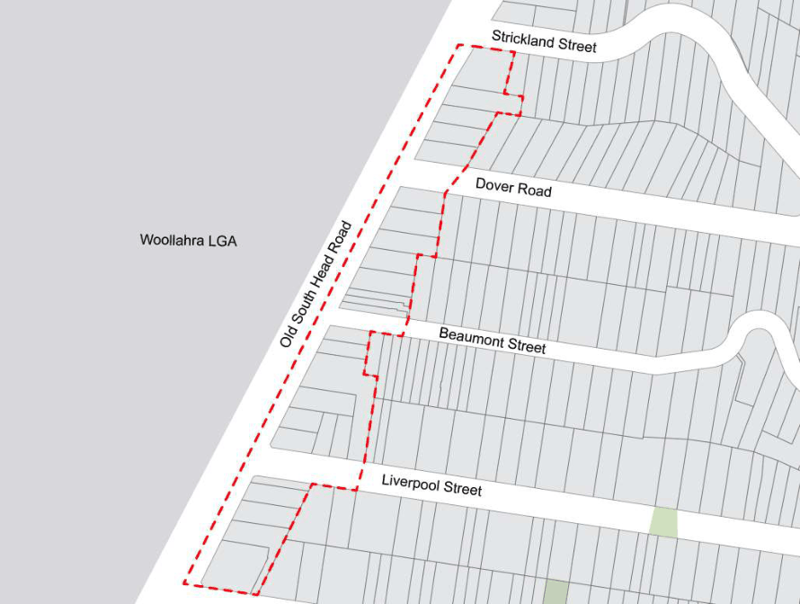

> [Picture on page 93: a picture, saved as a picture (images/part-e-site-specific-development-page-93-22.gif, 150 dpi).]

Figure 58 Rose Bay South Centre

#### Existing Character and Built Form

The five retail and commercial clusters found along Old South Head Road accommodate approximately 110 shop front premises of which approximately 70 are within Waverley. The two clusters forming the Rose Bay Small Village contain a variety of uses that, when combined with the retail strips on the Woollahra side of the road, provide the daily needs of the local community.

Shop top housing is an important feature of Old South Head Road and provides housing diversity and affordability. This increases pedestrian activity and presence within the village.

#### Desired Future Character Objectives

(a) To ensure an integrated approach and consistent treatment to the conservation of buildings of historic character.

(b) To maintain and improve the continuity of awnings over the footpath.

(c) To maintain Old South Head Road as the primary streetscape in the village with side streets as secondary frontages.

(d) To create a cohesive streetscape, comprising well-designed low-rise buildings of varying styles which form a consistent street frontage with small active shopfronts.

(e) To maintain a clean environment, with waste disposal managed discreetly and efficiently.

(f) To ensure that the centre provides universal access to all users.

(g) To ensure new buildings are well designed and responsive to existing built form, with appropriate street frontage heights, upper storey setbacks and active ground floor uses.

(h) To ensure that building services and basement car parking do not compromise the active street frontage and business opportunities that the Old South Head Road high-street offers.

#### 3.1.10 Blake Street

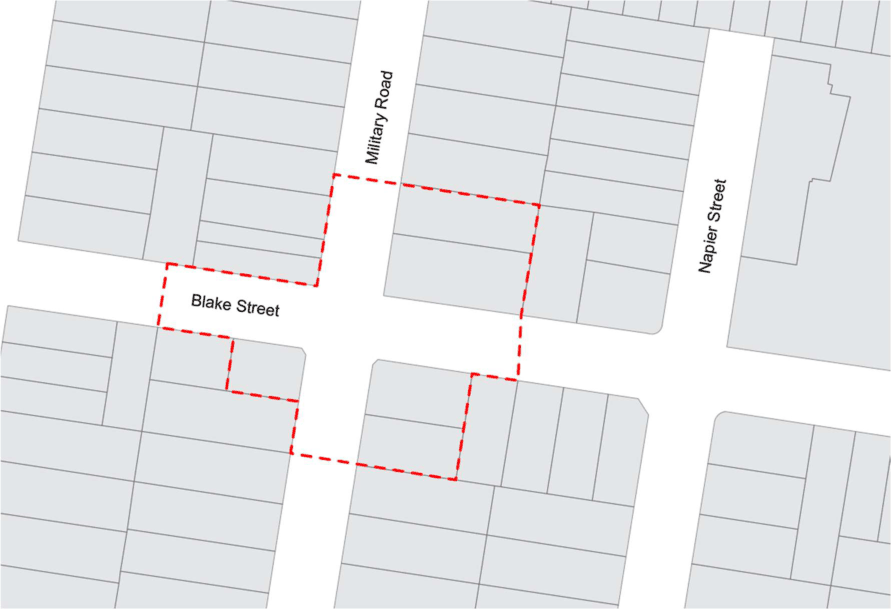

> [Picture on page 95: a picture, saved as a picture (images/part-e-site-specific-development-page-95-2.gif, 150 dpi).]

Figure 59 Blake Street Centre

#### Existing Character and Built Form

This local centre has several small shops and commercial uses, servicing the local resident community. The centre does not possess a distinctive historical or neighbourhood character. Modern buildings and renovations having occurred over time creating a varied building typology and street edge definition. While the scale of buildings varies, it is generally two (2) storeys in character. Some buildings in the centre possess street awnings over the footpath.

Due to its elevated location the centre enjoys prominent views west along Blake Street to the inner Harbour and City skyline.

#### Desired Future Character Objectives

(a) To establish and support a centre characterised by mixed use development incorporating small local shops and services for the local resident community.

(b) To encourage new mixed-use development with ground level local shops and services and upper level residential use.

(c) Where redevelopment in the neighbourhood centre occurs, to ensure the scale of new development protects the residential amenity of adjoining and surrounding properties.

(d) To better maintain the area so that it is clean and attractive, including the replacement of pavers and planting verges that are damaged during construction.

(e) To ensure that the centre provides universal access to all users.

(f) To ensure new buildings and/or refurbishment of existing buildings are well designed and responsive to existing low-rise built form.

(g) To retain the low-rise built form of varying styles, with active shopfronts that contain local business and retail offerings catering to local needs.

(h) The planting of trees and shrubs as part of a Development Application in this centre should consider the NSW Land and Environment Court Planning Principle based on Tenacity Consulting v Warringah [2004] NSWLEC 140 which provides general principles for the assessment of views and view sharing. Note: This does not apply to landscape works conducted outside of a Development Application.

#### 3.1.11 Rose Bay North

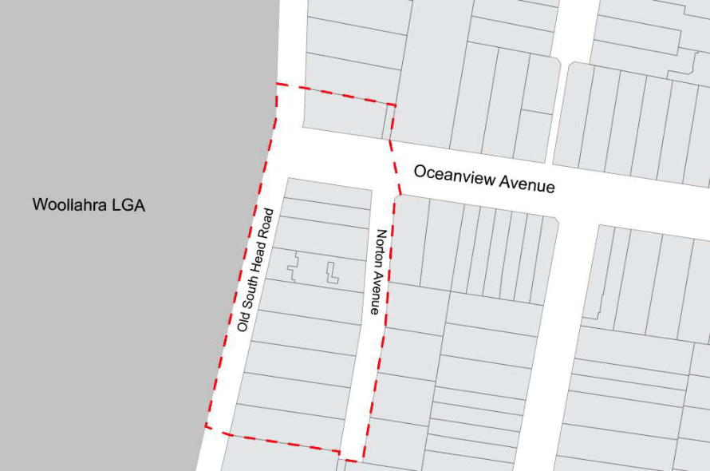

> [Picture on page 96: a picture, saved as a picture (images/part-e-site-specific-development-page-96-7.gif, 150 dpi).]

Figure 60 Rose Bay North Centre

#### Existing Character and Built Form

The five retail and commercial clusters found along Old South Head Road accommodate approximately 110 shop front premises of which approximately 70 are within Waverley. The two clusters forming the Rose Bay Small Village contain a variety of uses that, when combined with the retail strips on the Woollahra side of the road, provide the daily needs of the local community.

Shop top housing is an important feature of Old South Head Road and provides housing diversity and affordability. This increases pedestrian activity and presence within the village.

#### Desired Future Character Objectives

(a) To ensure an integrated approach and consistent treatment to the conservation of buildings of historic character.

(b) To maintain and improve the continuity of awnings over the footpath.

(c) To maintain Old South Head Road as the primary streetscape in the village with side streets as secondary frontages.

(d) Maintain a good distinction between the mixed use sections of Old South Head Rd and residential side streets.

(e) To maintain a clean and attractive environment, with waste disposal managed discreetly and efficiently.

(f) To ensure that the centre provides universal access to all users.

(g) To promote well-maintained mid-rise buildings of varying styles which form a consistent street frontage of ground floor shop fronts and upper storey residential.

(h) To ensure new buildings are well designed and responsive to existing built form with appropriate street frontage heights.

(i) To maintain and encourage a diverse range of shops and services.

#### 3.1.12 Murriverie Road

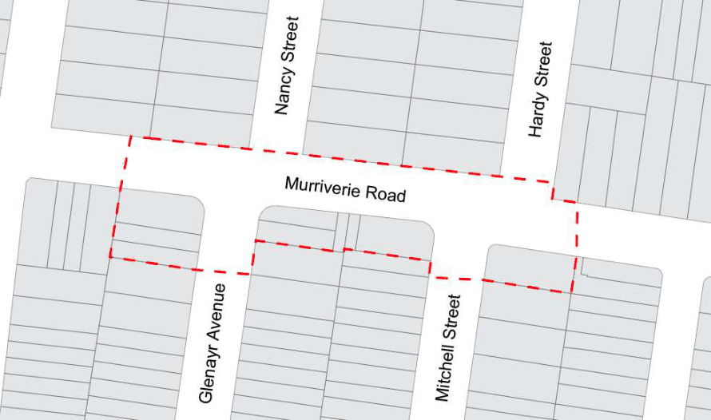

> [Picture on page 97: a picture, saved as a picture (images/part-e-site-specific-development-page-97-10.gif, 150 dpi).]

Figure 61 Murriverie Road Centre

#### Existing Character and Built Form

The Murriverie Road local village centre is comprised of approximately nine shops which are used for commercial and retail purposes with some residential uses above ground floor.

The shops are spread over three sections of the street, providing a range of goods and services to assist in meeting the daily needs of the local residents. The area maintains a strong two (2) storey character.

The mixed use buildings are of a range of typologies, built to the street edge with awnings. The buildings of historic character at No.1 Mitchell Street have had some alterations, although the original shop front exists.

The strongest historic character of the centre is provided by the substation, located east of the pocket park on Murriverie Road.

No. 2 Mitchell Street is a good example of a successful transitional building in terms of height (from one (1) to two (2) storeys) and function (from mixed-use to residential).

The centre accommodates a small pocket park at the south east intersection of Murriverie Road and Glenayr Avenue.

#### Desired Future Character Objectives

(a) To ensure appropriate architectural design and scale for corner site development.

(b) To maintain and enhance accessibility to public open space.

(c) To provide a clean environment, with waste disposal managed efficiently.

(d) To ensure that the centre provides universal access to all users.

(e) To retain low-rise distinctive heritage and character buildings that frame the street.

(f) Maintain fine grain shop-fronts and preserve existing character of heritage or character buildings.

(g) Promote activation of the streetscape.

#### 3.1.13 Vaucluse

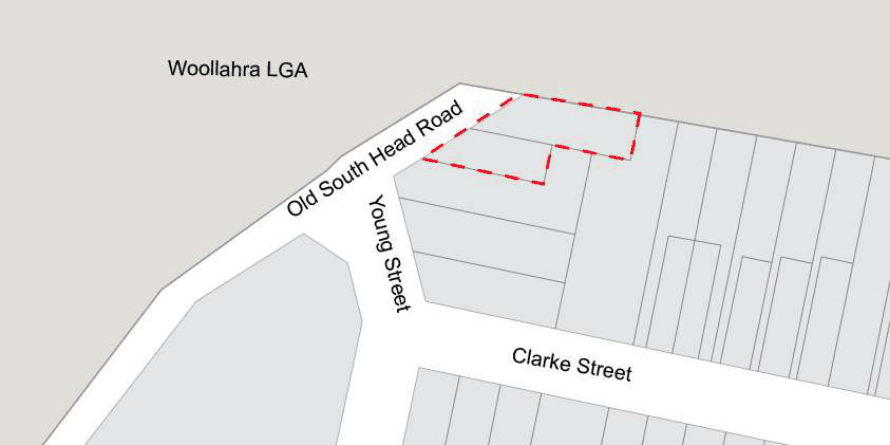

> [Picture on page 98: a picture, saved as a picture (images/part-e-site-specific-development-page-98-13.gif, 150 dpi).]

Figure 62 Vaucluse Centre

#### Existing Character and Built Form

The Vaucluse Centre services the northern-most portion of the Waverley LGA. Two lots feature shop top housing development, with ground floor uses activating the immediate surrounds. The vitality of this centre is largely driven by the individual operators of the centre.

The centre often has people seated outdoors, with the close proximity of the centre to public open space attracting good local business.

#### Desired Future Character Objectives

(a) To promote a safe and attractive meeting point for locals and visitors alike.

(b) To promote a cohesive and vibrant streetscape, with leafy trees, verge gardens and areas for people to stop and congregate.

(c) To ensure that the centre provides universal access to all users.

(d) To retain and maintain the small cluster of shop-top housing.

#### 3.1.14 Bondi Road

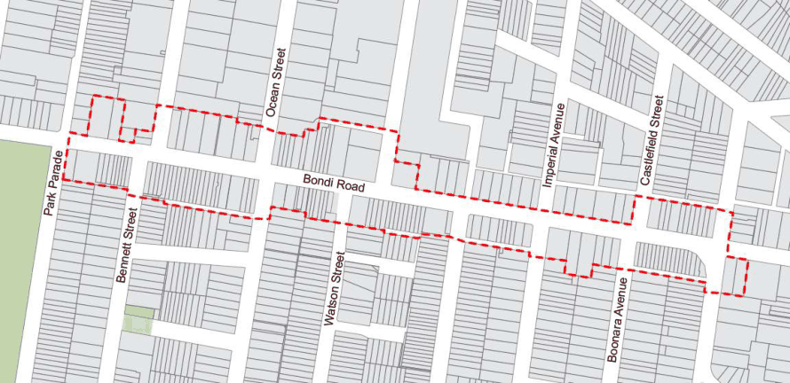

> [Picture on page 99: a picture, saved as a picture (images/part-e-site-specific-development-page-99-2.gif, 150 dpi).]

Figure 63 Bondi Road Centre

#### Existing Character and Built Form

Bondi Road is an important and busy transport corridor that runs along the ‘spine’ connecting Bondi Beach to Bondi Junction and the City. The existence of numerous bus stops draw people to Bondi Road, increasing pedestrian presence. A strength of the village is good pedestrian accessibility to the retail shops from a relatively large residential catchment.

The strip is composed of smaller 'shop house' buildings of a scale which are reflective of the historical small scale lot subdivision pattern. Buildings are generally two (2) storeys to the street edge, having an effective height, due to the existence of parapets and roof forms, of three (3) levels.

A number of contradictions exist in the form of larger high rise 1960's and 1970's residential and hotel towers. These buildings are inconsistent with the overall scale of the street fabric. Lower podium levels of the building (lower two (2) to three (3) levels) tend to have front and side setbacks inconsistent with adjoining development and the rhythm of the streetscape. All existing buildings of historic character are mixed use, with commercial ground floor and residential upper storey(s).

Numerous buildings within this area possess elements of, or largely intact, original shop-fronts. Many other buildings preserve the original entry configuration (i.e. with inset doorway to one

side) reconstructed with contemporary materials.

The Bondi Road centre comprises of three distinct existing characters: West Bondi Road, Central Bondi Road and East Bondi Road. A distinct character exists between the western end and eastern end of Bondi Road, both in built form and the public domain.

The western end of Bondi Road, closer to Bondi Junction, has a less consistent character when compared to the eastern end. The western end has more diverse land use offerings, with a mix of retail, hospitality and personal services. The built form is inconsistent with a former service station, a range of residential and shop-top housing buildings, and public buildings such as St Patrick’s Catholic Church and the Waverley Woollahra Arts School.

The northern side of Central Bondi Road section is largely residential development with a few health & beauty services. The southern side is mostly shops, with two residential flat buildings near Boonara Ave. The residential developments along this section of Bondi Rd distinguish this section from the West and East Bondi Rd characters.

The eastern end of the corridor is lively and bustling with activity in the evenings, as a local and tourist ‘go-to’ for restaurants and recreation. The eastern end of Bondi Road, closer to Bondi Beach, has a mix of commercial and residential ground floor uses. The commercial uses are typically at the street frontage, whilst the blocks of apartments have large front setbacks with vehicle crossings and landscaped areas. There are a number of inter-war period 3-4 storey walk-ups and shop-top housing buildings that provide a strong sense of character to the area. The ground floor commercial uses are mostly hospitality and retail and have created a retail ‘hub’ around the intersection of Denham Street and Bondi Road, due to the fine grain nature of the shop fronts and human scale of the built form.

#### Desired Future Character Objectives

(a) To maintain the role and character of Bondi Road in providing local shops, services and residential accommodation for the local community.

(b) To limit the scale of redevelopment and infill development at the street edge to match the parapet façade height of buildings of historic character, with setbacks to further levels where appropriate.

(c) In the case of future works and improvements to the 1960s and 1970s residential and hotel towers that exist along Bondi Road, to encourage the street and podium levels to better knit the street fabric together through the introduction of shop fronts at ground level.

(d) To encourage the use of rear courtyards during trading hours to extend business operations where there will be minimal adverse impacts upon surrounding neighbours.

(e) To support shared cycle/pedestrian links parallel to Bondi Road that will connect Bondi Junction and Bondi Beach, increase pedestrian and cycle safety, provide rear lane activation opportunity and improve service access and on-site parking arrangements.

(f) To promote Bondi Road as an important local centre that provides a walkable range of goods and services to the surrounding residential community.

(g) To ensure ground floor premises provide active and inviting street frontages.

(h) To ensure development incorporates best practice sustainability initiatives.

(i) To promote localised energy generation including through solar panels and microgrids.

(j) To promote green roofing and increased planting on buildings where appropriate.

(k) To promote a clean environment, with waste disposal managed discreetly and efficiently.

(l) To encourage heat-reflective materials and increased shading to create a cooler climate for pedestrians.

(m) To ensure that the centre provides universal access to all users.

(n) To retain the distinctive historic urban fabric of the high street, including the fine grain shopfront pattern, two-storey street frontage and nil-setbacks, and the architectural detail of the original facades.

(o) To protect and celebrate the historic character and diverse buildings along Bondi Road.

(p) To ensure infill development is well designed and responsive to the existing built form and scale, including heritage and character buildings, and is of human scale.

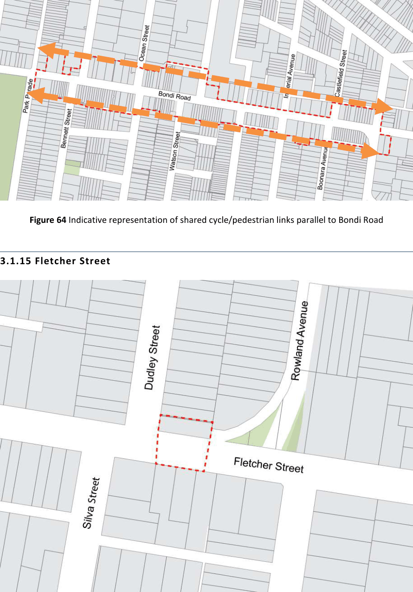

> [Picture on page 101: a picture, saved as a picture (images/part-e-site-specific-development-page-101-1.gif, 150 dpi).]

Figure 64 Indicative representation of shared cycle/pedestrian links parallel to Bondi Road

#### 3.1.15 Fletcher Street

Figure 65 Fletcher Street Centre

#### Existing Character and Built Form

The Fletcher Street Centre contributes to the neighbourhood feel of the area. The nearby reserve provides a place to sit and enjoy a coffee in the sun. The centre receives a good amount of foot traffic due to its location on the way to Tamarama Beach.

#### Desired Future Character Objectives

(a) To ensure that the centre provides universal access to all users.

(b) To ensure the refurbishment of existing buildings maintains the heritage character of the centre.

(c) To enhance character buildings through art and planting.

#### 3.1.16 Bondi Beach

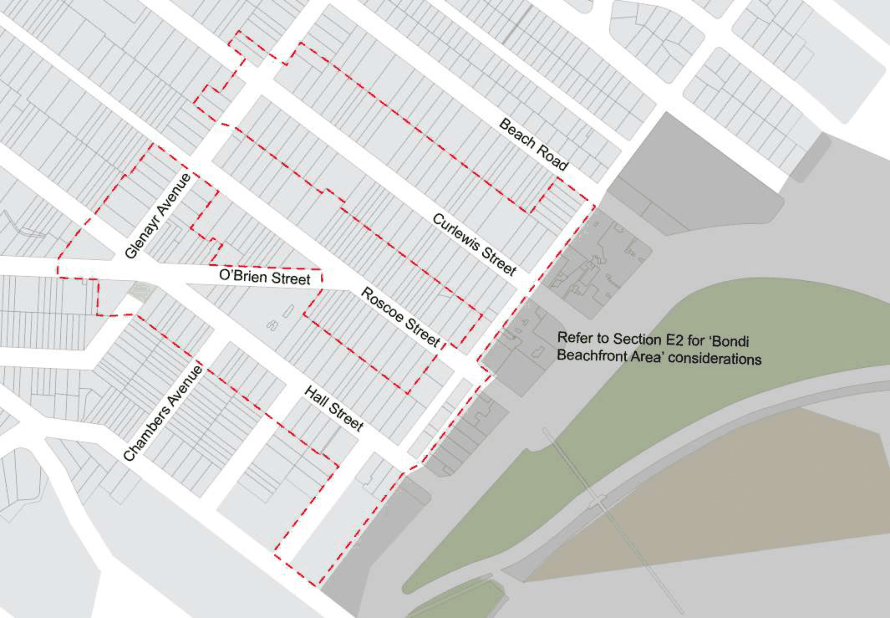

> [Picture on page 102: a picture, saved as a picture (images/part-e-site-specific-development-page-102-7.gif, 150 dpi).]

Figure 66 Bondi Beach Centre

Refer to Part E2 of this Chapter for controls relating to the Bondi Beachfront Area.

#### Existing Character & Built Form

The built form is varied with many original buildings remaining as well as newer infill development.

Hall Street and the southern end of Glenayr Avenue contain predominantly mixed use development, with retail shops at ground floor level and residential uses on the upper floors. The retail strip is also adjoined by residential streets along its length, resulting in a vibrant mixed use area. Challenges exist however in terms of managing the interface between the non-residential and residential uses.

Due to the popularity of Bondi Beach and Hall Street, the extent of regional and local traffic and car parking has a strong influence on the character and use of the area, particularly the public domain.

The area contains a consistent pattern of retail buildings located to the front edge of the street boundaries, although some have substantial setbacks from street boundaries. Buildings are typically of masonry construction, with face (decorative) brick and/or painted brick.

In terms of building footprint, regular side passages tend to emphasise separated, regular lots of narrow frontage.

Within the Hall Street precinct are two key sites, namely the Bondi Post Office on the corner of Hall Street and Jacques Avenue, and the intersection of Hall Street, O’Brien Street and Glenayr Avenue.

#### Desired Future Character Objectives

(a) To maintain Hall Street and the southern end of Glenayr Avenue as a separate and discrete precinct within the wider Bondi Beach town centre, with the role and character of providing local shops, services and residential accommodation for the local community.

(b) To effectively manage the retail/commercial and residential interface in the centre.

(c) To maintain and enhance accessibility to public open space.

(d) To promote a diversity of uses, businesses and retail offerings in smaller shopfronts with active frontages to maximise interactions and interest.

(e) To consistently maintain the public realm to ensure that it is green, clean and free of litter.

(f) To increase urban greening around Bondi Beach.

(g) To promote places for the arts, entertainment and culture as well as health and fitness.

(h) To ensure ground floor premises provide active and inviting street frontages.

(i) To ensure development incorporates best practice sustainability initiatives.

(j) To promote localised energy generation including through solar panels and microgrids.

(k) To promote a clean environment, with waste disposal managed discreetly and efficiently.

(l) To protect and promote open spaces and corridors providing visual and physical connection through to Bondi Beach.

(m) To encourage heat-reflective materials and increased shading to create a cooler climate for pedestrians.

(n) To balance the shared use of the public domain between pedestrian movements, landscaping, outdoor dining and vehicle access and parking.

(o) To advocate for improved public transport capacity and services.

(p) To ensure that the centre provides universal access to all users.

(q) To ensure infill development is well designed and responsive to existing built form, history and heritage, with appropriate street frontage heights and upper storey setbacks.

(r) To promote a mix of old and new buildings, with adaptive re-use of heritage and encouragement of innovative modern design for new development.

(s) To retain the distinctive historic urban fabric including the fine grain shopfront pattern.

(t) To protect and celebrate the historic character throughout the centre.

(u) To encourage entertainment or event uses, where residential amenity can be reasonably retained.

(v) To maintain fine grain shop-fronts in new developments, particularly along Hall Street, Glenayr Avenue and Gould Street.

#### 3.1.17 Seven Ways

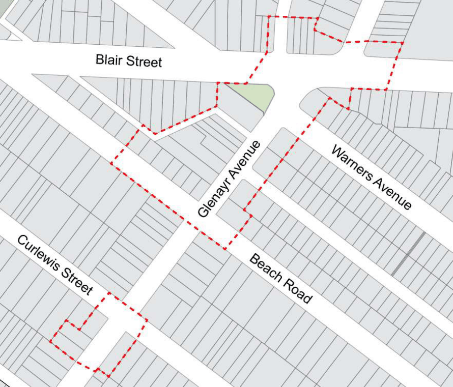

> [Picture on page 104: a picture, saved as a picture (images/part-e-site-specific-development-page-104-2.gif, 150 dpi).]

Figure 67 Seven Ways Centre

#### Existing Character and Built Form

The centre comprises two areas. The first is a small group of buildings located at the corner of Curlewis Street characterised by two (2) storey Interwar mixed-use buildings. The second area is centred around the ‘Seven Ways’ intersection which is largely comprised of two (2) to three (3) storey Interwar apartment buildings and also notable for its mixed use buildings with ground floor shops and residential storeys above.

In addition to the two distinct centres, Glenayr Avenue includes a series of small scale nodes, interspersed with residential development.

The ‘Seven Ways’ commercial centre has good quality local shops and cafes. Three of the buildings addressing the ‘Seven Ways’ and 83-85 Glenayr Avenue possess intact original shop-fronts.

Several mixed-use corner sites were (commercial ground floor and residential upper floors) assessed as being buildings of historic character. They represent examples of successful transition in form and function between the commercial uses of Glenayr Avenue and the residential character of the side streets. These corner buildings enable a transition by a reduction in height, and the incorporation of a setback, in those (northern) facades while addressing the residential side street.

#### Desired Future Character Objectives

(a) To maintain the role and character of the discrete sections that make up the Glenayr Avenue centre, including the provision of local shops, services and residential accommodation for the local community.

(b) To effectively manage the retail/commercial and residential interface in the centre, and in particular maintain the strong residential character where it currently exists along Glenayr Avenue.

(c) To ensure an appropriate architectural design and scale for corner site development.

(d) The ‘Seven Ways’ intersection of Blair Street and Glenayr Avenue should stand as the focus of the Glenayr Avenue precinct. This intersection has the potential to be an even more vibrant and active public space.

(e) To support diverse uses, businesses and retail offerings, interspersed by residential and civic uses and book-ended by open and active community spaces.

(f) To maintain a fine-grain streetscape with well-maintained and distinctive character buildings.

(g) Landscaping and tree planting that provides continuous greenery through the centre.

(h) To promote a clean environment, with waste disposal managed discreetly and efficiently.

(i) To encourage a high level of pedestrian and cyclist activity and connectivity within and from the centre to surrounding centres and Bondi Beach.

(j) To ensure that the centre provides universal access to all users.

(k) A fine-grain streetscape, with well-maintained and distinctive character buildings.

#### 3.1.18 North Bondi

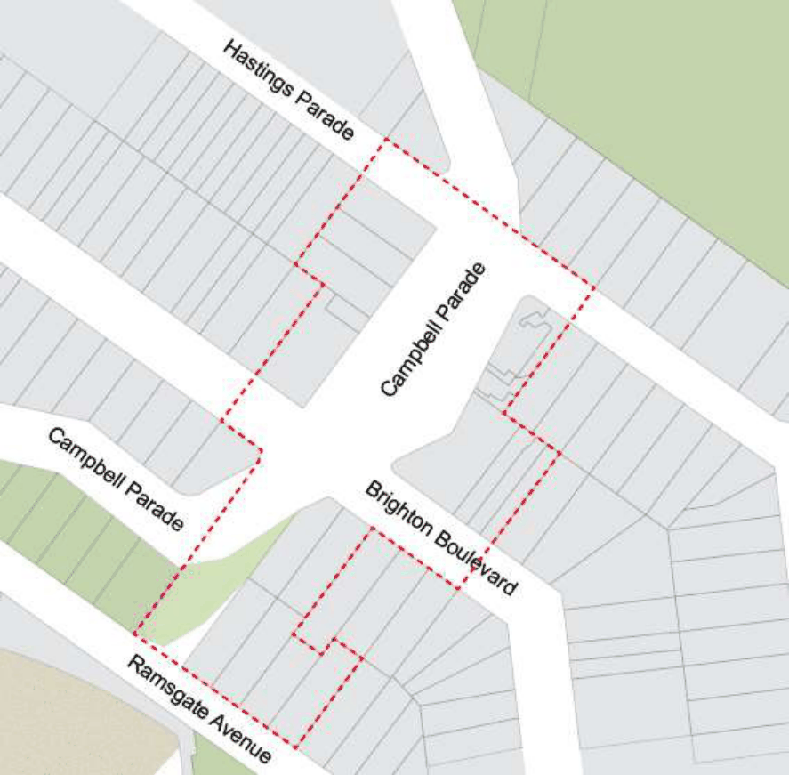

> [Picture on page 106: a picture, saved as a picture (images/part-e-site-specific-development-page-106-2.gif, 150 dpi).]

Figure 68 North Bondi Centre

#### Existing Character and Built Form

North Bondi Neighbourhood Centre contains a cluster of shops adjacent to the bus terminus. It exists at the northern end of Campbell Parade where it meets Scarborough Crescent, at the intersection with Brighton Boulevard.

The Campbell Parade/Terminus local shopping strip offers a range of retail and other services, providing for the daily needs of the local residents.

This area has a varied building typology, although building styles are all of the Interwar period and built to the street property boundaries.  Construction does not exceed three (3) storeys (generally two (2) storeys with a pitched roof) and the majority of buildings of historic character are of brick construction with decorative face brickwork.

All of the buildings of historic character are mixed use, with commercial ground floor and residential upper storeys.

Most buildings in this part of the centre address the terminus/junction area along Campbell Parade and this space is considered to have historic character for the area, given its socially important role as a transport interchange.

#### Desired Future Character Objectives

(a) To maintain North Bondi as a separate and distinct precinct to the larger Bondi Beach precinct, with the role and character of providing local shops, services and residential accommodation for the local community.

(b) Where redevelopment in the neighbourhood centre occurs, to ensure the scale of new development protects the residential amenity of adjoining and surrounding properties.

(c) To maintain the predominantly two - three storey scale of development, at the same time as protecting the existing amenity of properties adjoining the centre.

(d) The North Bondi RSL is an important community building and considered to be a key site in the centre. It is unlikely that this building marked *, will ever be developed to conform with the planning controls.

(e) The bus interchange is a key community site and future development at this site is addressed in the Local Village Centres Public Domain Improvement Plan.

(f) To provide a visual connection to Bondi Beach.

(g) To provide clean environment, with waste disposal managed efficiently.

(h) To promote a safe and walkable public domain that promotes connectivity within the centre and to Bondi Beach and surrounding residential areas.

(i) To ensure that the centre provides universal access to all users.

(j) To retain low-rise distinctive heritage and character buildings that frame the street, comprising ground floor business and retail offerings, with residential uses on the upper floors.

(k) To ensure new building and/or refurbishment of existing buildings are well designed and responsive to existing low-rise built form, with appropriate setbacks at upper levels, and driveway crossovers.

(l) To ensure that no additions are permitted within the front setback of buildings unless it can be clearly demonstrated that the new structure will not dominate the streetscape and subject building, will not obscure views to the building, and will not adversely impact the cultural significance of the place.

#### 3.1.19 Wairoa Avenue

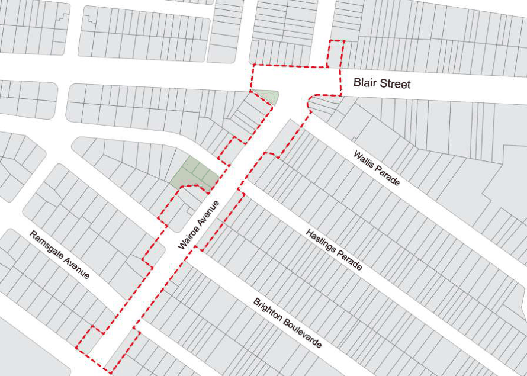

> [Picture on page 108: a picture, saved as a picture (images/part-e-site-specific-development-page-108-2.gif, 150 dpi).]

Figure 69 Wairoa Avenue Centre

#### Existing Character and Built Form

The Wairoa Avenue Centre contains fine grain shop fronts with a continuous awning characterising the area. The centre is located in a residential area within walking distance to schools, other larger centres, and Bondi Beach and the coastline.

#### Desired Future Character Objectives

(a) To promote a small clusters of businesses and retail offerings, interspersed by civic and residential uses.

(b) To provide a clean environment, with waste disposal managed efficiently.

(c) To ensure that the centre provides universal access to all users.

(d) To ensure new buildings are well designed and responsive to the existing built form and scale, including heritage and character buildings, and is of human scale and provides for a high quality of living.

(e) To ensure low-rise distinctive heritage and character buildings that frame the street.
